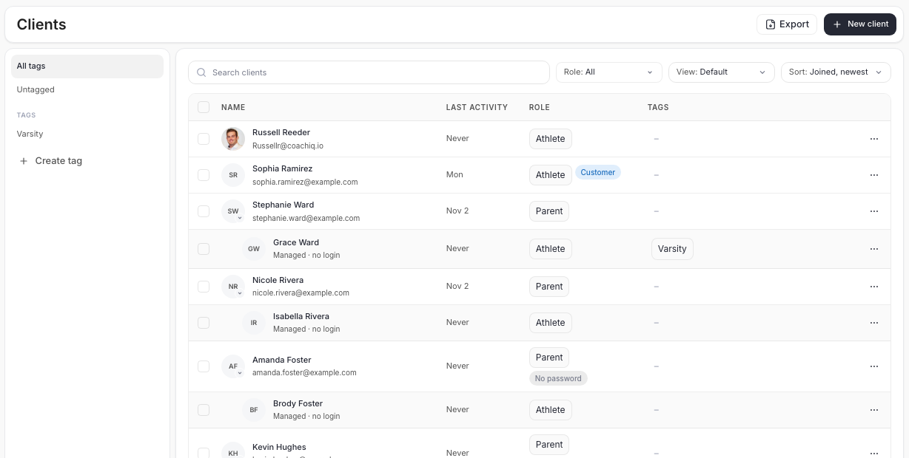
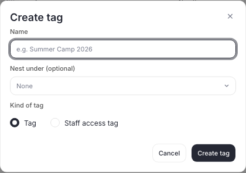
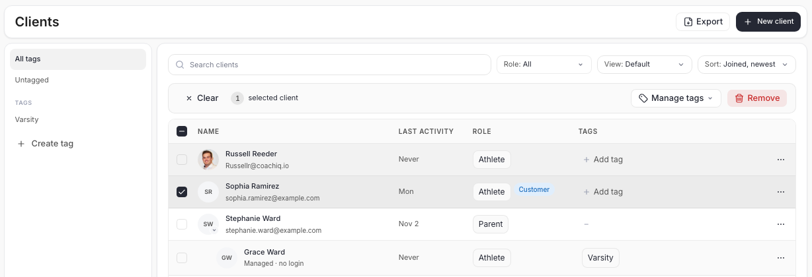

<Info>
  **Where to find this**: **People › Clients**. Your tags are in the column on the left; search, **Role**, **View** and **Sort** are above the list.
</Info>

## Read the Clients list

<Frame>
  
</Frame>

Each row is one client:

| Column | What it shows |
|---|---|
| **Name** | Photo or initials, name and email. Athletes a parent manages sit indented under the parent; a parent's chevron collapses or expands their family. **Managed · no login** marks an athlete without their own login. |
| **Last activity** | When they were last active: "3h ago", "Yesterday", a weekday, a date such as "Oct 31" (with the year only for other years), or **Never**. Click the heading to sort by it. |
| **Role** | **Athlete**, **Parent**, **Coach** or **Admin**. **Customer** marks someone who has bought from you, and **No password** marks someone who hasn't set one yet. |
| **Tags** | Each tag as a chip. A client with no tags shows a dash, and **Add tag** appears when you hover over the row. Click the cell to add or remove tags. In a narrow window the cell shows a button such as "3 tags"; click it to see every tag. |

The **...** menu at the end of a row has **View client**, **Waivers**, **Block client** and **Remove client**.

## Search, filter and sort

- **Search clients** matches first name, last name, email and phone.
- **Role** narrows the list to one role.
- **Tags** on the left: click a tag to show only clients who have it, or **Untagged** to find clients you haven't organized yet. **All tags** clears it. On a phone, tags open from a **Tags** button.
- **View**: **Default**, or **Credits** to see each client's credit balances.
- **Sort**: **Recent** and **Oldest** order clients by last activity, with clients who have never been active last. **Name A to Z** and **Name Z to A** sort by name. **Joined, newest** is how the list opens. Sorting from a column heading updates the Sort label too.

When nothing matches, the list says why: "No clients match" with **Clear search**, or **Clear filters** when the role or tag leaves nobody.

When you search for an athlete, their parent stays in view above them so you can see the family. A parent kept only for that reason is labeled **Parent of matching athlete**.

## Tags

Tags are your own labels for groups of clients: a program, a team, a membership status, a location. Use them to filter this list, to [message a group](/inbox/new-message#step-2-choose-who-gets-it), to show certain sessions only to certain clients, to start [automations](/tools/automations/triggers-actions-reference), and to [limit what a coach sees](/people/staff-access#limit-a-coach-to-certain-clients).

Clients never see their tags in your app. Tags in the list on the left are sorted by name, with numbers in order (Lead 1, Lead 2, Lead 10).

### Create a tag

<Steps>
  <Step title="Open Create tag">
    Click **Create tag** under your tag list on the left. (With no tags yet, the tag picker in a row also offers **Create tag**.)
  </Step>
  <Step title="Fill in the window">
    - **Name**: what the tag is called, for example `14U`.
    - **Nest under (optional)**: pick an existing tag to make this a sub-tag of it.
    - **Kind of tag**: **Tag** for an ordinary tag, or **Staff access tag** if this tag decides which coaches see these clients. See [Staff access](/people/staff-access#limit-a-coach-to-certain-clients).
  </Step>
  <Step title="Create it">
    Click **Create tag**. If a tag with the same name already exists, the window asks first and says how many clients already have it.
  </Step>
</Steps>

<Frame>
  
</Frame>

You can also create a tag on the spot while tagging a client, or in **New client**.

### Sub-tags

A sub-tag sits inside a parent tag: "12U" inside "Travel Teams". Tags go two levels deep, parent and sub-tag. Sub-tags are listed under their parent on the left, and in the Inbox recipient picker, so you can message one team without messaging the whole program. A client can carry the sub-tag alone.

Staff access tags can't be placed inside another tag.

### Tag clients

- **One client**: hover over their row and click **Add tag**, or open their profile and use **Add tag** in **Client details**.
- **Many clients**: tick the box on each row (or the box in the header to select everyone the list shows). A bar appears with the number selected, **Manage tags** and **Remove**. Choose **Manage tags** to add or remove a tag for all of them.

<Frame>
  
</Frame>

Selecting everyone covers the whole filtered list, including clients further down that haven't loaded yet and athletes in collapsed families. Untick anyone you want to leave out, then check the count before you apply a change.

Each client whose tags actually changed gets one line in their **Activity**, with the name of the person who made the change.

<Warning>
  Adding a tag can start a **User Tag Added** automation for every client who gets it. Before tagging a large group, check which automations use that tag.
</Warning>

### Rename, copy or remove a tag

Hover over a tag on the left and open its menu:

- **Rename Tag**: change the name. Everyone keeps the tag, and the schedulers, automations and staff access that use it keep working under the new name.
- **Copy Tag ID**: copy the tag's ID for an integration.
- **Staff access settings**: make it a staff access tag, choose which coaches it applies to, and see how many clients have it.
- **Remove Tag**: remove the tag. Clients aren't told, and messages already sent to that tag stay in your Inbox.

## Common questions

<AccordionGroup>
  <Accordion title="Can clients see their tags?">
    No. Tags are only visible to you and your staff. They do change what a client can see when you use them to limit a scheduler or a product to tagged clients.
  </Accordion>
  <Accordion title="How many tags can a client have?">
    There's no limit. Most businesses do well with a few tags per client: their program or team, and their status.
  </Accordion>
  <Accordion title="Can I filter by a custom field?">
    No. Custom fields show on the profile and in the export. Use a tag for anything you want to filter by.
  </Accordion>
  <Accordion title="Can I export just the clients I've filtered?">
    Yes. Set your search, role and tag, then click **Export**. See [Export your client list](/people/adding-editing-clients#export-your-client-list).
  </Accordion>
</AccordionGroup>

## Related articles

<CardGroup cols={2}>
  <Card title="Message a group by tag" icon="inbox" href="/inbox/new-message">
    Send to everyone with a tag or sub-tag
  </Card>
  <Card title="Staff access" icon="user-lock" href="/people/staff-access">
    Limit a coach to clients with access tags
  </Card>
  <Card title="Add and edit clients" icon="user-plus" href="/people/adding-editing-clients">
    New client, client details and custom fields
  </Card>
  <Card title="Automations triggers" icon="bolt" href="/tools/automations/triggers-actions-reference">
    Start an automation when a tag is added
  </Card>
</CardGroup>
