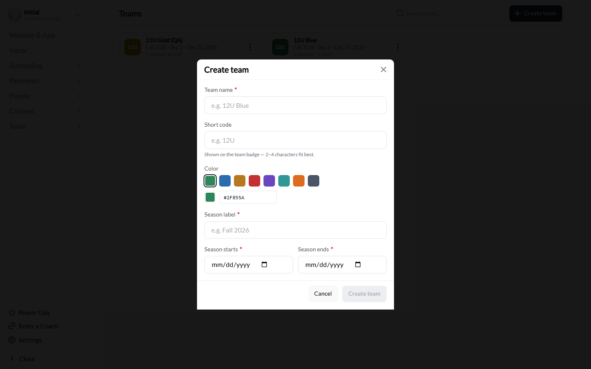

Teams gives a season roster one place to work. Keep athletes, staff, registration connections, practices, games, and team automations together while continuing to use CoachIQ's existing profiles, schedulers, and messaging.

<Info>
  Open **Teams** in the left sidebar, directly under **People**. Teams must be turned on for your organization, and staff access still applies: a coach blocked from Teams, or limited to clients with access tags, doesn't see it. If you don't see Teams, contact CoachIQ Support.
</Info>

## Why we built Teams

A team involves more than a list of names. Families register an athlete, staff need a current roster, and that roster needs the right practices, games, and communication. Managing those pieces separately makes it easy for a roster change to be missed elsewhere.

Teams connects those tasks around the athletes participating in a season. Athlete memberships identify who plays; their existing guardian relationships identify family contacts. Team staff responsibilities identify who is helping run the team.

## Create your first team

1. Open **Teams** and select **Create team**.
2. Enter the team name, such as **12U Blue**.
3. Choose a short code and color for its badge. Two to four characters works well for the code.
4. Enter a season label and the season start and end dates.
5. Create the team, then open its workspace.

<Frame caption="Create a team with a name, badge, and season. This screenshot uses a testing organization.">
  
</Frame>

Use **Edit team** on the team's card menu or at the top of the team's page when the name or season details need attention. The window opens with the team's details filled in. Check the season before connecting schedules or sharing registration links.

## Your team workspace

| Tab | What you manage |
| --- | --- |
| Roster | Athlete memberships, guardian information, and how athletes joined |
| Staff | Existing organization staff and their responsibilities on this team |
| Practices | Linked practice schedulers, roster-booking status, and the team calendar |
| Games & tournaments | Game and tournament schedulers and their calendar |
| Registration | Products and forms that add registering athletes to the team |
| Automations | Rules created for the team, including an athlete-joins trigger |

## A practical setup order

<CardGroup cols={2}>
  <Card title="Build your roster and staff" icon="users" href="/people/teams/roster-and-staff">
    Add athletes, import from a tag, and assign team responsibilities.
  </Card>
  <Card title="Set up practices and games" icon="calendar" href="/people/teams/practices-and-games">
    Connect schedulers and verify the roster's bookings.
  </Card>
  <Card title="Connect registration and communication" icon="clipboard-list" href="/people/teams/registration-and-messaging">
    Share the right registration links and reach athletes and guardians.
  </Card>
</CardGroup>

Create the team and confirm the season, add staff and the initial roster, then connect its schedulers and check the booking results. Connect registration when you are ready for families to join through the appropriate product or form.

## Find and archive teams

The Teams list shows a card for each team with its badge, name, season, and athlete and staff counts. Click anywhere on a card to open the team. Use **Search teams** and the **Active**, **Archived** and **All** filters to find one. Archive a team from its card menu (**Archive team**) when you want it out of the active list, and use **Restore team** to bring it back.

You can't add athletes to an archived team: **Add athletes** is turned off with the note "This team is archived. Restore it to add athletes."

Before closing a season, review future sessions, registration connections, and active automations separately. Do not use archive as a substitute for canceling sessions or managing a subscription.

## Teams, tags, and staff access

Tags help organize clients. A Teams roster connects athlete membership to team workflows. Importing from a tag is an explicit roster action; the tag itself is not the roster.

Team responsibilities such as Head coach or Manager do not grant organization permissions. Manage staff access through [People › Staff](/people/staff-access). A staff member's existing restrictions can affect access to the team or its roster.
