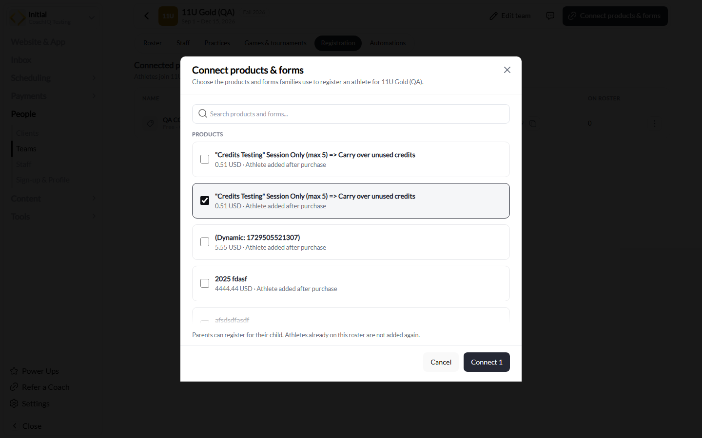
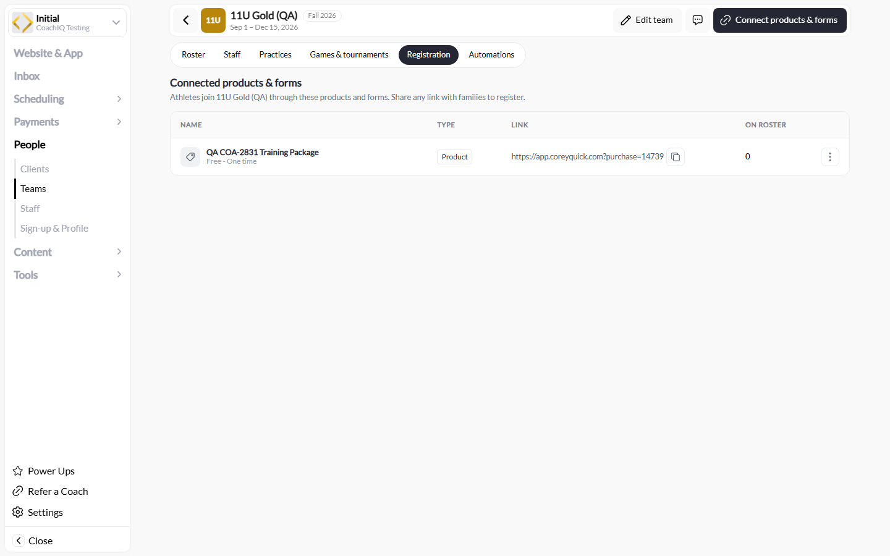
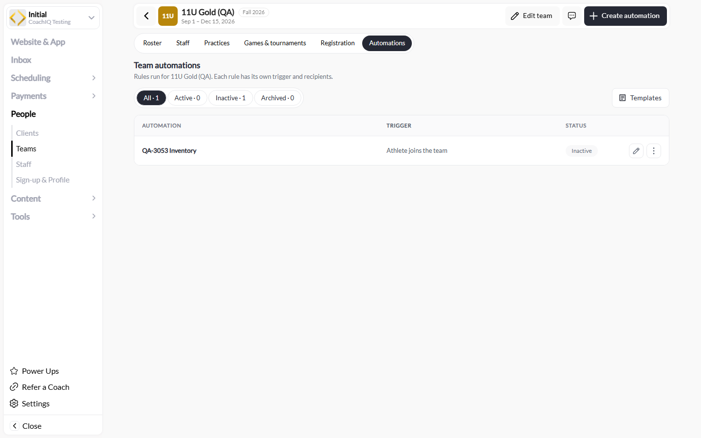

Use **Registration** to connect the products and forms families use to join a team. Use the team message action and **Automations** for ongoing communication.

Open the team from **Teams** in the sidebar. Teams must be turned on for your organization.

## Connect registration products and forms

1. Open the team's **Registration** tab.
2. Select **Connect products & forms**.
3. Search and select the existing products or forms intended for this team.
4. Review the selection, then connect it.
5. Check the connected list and copy the appropriate link to share with families.

<Frame caption="Select the product or form, then check the count on Connect before saving. Products and prices shown here are testing examples.">
  
</Frame>

<Frame caption="After connecting, use the copy control beside the intended registration link. The URL and product in this testing screenshot are examples; copy the link from your own team.">
  
</Frame>

Each connected product or form keeps its own shareable link. There isn't a single replacement registration link for every asset. Check the name and destination when copying a link.

A completed eligible purchase or completed team-connected form submission adds the selected athlete to the roster. Repeated registration for the same athlete does not create duplicate memberships.

<Note>
  The family must register the participating athlete. Where a parent has multiple children, confirm the intended child in the registration or checkout flow. A payer's profile is not interchangeable with the athlete's profile.
</Note>

For product registration, configure the product to require the athlete when the purchase needs to belong to a child. Use the existing [product builder](/payments/product-builder) and [family account guidance](/athlete-portal/family-accounts).

## Check that registration worked

After the family completes registration, check the athlete's **Roster** entry, how they joined, and the relevant purchase or form response. A product purchase, a submitted form, a roster membership, and a successful session booking are separate results.

The **On roster** count belongs to a particular connection. The same athlete can be associated with more than one connection, so do not add those counts together to calculate unique roster size or money collected.

Adding an athlete manually does not create a purchase. Likewise, a registration connection does not replace checking [roster-booking status](/people/teams/practices-and-games#confirm-the-roster-is-booked).

## Choose who joins from a form

One registration form can feed several teams. On a connected form, open **Who joins from this form** and set the answers that put an athlete on this team, for example "Age group is 12U". Families whose answers don't match aren't added. If a form's questions change, the connection shows a needs-review notice with **Update rule**.

Each connected form shows its count of submissions, the same as the form's own Responses page: "5 responses" means five families submitted, however many questions the form has.

## Waivers on a parent's registration

When a parent ticks a waiver on a form they submit for their child, such as a team registration, the waiver is recorded as accepted for the child as well as the parent. The child's **Waivers** section and the waiver's compliance report show the child as accepted, with a link to the parent's answer so you can see who signed.

After connecting an existing product or form, review the roster. If athletes who registered earlier are missing, add them through the Roster tab.

## Disconnect registration

Use the connection's menu when you need to stop future additions through that product or form. Disconnecting preserves existing team memberships. Manage a roster removal separately if an athlete should leave the team.

Payment changes also need their own review. Do not assume a refund or subscription cancellation automatically removes an athlete from the roster.

## Message the team

Use **Message team** in the team header. Review the audience before sending: team messages go to the roster athletes and their linked guardians, with duplicate recipients removed. Children reached through a parent count as reached. The warning lists only team members nobody can reach, such as an athlete with no login and no guardian, and says when the recipient list was capped.

Use [Inbox](/inbox/inbox-overview) for the normal composition and sending experience. Delivery still depends on valid contact details, channel availability, and messaging preferences. SMS can use [messaging credits](/inbox/sms-credits).

## Create a team automation

Open **Automations** in the team, then choose **New automation** or **Templates**. Starting from the team keeps its context in the existing automation builder. The current team flow includes an **Athlete joins team** trigger.

<Frame caption="Team automations show each rule's trigger and status. This testing example is Inactive; use the filters to find active, inactive, or archived rules.">
  
</Frame>

Review the trigger, conditions, recipient target, actions, and status before saving or enabling the rule. A useful first rule is a welcome message when an athlete joins, addressed to the eligible contacts you select. Check whether another registration automation already sends the same message before enabling a second one.

Practice and game reminders are configured on their schedulers. Use the scheduler's reminder settings for session timing and the team automation for the roster event. See [Build your first automation](/tools/automations/build-your-first-automation) and [scheduler settings](/scheduling/advanced-scheduler-settings).

When starting from a template inside the team, check that **Athlete joins team** and the correct team remain selected before enabling it. After a qualifying registration, check the roster and [Activity](/tools/automations/builder-reference#activity); the log distinguishes completed actions from partial success.

## If a family is missing

Confirm the completed registration, the selected athlete, and the product or form's team connection. Then check the roster and family relationships. If the athlete is on the roster but not in a session, inspect roster-booking details rather than registering them again.
