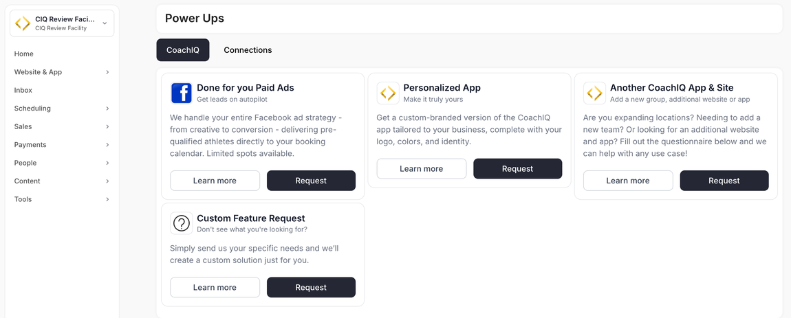

Power-Ups are services the CoachIQ team runs for you: more leads, your own branded app, another location's site and app, higher limits, or a feature built for your business. You ask from inside CoachIQ, and the team takes it from there.

<Info>
**Where to find this**: click **Power Ups** at the bottom of the sidebar.
</Info>

<Frame caption="Power Ups, on the CoachIQ tab.">
  
</Frame>

## How to request a Power-Up

1. Open **Power Ups**. The **CoachIQ** tab lists what you can request.
2. Click **Learn more** on a card for the details, or **Request** to ask for it.
3. **Request** opens a short form for that Power-Up. Answer the questions (the ones marked * are required) and click **Complete Request**.
4. The CoachIQ team reviews your request and gets in touch about next steps and pricing.

The **Connections** tab lists apps you can connect, such as Stripe and Google Calendar. To connect ChatGPT or Claude, or to see and disconnect AI apps, use [Settings → Connections](/settings/connections).

## Available Power-Ups

<CardGroup cols={2}>

<Card title="Done-for-You Paid Ads" icon="bullseye-arrow" href="/power-ups/done-for-you-paid-ads">
  Get leads on autopilot. We manage your entire Facebook ad strategy—from creative to conversion—delivering pre-qualified athletes directly to your booking calendar.
</Card>

<Card title="Personalized App" icon="mobile-screen" href="/power-ups/personalized-app">
  Make it truly yours. Get custom-branded iOS and Android apps featuring your logo, colors, and identity.
</Card>

<Card title="Another CoachIQ App & Site" icon="grid-2-plus" href="/power-ups/additional-app-and-site">
  Expand your reach. Add a new location, team, website, or app as your business grows.
</Card>

<Card title="User Limit Expansion" icon="users-gear" href="/power-ups/user-limit-expansion">
  Outgrowing 400 athletes? Raise the cap on athletes and on announcement, SMS, and email recipients so one send reaches your whole organization. Its card appears once your organization gets close to 400 athletes.
</Card>

<Card title="Custom Feature Request" icon="lightbulb" href="/power-ups/custom-feature-request">
  Don't see what you need? Tell us your specific requirements and we'll build a custom solution just for you.
</Card>

</CardGroup>

## Who Are Power-Ups For?

<CardGroup cols={3}>

<Card title="Growing Coaches" icon="seedling">
  Ready to scale beyond word-of-mouth and attract a consistent flow of new athletes.
</Card>

<Card title="Established Facilities" icon="building">
  Looking to expand locations, add teams, or create a more professional brand presence.
</Card>

<Card title="Unique Operations" icon="fingerprint">
  Need custom solutions that go beyond standard platform features.
</Card>

</CardGroup>

<Note>
**Limited availability**: Some Power-Ups have limited spots to ensure quality delivery. Submit your request early to secure your place.
</Note>

