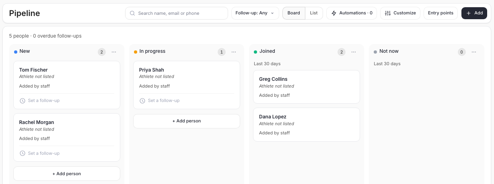

<Info>
  **Where to find this**: **Sales › Pipeline** in the left sidebar. The number beside **Pipeline** counts people who are new since you last looked.
</Info>

Pipeline is a board of the people you're working to bring in or keep: a family on a free trial, players coming to tryouts, members up for renewal. Each card is a person (the parent or adult, with their athletes). Cards move from stage to stage until they land in one of the two closing stages: joined, or not now.

<Frame>
  
</Frame>

## Set up your pipeline

The first time an owner or admin opens Pipeline, it shows **Start your pipeline** with four templates:

| Template | Use it for |
|---|---|
| **Trial membership** (recommended) | Families trying you out before they buy a membership |
| **Tryouts & team selection** | Players coming to tryouts and being placed on teams |
| **Renewals & win-back** | Members whose membership is ending or has ended |
| **Onboarding evaluation** | New athletes from first evaluation to a training plan |

Pick a template to see its stages, choose which of your forms, products and sessions feed it, and turn on the automations you want. Then click **Create pipeline**. **Start from scratch** creates an empty pipeline you set up yourself.

Coaches see **No pipeline yet** ("An owner or admin can set one up") until then. Your business has one pipeline.

## The board and the list

- **Board** shows a column per stage, with a count and a **...** menu. Drag a card to another stage to move it. Dragging never sends anyone a message. If a move doesn't save, the card offers **Retry**.
- **List** shows one row per person with **Person**, **Stage**, **Source**, **Follow-up**, **Last activity** and **Added**. The row's **...** menu has **View in People** and **Message** (for people in People), then **Move to** with each stage.
- The line above the board counts people and overdue follow-ups, for example "5 people · 0 overdue follow-ups".
- **Search name, email or phone** finds a person, and **Follow-up** filters by when their follow-up is due.

The two closing stages show the last 30 days, so the board doesn't fill up with old cards.

## Add people

**Automatically, from entry points.** Click **Entry points** and choose what adds people to the pipeline:

- **Forms**: people are added when they submit one of these forms.
- **Products**: people are added on a completed first purchase.
- **Sessions**: people are added when they book one of these.

Add as many as you like, or leave a type empty. People start in the first stage. If someone already has an open card, the new activity goes on that card instead, so one checkout with a form, purchase and booking makes one card. Entry points start working when you click **Save**; past activity isn't brought in.

**By hand.** Click **Add** at the top, or **+ Add person** under a stage.

<Steps>
  <Step title="Type a name">
    The name box searches People as you type. Pick someone who's already a client to fill in their email and phone and link the card to their profile, or choose **Add "name" as a new person**.
  </Step>
  <Step title="Add contact details and a follow-up">
    A new person needs a name plus an email or phone. Optionally pick a **Follow-up** date.
  </Step>
  <Step title="Click Add to pipeline">
    The card shows "Added by staff" as its source. If the person is already in the pipeline, you're told which stage they're in, with **Open** to go to their card. No second card is made.
  </Step>
</Steps>

## Work a card

Click a person to open **Person details**:

- The header shows their name, email and phone, with **Phone**, **Message** and **View in People** where they apply, and **Edit** for their contact details.
- **Stage** and **Follow-up**. The follow-up menu offers **Tomorrow**, **Next week** and other dates, or **Pick a date**. Once a follow-up is set, **Mark done** sits next to it.
- **Athletes**: the athletes this person is bringing. **Add athlete** adds a name.
- **Source**: where they came from, such as a form, product, session or "Added by staff".
- **Notes** and **Activity**: everything that's happened on this card, including each stage move and who made it.
- At the bottom, buttons to move them to your closing stages (for example **Mark joined** and **Not now**).

### Remove someone added by mistake

Owners and admins can open the person and choose **Remove from pipeline**. Their profile, bookings and purchases stay. A new form, booking or purchase from an entry point would add them again as a new card.

## Customize stages

Click **Customize** › **Stages**. Drag stages to reorder them, change a stage's color and name, **Add stage**, or delete one. Deleting a stage that has people in it asks where to move them. The last two stages close a card, one for success and one for not now; you can rename them but not remove them. Click **Save**.

## Automations

Click **Automations** (or **Customize** › **Automations**). "Automations move people between stages and follow up for you. They use the same builder as Tools > Automations and show up there too."

Pipeline adds these to the automation builder:

- **Triggers**: **Added to Pipeline** and **Pipeline Stage Changed**.
- **Actions**: **Move to Pipeline Stage** and **Add to Pipeline**.
- **Conditions** such as the pipeline stage, days in stage, upcoming bookings and tags. Tag conditions read as the tag's name, for example "Tag is Newsletter".

Automations never reopen a closed card. When an event matches an automation but the automation can't run, its **Activity** tab shows **Not run** with the reason. See [Build your first automation](/tools/automations/build-your-first-automation).

## Who can use Pipeline

Owners and admins set up the pipeline, its entry points, stages and automations, and remove cards. Coaches work the cards they can see. A coach blocked from **Pipeline** in [staff access](/people/staff-access), or limited to clients with access tags, doesn't see it.

## Common questions

<AccordionGroup>
  <Accordion title="Is a pipeline card the same as a client?">
    No. A card can be someone who isn't in People yet, such as a parent who asked about tryouts. Once they book, buy or sign up they're in People too, and **View in People** opens their profile.
  </Accordion>
  <Accordion title="Will dragging a card message the family?">
    No. Moving a card never sends a message by itself. Only an automation you've turned on can.
  </Accordion>
  <Accordion title="Can I have more than one pipeline?">
    Not yet. Each business has one pipeline.
  </Accordion>
</AccordionGroup>

## Related articles

<CardGroup cols={2}>
  <Card title="Automations" icon="bolt" href="/tools/automations/build-your-first-automation">
    Build the automations that move people along
  </Card>
  <Card title="Forms" icon="file-lines" href="/tools/forms/overview">
    Make the inquiry or tryout form that feeds your pipeline
  </Card>
</CardGroup>
