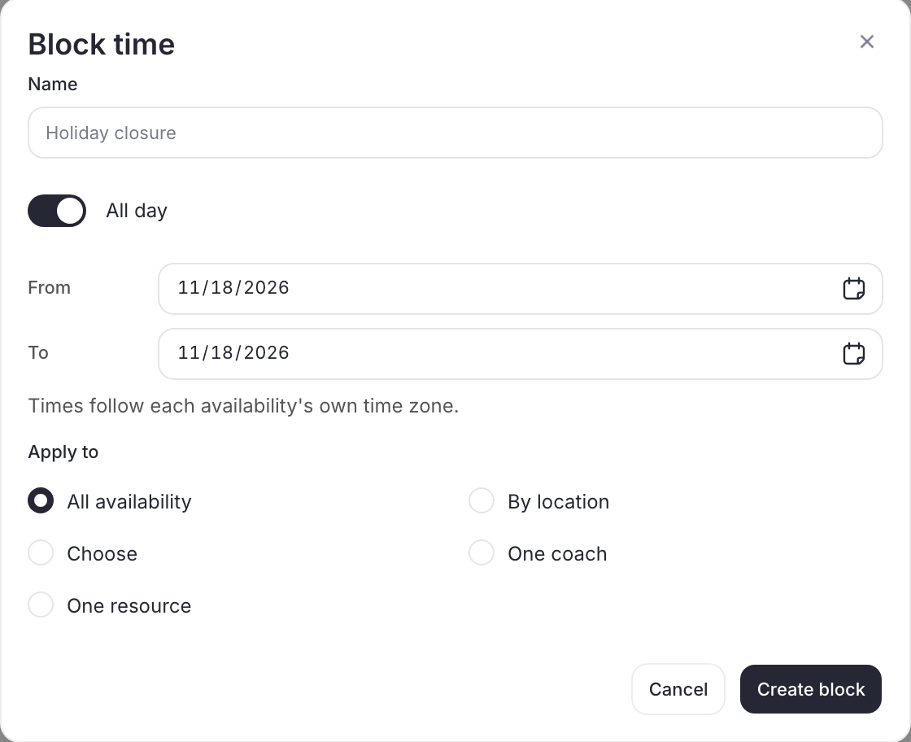
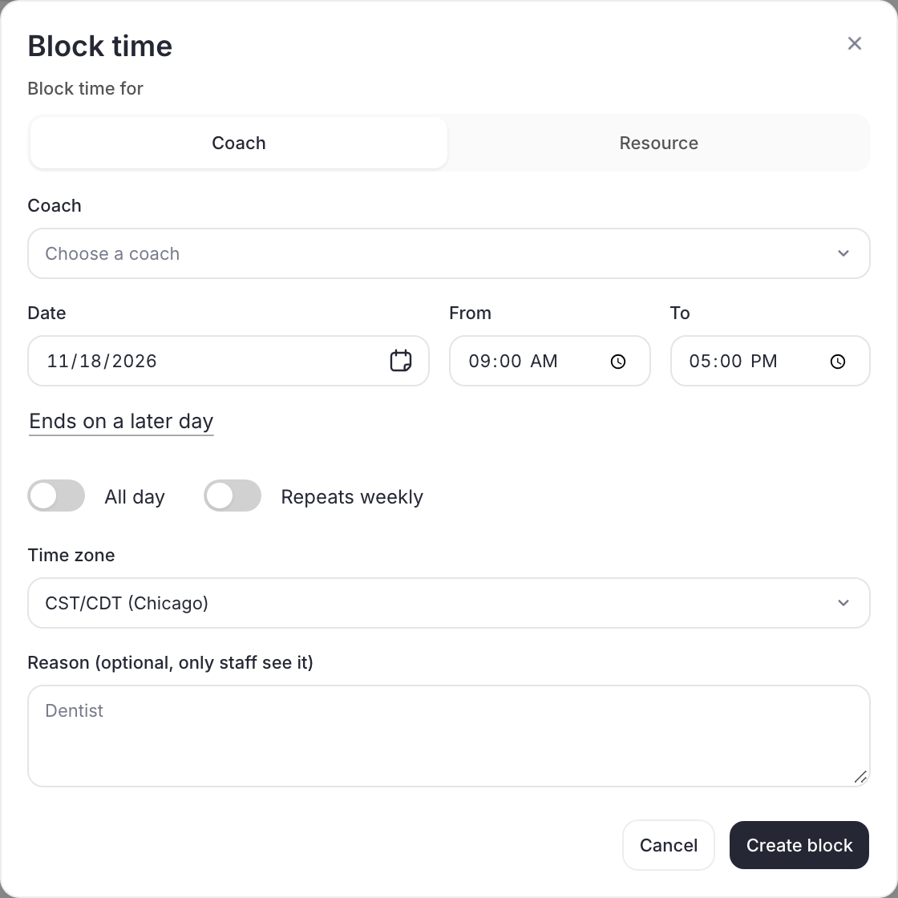

Block time stops families from booking a stretch of time. Use it for a holiday, a facility closure, a coach's day off, or a cage that's out for repairs. You don't have to edit any availability to do it, and you can remove the block later in one place.

**Where:** **Scheduling → Setup → Availability → Block time**.

<Frame>
  
</Frame>

The **Block time** window has two tabs:

| Tab | Use it to block | Example |
| --- | --- | --- |
| **Availability** | Times across many schedulers at once | Thanksgiving, a tournament weekend, a facility closure |
| **Coach or resource** | One coach or one resource only | A coach's dentist appointment, Cage 2 being re-netted |

Each tab lists the upcoming blocks of that kind, with **Edit** and **Delete** on each one. When there are none it says "No upcoming blocks. Clients can't book blocked time."

## Block time across schedulers

<Steps>
  <Step title="Open Block time">
    Go to **Scheduling → Setup → Availability** and click **Block time**. Stay on the **Availability** tab and click **New block**.
  </Step>
  <Step title="Name the block">
    Enter a **Name**, for example "Thanksgiving". The name shows in each affected scheduler's **Specific Dates** list, so pick something your staff will recognize.
  </Step>
  <Step title="Set the time">
    Leave **All day** on to close whole days, or turn it off to block part of a day. Set **From** and **To**. Times follow each availability's own time zone.
  </Step>
  <Step title="Choose what it applies to">
    Under **Apply to**, pick one:
    - **All availability**: every scheduler in the group.
    - **By location**: the schedulers at the locations you choose.
    - **Choose**: only the schedulers you pick.
    - **One coach** or **One resource**: switches you to the **Coach or resource** form (below).
  </Step>
  <Step title="Check existing bookings and create">
    Before you save, the window lists any bookings already inside the blocked time. Click **Create block**.
  </Step>
</Steps>

<Frame>
  
</Frame>

Families can no longer book the blocked times on your website, in your app or in the mobile app. An all-day block closes the whole day; a morning block removes only the morning times. Schedulers outside the block keep all their times.

To change or remove the block, open **Block time** again and use **Edit** or **Delete** on it. The change applies to every scheduler the block covers.

## Block one coach or one resource

Use this when the business stays open but one person or one space isn't available.

<Steps>
  <Step title="Open the Coach or resource tab">
    In **Scheduling → Setup → Availability → Block time**, open the **Coach or resource** tab and click **New block**.
  </Step>
  <Step title="Choose who or what">
    Under **Block time for**, pick **Coach** or **Resource**, then choose the coach or resource.
  </Step>
  <Step title="Set the date and time">
    A new block starts as one day: **Date**, **From** and **To** (9:00 AM to 5:00 PM). Click **Ends on a later day** for a date range. Turn on **All day** to block whole days, or **Repeats weekly** to block chosen weekdays every week. The **Time zone** starts on your business's default.
  </Step>
  <Step title="Add a reason and create">
    The **Reason** is optional and only staff see it. A block with no reason is named "Blocked time". Click **Create block** (or **Save** when you're editing a block).
  </Step>
</Steps>

<Frame>
  
</Frame>

What happens after you save:

- Only that coach's or resource's times stop showing as open. Everything else stays bookable.
- Schedulers set to **All coaches** aren't tied to one coach, so a coach block doesn't close them.
- A scheduler that uses **Use first available** skips the blocked resource and books another free one from its pool. See [Resources](/scheduling/resources).
- Moving a session onto a blocked resource is refused, and the message names the resource and the block.
- Blocks show on the admin calendar on the web and in the CoachIQ app.

**Coaches** can block their own time from their calendar. They can't block another coach.

## Bookings already inside a block

Blocking time never cancels or moves bookings that were made before the block. The window lists them before you save so you can decide what to do:

1. Open **Scheduling → Calendar** and go to the blocked dates.
2. Use **Move** in the session to move the whole session, or **Cancel Session** to cancel it for everyone.
3. To handle one athlete, open that athlete's booking instead.

See [Move and reschedule bookings](/scheduling/editing-rescheduling-bookings) and [Cancel bookings and sessions](/scheduling/canceling-bookings). Don't tell families a session was moved or refunded until you've done it.

## Other ways to close time

| You want to | Use |
| --- | --- |
| Close one scheduler's dates, or open extra hours | **Specific Dates** on its availability: **Add date** with **Type** set to **Unavailability** (or **Availability**). See [Availability](/scheduling/create-your-availability). |
| Change your regular weekly hours | Edit the availability's weekly hours |
| Switch to a new season's hours on a date | [Seasonal schedule changes](/scheduling/seasonal-schedule-transition) |
| Keep a coach's personal Google Calendar events from being booked over | [Google Calendar](/scheduling/google-calendar-sync#block-time-from-your-google-calendar) |
| Block or unblock time from another booking system | The **Block Time** and **Unblock Time** automation steps. See [Automation triggers and actions](/tools/automations/builder-reference). |

## If a blocked time is still bookable

- Check **Apply to**: the scheduler may not be covered by the block.
- For a coach block, check whether the scheduler is set to **All coaches**. Those aren't closed by one coach's block.
- For a partial-day block, check the times around it. Session length and buffers decide whether nearby start times still fit.
- Open the scheduler's **Specific Dates** list and look for the block by name.
