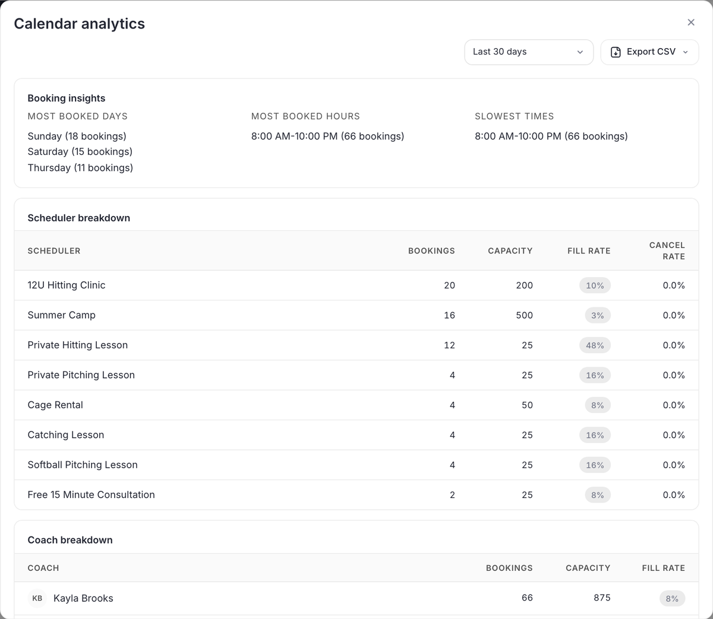

Open **Scheduling → Calendar** and click the chart icon next to the time zone. **Calendar analytics** opens with the range picker (for example **Last 30 days**) and **Export CSV** at the top right. Pick the range before you read the numbers.

<Frame>
  
</Frame>

Each part of the report is its own card. Fill rate shows as a colored label. A card with nothing in the range says so, for example "Nothing in this range yet."

## What to review

| Area | What it helps you investigate |
| --- | --- |
| **Booking insights** | Most booked days, most booked hours and slowest times |
| **Scheduler breakdown** | Bookings, capacity, fill rate and cancel rate for each scheduler |
| **Coach breakdown** | Bookings, capacity and fill rate for each coach |
| **Cancellation insights** | Which athletes or schedulers account for cancellations worth reviewing |

Bookings and sessions are different: a group session can contain several athlete bookings. Read the metric labels before comparing a count with the number of blocks on your calendar.

## Make a useful comparison

1. Choose a relevant period, such as a complete month or season.
2. Compare equivalent periods with similar operating days.
3. Check whether you changed availability, capacity, prices, or staff during either period.
4. Open the affected scheduler or bookings to investigate the pattern.
5. Make one scheduling adjustment, then review a comparable period afterward.

A lower fill rate can reflect more capacity, a newer service, or fewer bookings. It does not by itself measure coach quality. A cancellation rate does not tell you why someone canceled or whether they later rebooked.

## Turn a finding into an action

| Finding to investigate | Next step |
| --- | --- |
| Popular times regularly fill | Review [capacity and booking limits](/scheduling/scheduler-settings-limits-and-permissions), staffing, and available resources before adding seats |
| A service has few bookings | Check its [published placement](/scheduling/sharing-schedulers), availability, and checkout experience |
| One coach has far more bookings | Compare their services, working hours, and [coach assignments](/scheduling/setup-coaches) |
| Cancellations rise | Inspect affected bookings, [cancellation rules](/scheduling/canceling-bookings), and [reminders](/scheduling/session-reminders) |
| A season is ending | Plan a [seasonal schedule transition](/scheduling/seasonal-schedule-transition) |

## Export data

1. Click **Export CSV** and choose how many past months to include (**1 month** to **12 months**).
2. When the file is ready, a **Download CSV** button appears in the same place. Click it to download.

Check the fields and dates in the file before you combine it with other reports.

Use [Transactions](/payments/transactions) for payment records. Calendar bookings and attendance are not a substitute for collected revenue.
