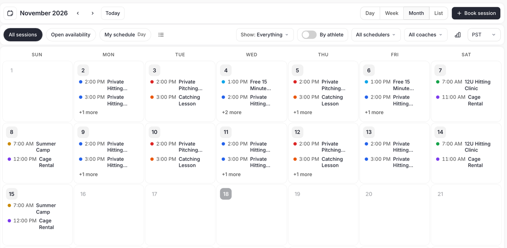
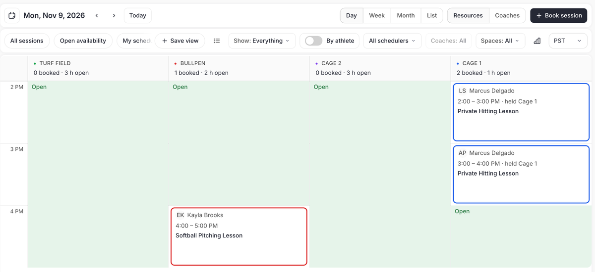
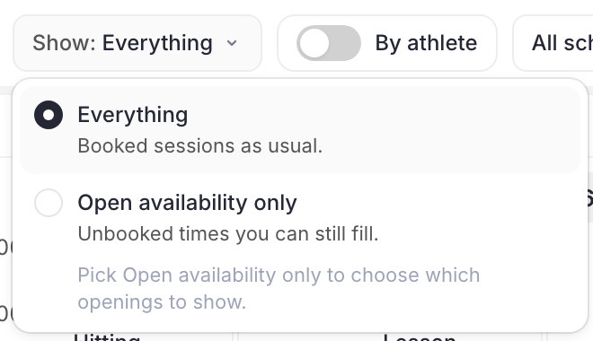
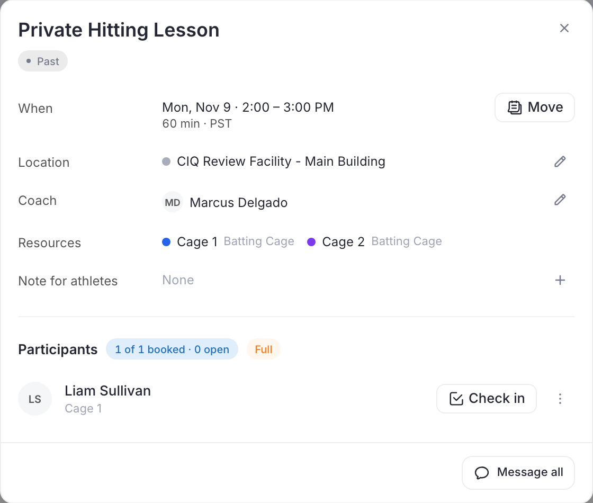

Open **Scheduling → Calendar** to see bookings, find open times and manage a session. Use **Schedulers** to change what families can book, and **Setup** for availability, locations, resources, coaches and defaults.

<Frame>
  
</Frame>

## The toolbar

| Control | What it does |
| --- | --- |
| **Day · Week · Month · List** | Switches the view. The arrows and **Today** move the dates. |
| **Resources · Coaches** (Day view) | Shows one column per space or one per coach. See [Day view by space](#day-view-by-space). |
| **Book session** | Opens a new booking. See [Book athletes from the calendar](/scheduling/manually-booking-athletes). |
| **All sessions · Open availability · My schedule** | Saved views. **Save view** keeps your current setup; the list icon opens **Manage views**. See [Saved views](/scheduling/saved-calendar-views). |
| **Show** | **Everything** or **Open availability only**. See [Find open times](#find-open-times). |
| **By athlete** | Shows each athlete's booking instead of grouping them by session. |
| **All schedulers · All coaches · Spaces** | Filters. In the Coaches filter, a coach with no name shows as **No name set** (or **You**), with the email underneath. |
| Chart icon | Opens [Calendar analytics](/scheduling/calendar-analytics). |
| Time zone | The zone the calendar shows times in. Check it before comparing times with a family. |

If a booking seems to be missing, go back to **All sessions**, check the dates and clear the filters before you create another booking.

## Views

| View | What you see |
| --- | --- |
| **Day** | One day, by coach or by space |
| **Week** | Seven days side by side. Sessions longer than 30 minutes show the scheduler name on up to two lines. |
| **Month** | Each session as one line: a dot in the scheduler's color, the start time and the name. When a day has more than fits, the last line says **+N more**; click it to open that day. |
| **List** | Bookings in order, with **Upcoming**, **Canceled** and **Past** tabs. Loading more shows every date of a weekly booking. |

A booking that runs past midnight shows on both days: until midnight on the first day and from midnight on the next. Opening either part shows the same session with its full start and end. The count next to each day still counts only bookings that start that day.

## Day view by space

In **Day** view, click **Resources** to get one column per space, such as a cage, court, field or room, instead of one per coach. Each column header shows how much is booked and open that day, for example "2 booked · 1 h open".

<Frame>
  
</Frame>

- Each column shows the space's bookings, its open time (green, marked **Open**) and blocked time.
- Sessions without a space go to an **Unassigned** column.
- Click open time to start **Book session** for that space, date and time.
- Use **Spaces** to show only some columns.

Coaches who only see their own clients can use this view too. Their own clients' bookings show as usual. Everyone else's bookings on a space show as **Busy** with only the time, so the open time in each space is accurate.

Set up spaces under [Resources](/scheduling/resources).

## Busy blocks from a linked group

If your group shares a calendar with another group (see [Shared calendar across groups](/scheduling/shared-calendar-across-groups)), the other group's bookings can show on your calendar as **Busy** blocks:

- **All sessions** shows them, with the space in use. They never show the other group's athletes, coaches or session titles.
- **My schedule** and a coach filter hide them, so your own sessions use the full width. Turn them back on under **Linked groups** in the filters. Hiding them never frees the time for booking.
- Click a Busy block to see a small box with the group's name, the space and the time. It has no booking buttons.
- If you coach in both groups, your own sessions in the other group show as sessions (title, time, space, number of athletes and a chip in that group's color), not as Busy blocks.

## Find open times

Open **Show** and pick **Open availability only** to see times that can still be booked. Then tick which kinds of openings to show. With **Everything** picked, those choices are folded away.

<Frame>
  
</Frame>

Openings have a dashed outline and no athlete pictures. Click one to add a participant. Each day shows the same openings count on a computer and on a phone; point at the number to see what it counts. In Month view a busy day shows as many whole openings as fit, then **+N more**.

Openings load in batches. If the calendar asks for a shorter range or fewer schedulers, narrow the view and try again. An empty or failed view doesn't mean you're fully booked.

## Open a session

Click a session to open its details.

<Frame>
  
</Frame>

| Row | What you can do |
| --- | --- |
| **When** | The date, time, length and time zone. **Move** moves the whole session to another time. |
| **Location** · **Coach** | The edit button changes them for this date only. |
| **Resources** | The spaces the session holds. |
| **Note for athletes** | Add a note families see on their booking. |
| **Participants** | A count such as "3 of 8 booked · 5 open", and a **Full** tag when full. Each person has **Check in** and a menu with more actions. A child's row shows **Booked by** and the family member who booked; click it to open their profile. |
| **Message all** | Message everyone booked. |

Only one editor (Location, Coach or Note) is open at a time. If you have an unsaved change and click elsewhere, press Escape, or start **Move**, you're asked whether to discard it or keep editing.

| To | See |
| --- | --- |
| Add an athlete | [Book athletes from the calendar](/scheduling/manually-booking-athletes) |
| Move a session, change its length, location or coach | [Move and reschedule bookings](/scheduling/editing-rescheduling-bookings) |
| Record who came | [Check in athletes](/scheduling/checking-in-athletes) |
| Remove one athlete or cancel the whole session | [Cancel bookings and sessions](/scheduling/canceling-bookings) |
| Change one date of a repeating booking | [Recurring bookings](/scheduling/recurring-bookings) |

## Calendar in the CoachIQ app

The calendar in the CoachIQ app (iOS and Android) has the same views for checking and managing sessions away from your desk. Its view chips (**All sessions**, **Open availability**, **My schedule**) scroll sideways, with **Manage** fixed on the right. Under **Filters**, scroll past **Schedulers** to find **Coaches** and **Linked groups**. Some features arrive in the app later than on the web; if something fails with a general message in the app, try it on the web, where you'll see the specific reason.

For missing sessions, unexpected times or slots you can't book, see [Scheduling troubleshooting](/scheduling/troubleshooting).
