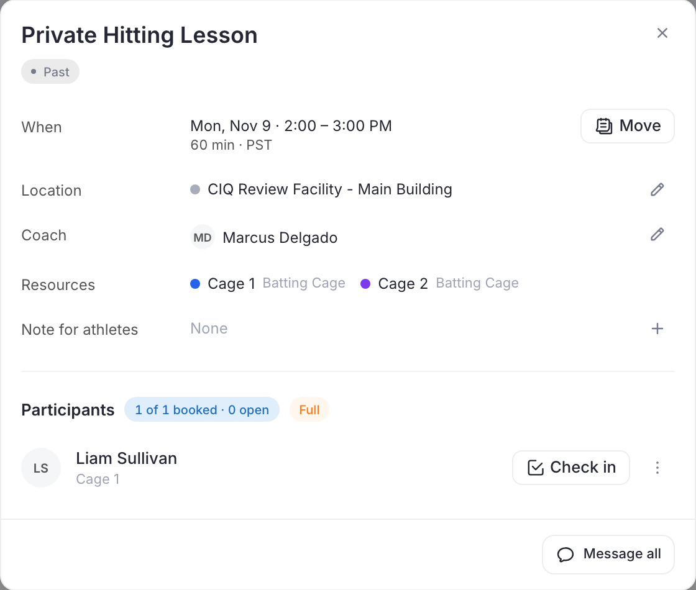
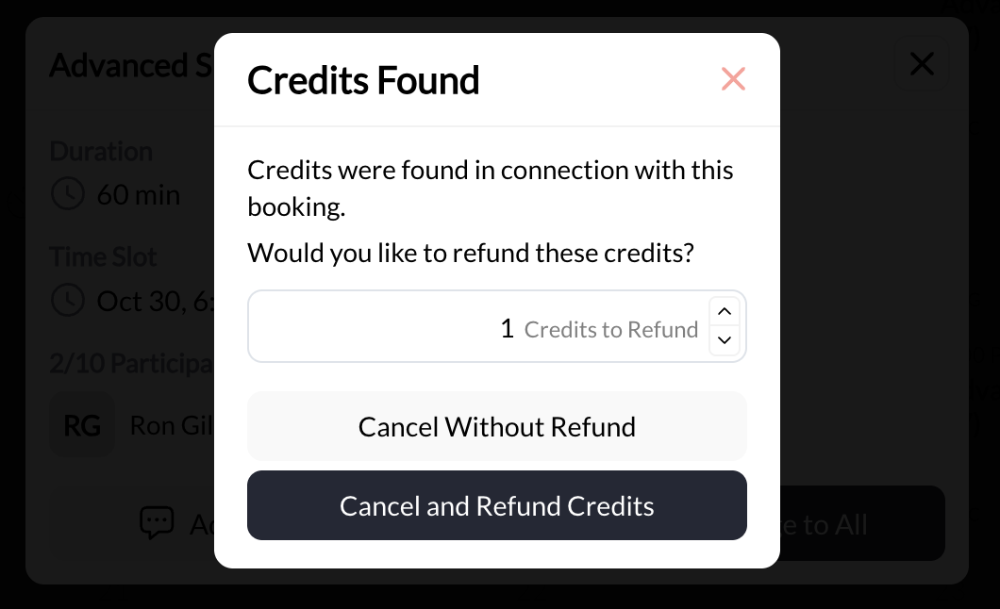

Cancel from **Scheduling → Calendar**. First decide whether you are removing **one athlete's booking** or **the entire session on that date**. Canceling a whole group session affects everyone booked into it.

| What you need | Action |
| --- | --- |
| Remove one athlete from a session | Open that athlete's booking and cancel it |
| Cancel a class for everyone on one date | Open the session and use **Cancel Session** |
| Skip one date in an athlete's recurring series | Open the recurring booking's **Occurrences** and use **Skip** |
| Stop a recurring booking | Remove the recurring pattern; review the scope before confirming |
| Keep the booking but change its time | [Move or reschedule it](/scheduling/editing-rescheduling-bookings) |

## Cancel one athlete's booking

1. Open the session on the calendar and find the athlete in the participant list. You can also open the booking from the client's profile.
2. Open the three-dot menu next to that athlete and choose **Cancel Booking**.
3. Confirm the cancellation. The confirmation names the client by full name (so two clients who share a first name can be told apart), with the date and time; a booking that runs past midnight shows both dates. **No** keeps the booking. The same confirmation appears when you cancel from a bookings list.
4. If the booking used credits, choose **Cancel Without Refund** or **Cancel and Refund Credits**.
5. Check that the athlete was removed and the other participants remain.

<Frame>
  
</Frame>

<Frame>
  
</Frame>

## Cancel an entire session from the calendar

1. Open the session on the date you want to cancel.
2. Choose **Cancel Session** in the session's details.
3. Review the date and affected participants.
4. Review **Notify participants**, the recipient count, and the selected channels. The dialog offers **Announcement**, **SMS**, and **In-app message**. Edit the prefilled message if you need to explain the change.
5. Click **Cancel Session** to confirm, or **Keep Session** to leave it as it is.

This cancels that occurrence and closes that time. It does not delete the scheduler or close all future availability.

If you need the time back later, book it again from **New booking**: CoachIQ asks **Reopen canceled time?** first. Clients who were canceled stay canceled. See [Book a time closed with Cancel Session](/scheduling/manually-booking-athletes#book-a-time-closed-with-cancel-session). To close other dates, [block time](/scheduling/block-time) and separately review any bookings already made for those dates.

## Delete an archived scheduler that still has bookings

Deleting an archived scheduler is refused while it still has upcoming bookings or repeating series, and the message says how many to cancel first, for example "This session has 1 upcoming booking. Cancel it first, then delete." Cancel them here first, so families get a cancellation and any credits are handled. See [Organize schedulers](/scheduling/organizing-schedulers).

## Cancellation and credit refunds

Athlete self-service cancellation depends on two separate settings in the scheduler. Find cancellation permission and notice under **Advanced settings**, and the credit-refund toggle under **Advanced settings → Booking Rules**:

| Setting | What it controls |
| --- | --- |
| **Allow athletes to cancel** and the cancellation notice window | Whether and how close to the session an athlete can cancel themselves |
| **Refund credits used on cancellation** | Whether an eligible self-service cancellation returns the credit |

Inside the notice window, the athlete cannot cancel through the app. The booking explains why and suggests contacting the coach. It is not an automatic late-cancellation flow that lets them cancel and forfeits the credit. Outside the window, the athlete's cancel confirmation says whether the credit will be returned.

When staff cancel a credit booking, review the refund choice rather than assuming the scheduler's policy has made the decision for you. Afterward, confirm the transaction in the athlete's **Credits** tab. If you need to correct a balance, see [Manage athlete credits](/payments/credits/managing-athlete-credits).

<Note>
  A credit refund and a card payment refund are different actions. Canceling a booking is not confirmation that a card payment was refunded. Review the payment separately using [Issue refunds](/payments/issuing-refunds).
</Note>

## Recurring bookings

Use **Skip** for one occurrence, or end the series with **Set an end date**. Skipping a credit-paid date asks how many credits to return; for a series charged per lesson, that lesson's credits are offered. Shortening a per-lesson series can return credits for the lessons removed that haven't happened yet.

Removing a whole series made before per-lesson credits gives no credits back. To return credits for future lessons on an older series, skip those dates with a refund, or [adjust the athlete's credits](/payments/credits/managing-athlete-credits). Check the scope before confirming: canceling an entire calendar session may affect other athletes as well. See [Recurring bookings](/scheduling/recurring-bookings) for occurrence changes and payment considerations.

## After canceling

Canceling a booking also removes its Google Calendar event, stops any scheduled booking automations for it, and runs your cancellation automations.

Check the calendar, the athlete's credit or payment record, and any notification choices you made. If you promised a replacement session, [book it](/scheduling/manually-booking-athletes) and verify whether a credit should be redeemed; do not deduct twice for the same service.

For athletes who did not attend, use [attendance tracking](/scheduling/checking-in-athletes). A no-show does not by itself tell CoachIQ to refund a payment or credit.
