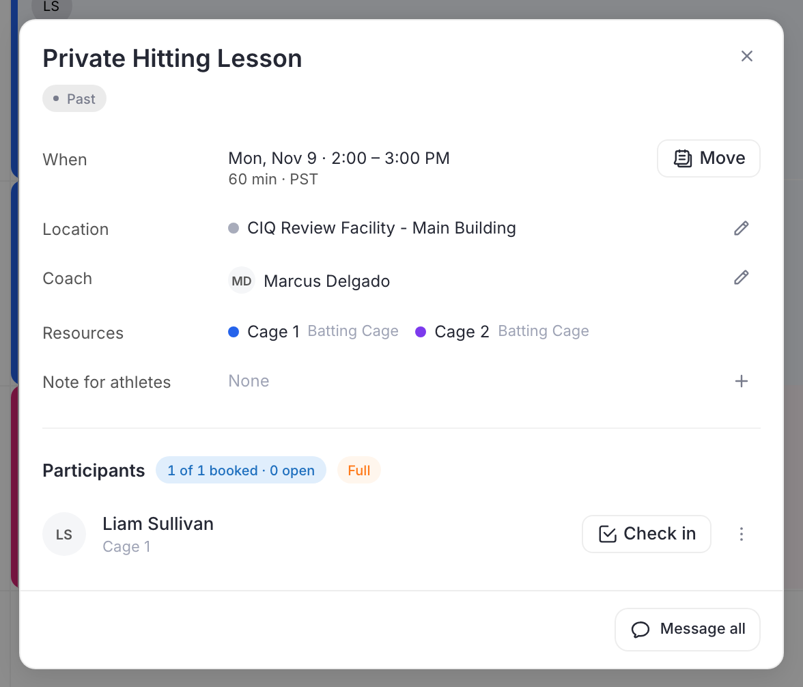
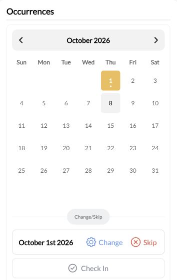

Mark athletes as checked in when they arrive for sessions. Check-in data is timestamped and saved to each booking, giving you a clear attendance record.

<Info>
**Where to find this**: Scheduling → Calendar → Click any booking
</Info>

## Check in from the calendar

<Steps>
  <Step title="Click a booking on the calendar">
    Open your calendar and click on any scheduled session. The booking details modal appears showing all participants.

    <Frame>
      
    </Frame>
  </Step>

  <Step title="Click Check in next to each athlete">
    Each participant has a **Check in** button next to their name. Click it to mark them as checked in.

    Each athlete shows as checked in straight away, and the session details stay open and in place, so you can check in several athletes in a row without the page reloading. If a check-in can't be saved, that athlete goes back to not checked in and a message asks you to try again.

    <Tip>
    Clicked by accident? Click the checkmark again to undo the check-in.
    </Tip>
  </Step>
</Steps>

## Check in a recurring occurrence

Open the participant's three-dot menu and choose **Edit booking**. In **Occurrences**, select the date and click **Check In**. Check that you selected the date the athlete attended, rather than another date in the series.

<Frame>
  
</Frame>

The button changes to **Checked In** after attendance is recorded. You can undo an accidental check-in from the session's participant list.

## View check-in data

### Calendar list view

Switch to **List** and review the **Check-In** column.

### Client profile

Open **People → the athlete's profile → Bookings** to review the booking's check-in timestamp.

A blank check-in is an unrecorded arrival, not proof of a no-show. Confirm attendance with the coach before using it in follow-up or reporting.

## Common questions

<AccordionGroup>
  <Accordion title="Can I check in multiple athletes at once?">
    There's no select-all, but you can tap **Check in** for each athlete one after another. Each shows as checked in right away and the session details stay open while you go.
  </Accordion>

  <Accordion title="Can I undo a check-in?">
    Yes. Click the green checkmark again to remove the check-in status.
  </Accordion>

  <Accordion title="Does check-in affect credits?">
    No. Check-in is purely for attendance tracking. Checking in does not collect payment, deduct a credit, or refund a no-show. Review the booking's credit and payment records separately.
  </Accordion>

  <Accordion title="Who can check in athletes?">
    Any coach or admin with calendar access can check in athletes.
  </Accordion>

  <Accordion title="Can athletes check themselves in?">
    Not currently. Only coaches and admins can mark athletes as checked in.
  </Accordion>
</AccordionGroup>

## Related articles

<CardGroup cols={2}>
  <Card title="Calendar Overview" icon="calendar" href="/scheduling/calendar-overview-and-navigation">
    Navigate and manage your calendar
  </Card>
  <Card title="Edit Bookings" icon="pen-to-square" href="/scheduling/editing-rescheduling-bookings">
    Modify booking details
  </Card>
</CardGroup>
