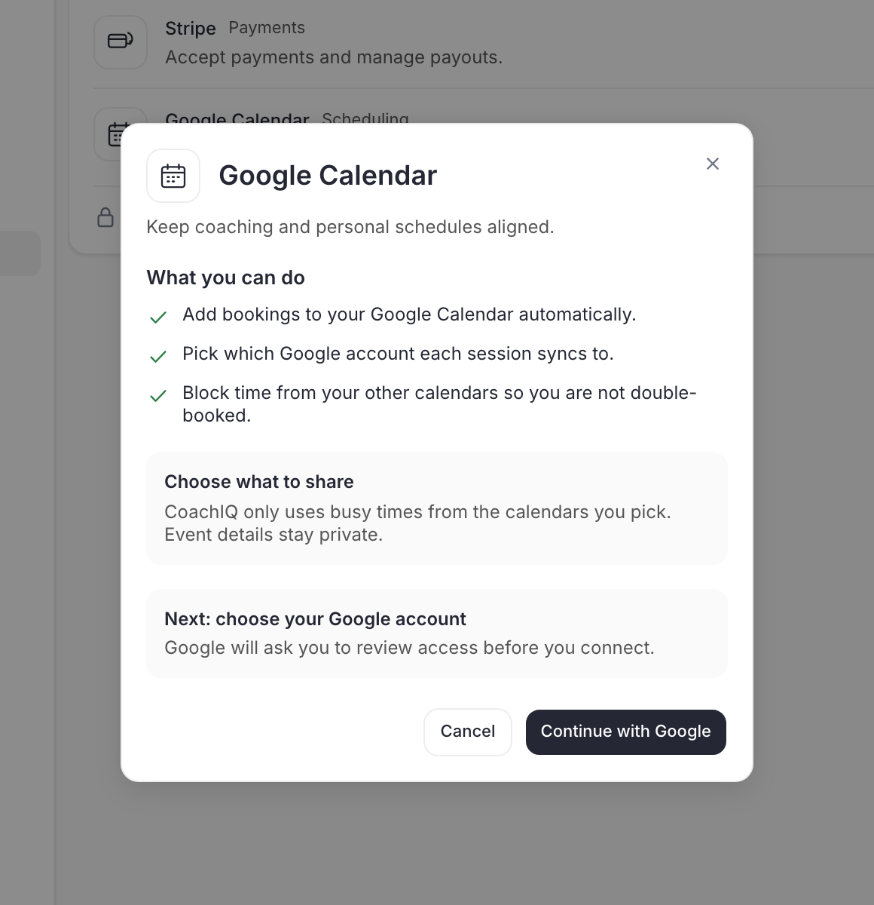
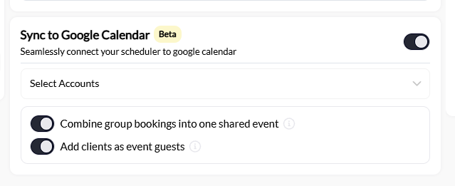

Google Calendar works in two directions, and you can use either or both:

| | What it does | Where |
| --- | --- | --- |
| **Send bookings to Google** | Each booking on a scheduler shows up as an event on a Google calendar | The scheduler's **Google** section |
| **Block busy Google time** | When a coach is busy on their Google Calendar, that time stops showing as open for booking | **Settings → Connections → Google Calendar** |

Manage bookings, changes and cancellations in CoachIQ. Editing a Google event never changes the CoachIQ booking.

## Block time from your Google Calendar

Use this so families can't book a coach during a dentist appointment or a second job that lives on their Google Calendar.

<Steps>
  <Step title="Open the connection">
    Go to **Settings → Connections** and click **Connect** next to **Google Calendar**.
  </Step>
  <Step title="Continue with Google">
    The window explains what's shared: CoachIQ only uses busy times from the calendars you pick, and event details stay private. Click **Continue with Google** and review the access Google asks for.
  </Step>
  <Step title="Pick your calendars">
    Choose which Google calendars count as busy. Only the busy times on those calendars block booking.
  </Step>
</Steps>

<Frame>
  
</Frame>

After you connect, busy times on the chosen calendars stop showing as open for that coach. Titles, guests and other event details are never copied into CoachIQ.

- Coaches and admins each manage their own busy calendars.
- **Stop blocking** turns busy-time blocking off. The coach who connected the account can pick calendars again later.
- Only admins see **Disconnect**, which removes the Google account.
- Busy time also blocks correctly for a coach who works for two businesses on CoachIQ, and across the November clock change.

## Send bookings to Google Calendar

### Connect a scheduler

1. Open **Scheduling → Schedulers** and select the scheduler.
2. Open **Google** in the scheduler builder.
3. Turn on **Sync to Google Calendar**.
4. Use **Select Accounts** to connect or choose the Google account and grant the requested calendar access.
5. Review the group-event and guest options below.
6. Click **Save** and check that a new booking shows on the intended Google calendar.

The connection is configured per scheduler. Connecting one does not enable every service automatically.

### Choose how group bookings appear

| Option | Effect |
| --- | --- |
| **Combine group bookings into one shared event** | Represents the group session with a shared Google event rather than separate events per athlete |
| **Add clients as event guests** | Invites clients to the Google event |

<Frame>
  
</Frame>

Check the saved toggle values rather than assuming a default. Combining group bookings and inviting clients are separate choices.

<Note>
  If you combine a group event and invite clients, attendees may be able to see other guests, depending on the Google event's guest settings. Leave client invitations off when you do not want to share a group guest list.
</Note>

### What sending bookings does not do

- It does not import Google events into CoachIQ as bookings. (To keep busy Google time from being booked, use [Block time from your Google Calendar](#block-time-from-your-google-calendar).)
- It does not make edits in Google apply to CoachIQ.
- It does not replace [session reminders](/scheduling/session-reminders) or your review of notification options when changing a booking.

Do not assume connecting an account retroactively creates every historical event. Verify the dates you need in Google after connecting.

## Troubleshoot missing or outdated events

1. Confirm the booking exists in CoachIQ and belongs to the connected scheduler.
2. Check that sync is enabled and the intended account is selected.
3. Open the correct Google calendar and confirm it is visible.
4. Compare dates and timezones.
5. If authorization has expired or been revoked, reconnect the account and check a new booking.

Make corrections in CoachIQ first. Avoid manually duplicating events while diagnosing sync, since that can leave two Google events for one appointment.

## Not the same as

- **Families' calendar subscription:** families can add their own bookings to Google, Apple or Outlook from your app. That's separate from these settings.
- **Shared calendar across groups:** shares busy time between two groups in your organization. See [Shared calendar across groups](/scheduling/shared-calendar-across-groups).
- **Block time:** closes holidays or one coach's time off inside CoachIQ. See [Block time](/scheduling/block-time).
