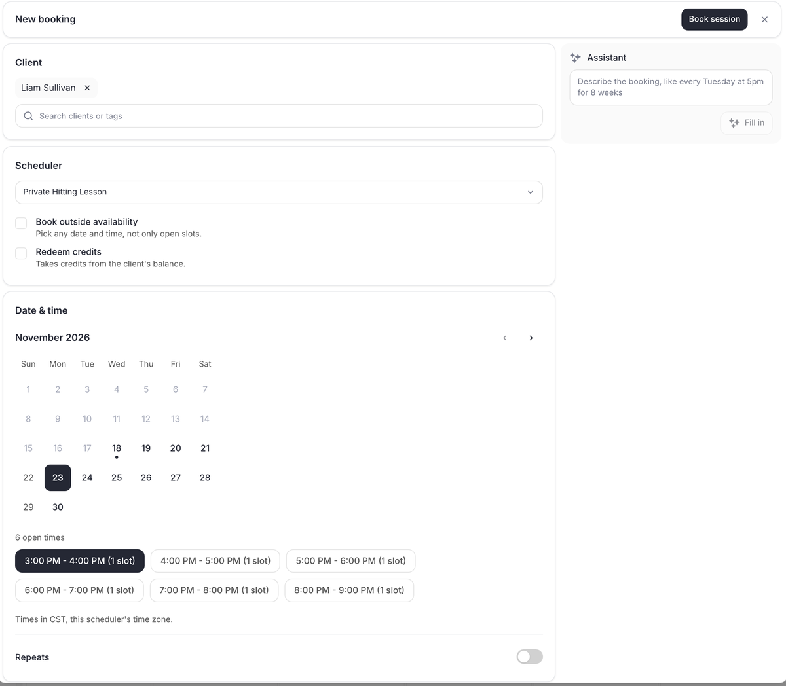
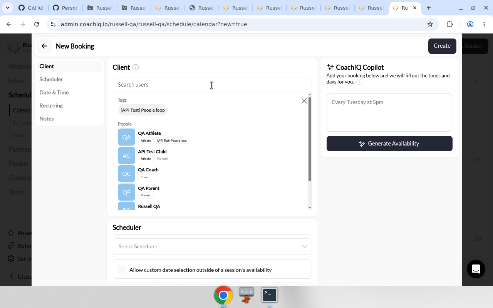

Click **Book session** at the top right of **Scheduling → Calendar** to book a client yourself. You can also click open time on the calendar, or use **Add participant** on a session. The **New booking** window opens.

<Frame>
  
</Frame>

<Note>
  A booking on the calendar doesn't mean anyone paid. Use **Redeem credits** to take credits, or handle payment separately, and check the client's credits or payments afterward.
</Note>

## Book a session

<Steps>
  <Step title="Choose the client">
    In **Client**, type in **Search clients or tags**. Results are grouped into **Tags** and **People**. Pick the athlete who'll attend; for a family, pick the child, not the parent. You can add several clients.

    Picking a tag adds everyone with that tag and shows how many people that is, with their names, before you book. A tag nobody has shows **No one has this tag** and books no one. **Add new user** creates a client if they aren't in CoachIQ yet.

    <Frame>
      
    </Frame>
  </Step>
  <Step title="Choose the scheduler">
    Pick the service under **Scheduler**. Two options sit under it:
    - **Book outside availability**: pick any date and time, not only open slots. Use it for a deliberate exception. The **Duration** starts at the scheduler's session length.
    - **Redeem credits**: takes credits from the client's balance. Leave it off for a comp session. See [Credits and schedulers](/scheduling/credits-and-schedulers).
  </Step>
  <Step title="Pick a date and time">
    Under **Date & time**, pick a day, then one of the open times, for example "3:00 PM - 4:00 PM (1 slot)". The line under the times says which time zone they're in, for example "Times in CST, this scheduler's time zone". If the scheduler's time zone differs from your calendar's, the time you type is treated as your calendar's time and saved that way.

    If the scheduler uses spaces, a **Space** list shows each one as **Free** or **Held** at that time, and which space the booking will take. A space held by a [linked group](/scheduling/shared-calendar-across-groups) names only that group.

    Turn on **Repeats** for a repeating booking; see [Recurring bookings](/scheduling/recurring-bookings).
  </Step>
  <Step title="Add notes and tell the family">
    **Notes** are kept with the booking. To send a confirmation, turn on **Notify participants**; see [Send a booking confirmation](#send-a-booking-confirmation).
  </Step>
  <Step title="Book">
    Click **Book session**. If the booking breaks one of the scheduler's rules, you're asked first; see [Book past a scheduler's rules](#book-past-a-schedulers-rules).

    When you book several clients at once, stay on the page until it finishes. If you try to close or reload it partway, your browser asks you to confirm, because clients not yet booked would be left out.
  </Step>
  <Step title="Check the result">
    Open the session on the calendar and check the participants. For several clients, check each one: a partial success doesn't mean everyone was booked. A client who isn't an active member of a small group is skipped, and you're told why.

    Bookings staff make for a child show **Booked by** with the coach's or admin's name in the calendar's List view, the client's **Bookings** tab, the session's participant list and **Edit booking**. Canceled bookings keep that line. When a parent's credits paid, it reads "Booked by (coach) with credits from (parent)".
  </Step>
</Steps>

If a booking can't be created and nothing was saved, the window says so: "The booking could not be created, and nothing was saved. Try again, or book this time from the calendar."

You can also describe the booking to the **Assistant** on the right, for example "every Tuesday at 5pm for 8 weeks", and click **Fill in**. Check every field it fills before you click **Book session**.

## Send a booking confirmation

When families book themselves, they get a "Session confirmed" email and app notification. A booking you create on their behalf sends nothing unless you ask it to.

<Steps>
  <Step title="Turn on Notify participants">
    In **New booking**, turn on **Notify participants** (below **Notes**). It's off by default, and shows who will hear, for example "1 athlete and their family". Under **Send by**, **Email** is selected first: the athlete and their linked parents get the same "Session confirmed" email and app notification they get when they book themselves. If a child has no email of their own, the parent receives it.
  </Step>
  <Step title="Add a message (optional)">
    Anything you type in **Message (optional)** appears in the email under a "Message from" line with your organization's name. Links in it work, so you can include a payment link for the session. This also reaches families who haven't set up the app yet.
  </Step>
  <Step title="Choose other channels (optional)">
    Add **In-app message**, **SMS** or **Announcement** under **Send by** to send the same message there too. With any of these selected, the message is required, and it starts with the session name and time.
  </Step>
</Steps>

For a recurring booking, the confirmation says it is a recurring session, with the first upcoming date and how it repeats. **Reschedule** on a canceled booking offers the same **Notify participants** step, so the family can get a confirmation for the new time.

<Note>
  Scheduled [session reminders](/scheduling/session-reminders) are separate. They go out before the session, not when the booking is made.
</Note>

## Book past a scheduler's rules

Staff can book a client at a time that breaks one of the scheduler's booking rules. Before anything is saved, CoachIQ asks **Book anyway?**, shows the date and time, and names the rule in the way:

- Inside the scheduler's minimum notice
- Outside the scheduler's availability or past its booking window
- Full, for example "2 of 2 booked"
- Over the athlete's daily or weekly booking limit

**Go back** keeps everything you entered so you can pick another time. **Book anyway** books the client and records which rule you booked past in the booking's history.

Some things can't be booked past, even by staff: the coach already booked elsewhere at that time, a space that's taken, an athlete booked twice at the same time, an inactive or archived scheduler, and credit rules. Fix the conflict or pick another time.

You can also book a past date, for example to add someone after the fact.

This works on the web from **Book session**, a client's profile, and **Add participant** on a calendar session. When you book several clients at once, you get one question that shows who is already booked. For a recurring series, dates outside the scheduler's availability are listed before anything is saved; see [Recurring bookings](/scheduling/recurring-bookings#review-conflicts-before-saving).

<Note>
  Clients who book for themselves still have to follow every rule. The override is only for coaches and admins.
</Note>

## Book a time closed with Cancel Session

[Cancel Session](/scheduling/canceling-bookings#cancel-an-entire-session-from-the-calendar) closes a time. You can book that time again from **New booking** on the web. Booking a client onto a closed time shows **Reopen canceled time?** with the date. **Reopen and book** makes the time bookable again and books the client. Moving an existing booking onto a closed time asks the same question, with **Reopen and move**.

A recurring booking that crosses closed dates lists them under "Canceled with Cancel Session" before anything is saved.

- Clients who were canceled from that time stay canceled. Check who was booked before you reopen it.
- Canceled team times can't be reopened.
- Reopening works on the web only. The Android app explains that the time is canceled and points you to the web calendar.

## Book siblings or a team

For siblings, use each child's linked athlete profile so attendance and booking history are attributed correctly. See [Book for families](/scheduling/booking-for-multiple-athletes).

For teams, a tag selection can help choose participants, but it does not replace Team membership or Team visibility rules. If your organization uses Teams, see [Team practices and games](/people/teams/practices-and-games).

## Moving from another booking system

To bring existing bookings in from another system, use **Settings → Data → Import bookings**. Its Preview shows every column in full, scrolling sideways on a small screen, so you can check scheduler names and dates before importing.

## Fix a booking problem

If the athlete is missing, confirm their profile exists in **People** and belongs to the correct organization. If a time or credit is unavailable, use [Scheduling troubleshooting](/scheduling/troubleshooting) before making an override.

Need to change a booking you already created? [Move or reschedule it](/scheduling/editing-rescheduling-bookings) instead of creating a second booking by accident.
