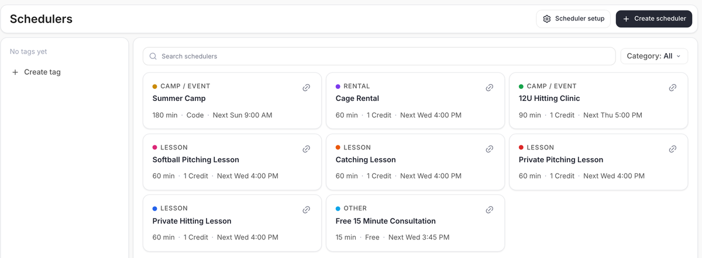
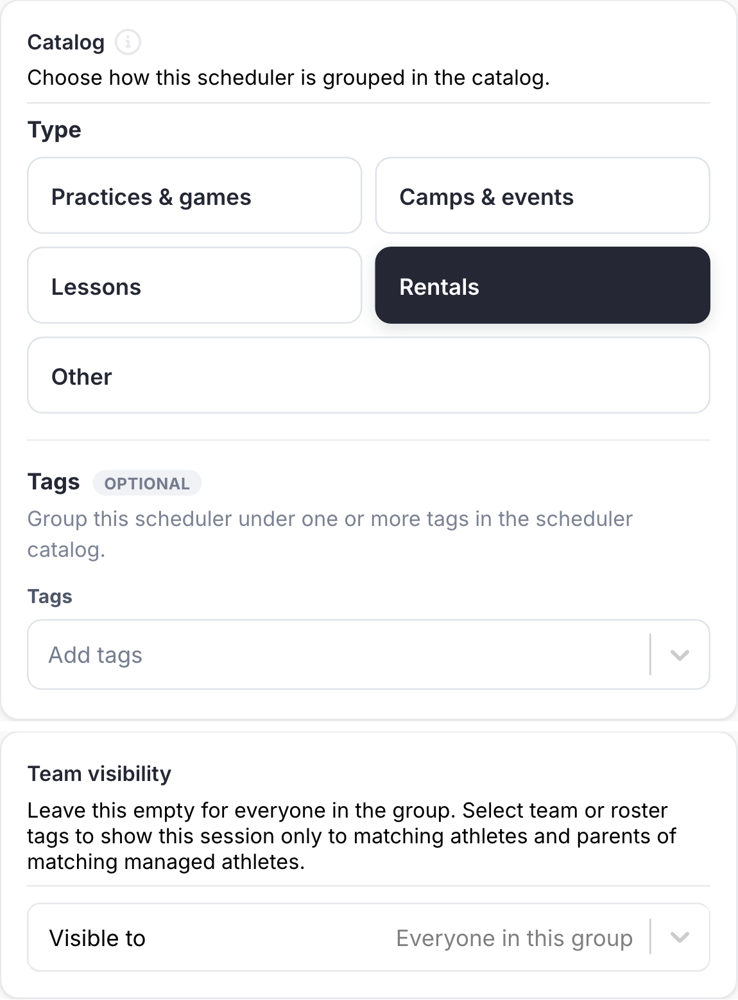

<Info>
  **Where to find this**: **Scheduling → Schedulers**, and the **Catalog** and **Team visibility** sections inside any scheduler
</Info>

## Why organize schedulers

Once you have more than a handful of schedulers, the list and your app both get noisy. Four tools keep them tidy:

- **Catalog type** groups schedulers by what they are
- **Tags** let you filter by anything you like
- **Team visibility** decides which athletes can see a scheduler at all
- **Archive** takes a finished scheduler out of the way without deleting its history

<Frame>
  
</Frame>

## Catalog types

Every scheduler has a **Type**, set in its **Catalog** section ("Choose how this scheduler is grouped in the catalog."):

| Type | Use it for |
|---|---|
| **Practices & games** | Team practices, scrimmages, match days |
| **Camps & events** | Multi-day camps, clinics, showcases, one-off events |
| **Lessons** | Private and small-group instruction |
| **Rentals** | Booking a court, cage, or field without a coach |
| **Other** | Anything that does not fit above |

On the **Schedulers** page, use **Category** next to **Search schedulers** to show one type at a time. Each card shows its type, length, price (or credits, a code, or Free) and the next time athletes can book, for example "Next Wed 4:00 PM". Click anywhere on a card to open the scheduler; the link icon only copies its link.

The **Next** time uses the same rules as the booking calendar: weekly hours, specific dates, blocked time, every session length, buffers, start times and minimum notice. It looks 60 days ahead:

- **Next: none in the next 60 days** means nothing is open in the next 60 days, but the scheduler's dates go on past that. Families can still book later times.
- **No availability** means no availability is set up, or the scheduler's dates end within 60 days with nothing open.

**Scheduler setup** at the top right opens **Scheduling → Setup**. Customer-facing placement is configured separately in the [app or website](/scheduling/sharing-schedulers).

Schedulers created before types existed default to **Other**. Open each one and set its type once; it takes a few seconds per scheduler and the filters become useful immediately.

## Scheduler tags

Tags are free-form labels you attach to a scheduler. Use the tags panel on the left of the Schedulers page (**Create tag**) or the optional **Tags** field in the scheduler's Catalog section, which groups the scheduler under one or more tags in the catalog. The panel shows a count next to each tag, so "Freehold Skills 4" means four schedulers carry it.

Good tag ideas:

- Season: `Fall 2026`, `Summer camp`
- Level: `Beginner`, `Advanced`, `High school`
- Coach: `Coach Dana`, `Coach Lee`
- Location: `Downtown`, `North field`

Click a tag on the Schedulers page to filter the list to that tag. Tags are internal: they are for you and your staff, and they are separate from the [client tags](/people/tags-filters) you put on people.

<Frame>
  
</Frame>

## Team visibility

An active scheduler still needs to be published on a page or shared by link. Team visibility determines which athletes can access it once they find it. The **Team visibility** section of the scheduler builder has one field, **Visible to**, which defaults to **Everyone in this group**. Leave it empty for everyone, or select team or roster tags to show this scheduler only to matching athletes and to parents of matching managed athletes:

- **Everyone in this group** — no team-specific visibility restriction; normal availability, payment, and booking rules still apply
- **Team or roster tags** — only athletes carrying the selected [client tags](/people/tags-filters), and the parents of managed athletes who carry them, see it

Use this for team-only practices, a private training block for a specific squad, or make-up sessions for one group. Athletes outside the roster never see the scheduler in your app, and the direct link will not let them book.

<Tip>
  Combine team visibility with [tag-based messaging](/inbox/new-message#combining-tags): tag the roster, restrict the scheduler to that tag, then message the same tag with the booking link. One tag runs the whole flow.
</Tip>

## Copying a scheduler link

Each card on the Schedulers page has a link icon (**Copy link for** the scheduler's name). Click it, then paste the link into a message, your website, or a form. Details in [Sharing schedulers](/scheduling/sharing-schedulers).

## Archiving a scheduler

When a season's clinics are over or a camp has run its course, archive the scheduler instead of deleting it or leaving it in the active list.

<Steps>
  <Step title="Open the scheduler">
    On **Scheduling → Schedulers**, open the scheduler you are finished with.
  </Step>
  <Step title="Click Archive">
    In the builder's top bar, next to the **Active** status and the **Save** button, click **Archive**.
  </Step>
</Steps>

What archiving does:

- The scheduler leaves your active Schedulers list and is removed from your app and any booking links, so nobody can book it.
- Past bookings, attendance, and payment history stay exactly as they were, on the calendar and on each athlete's profile.
- Sessions already booked for future dates are not cancelled by archiving. Cancel them first if the sessions will not run; see [Canceling bookings](/scheduling/canceling-bookings#cancel-an-entire-session-from-the-calendar).
- Availability templates, locations, resources, and coaches the scheduler used are untouched and stay available to other schedulers.

An archived scheduler can be restored later, with its settings kept. A repeating booking on an archived scheduler can still be ended or have dates skipped; see [Recurring bookings](/scheduling/recurring-bookings#series-on-an-archived-scheduler). Review its dates, availability, pricing, and published placement before accepting new bookings.

<Warning>
  If the scheduler is credit-based, check the products that issue its credits before archiving. Credits that were only valid on this scheduler have nowhere to go until you add a replacement scheduler to the product's **Which schedulers accept these credits** list. See [Credits and schedulers](/scheduling/credits-and-schedulers).
</Warning>

Archiving is different from **Inactive**. An inactive scheduler is hidden from athletes but still sits in your active list and can be switched back on in a second; use it for a short pause. Archive is for schedulers you do not expect to use again soon. Both keep history.

## Common questions

<AccordionGroup>
  <Accordion title="Can a scheduler have more than one type?">
    No, one type per scheduler. Use tags for anything that crosses types.
  </Accordion>
  <Accordion title="Does team visibility stop staff from booking athletes manually?">
    Team visibility controls customer access. Staff use the calendar booking flow with their own permissions and booking checks; visibility is not a guarantee that every manual booking will succeed.
  </Accordion>
  <Accordion title="An athlete on the roster can't see the scheduler">
    Check that the athlete carries the exact tag selected in Team visibility, and that the scheduler is **Active** and not archived. Tag names must match; "Varsity" and "varsity " with a trailing space are different tags.
  </Accordion>
  <Accordion title="Should I archive or delete a scheduler I no longer use?">
    Archive. Archiving keeps every booking record, can be reversed, and still takes the scheduler off your app and website.

    A scheduler has to be archived before it can be deleted, and delete is permanent: it also erases the scheduler's past bookings and cancellations, with no credit return or notice. Delete is refused while:
    - the scheduler still has upcoming bookings or repeating series. The message says how many, for example "This session has 2 upcoming bookings and 1 repeating series. Cancel them first, then delete."
    - a credit product can only be used on this scheduler.

    There's rarely a reason to delete a scheduler that has ever been booked.
  </Accordion>
</AccordionGroup>

## Related articles

<CardGroup cols={2}>
  <Card title="What are schedulers?" icon="calendar" href="/scheduling/overview">
    The building block of CoachIQ scheduling
  </Card>
  <Card title="Sharing schedulers" icon="share" href="/scheduling/sharing-schedulers">
    Links, embeds, and where to put them
  </Card>
  <Card title="Tags & filters" icon="tags" href="/people/tags-filters">
    The client tags that drive team visibility
  </Card>
  <Card title="Scheduler settings, limits & permissions" icon="lock" href="/scheduling/scheduler-settings-limits-and-permissions">
    Everything else that controls who can book
  </Card>
</CardGroup>
