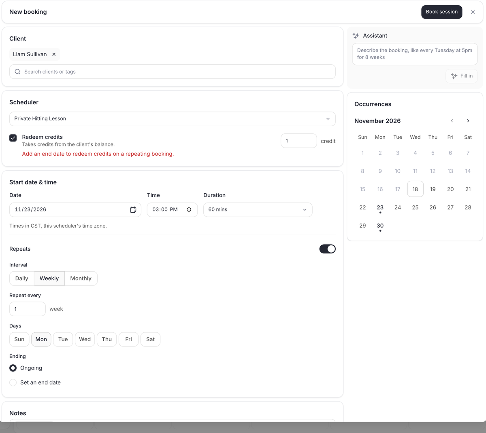
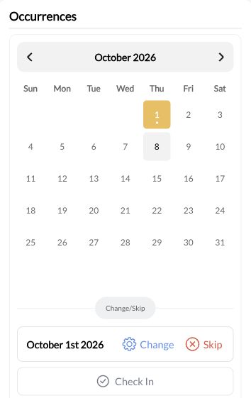

Use a recurring booking for a standing session, such as every Tuesday at 5:00 PM. Staff create the pattern from **Scheduling → Calendar → Book session**. Athletes use the normal booking flow to choose individual sessions.

A recurring booking reserves time. It is separate from a recurring membership or subscription that collects payment.

## Creating a recurring booking pattern

1. In **New booking**, choose the athlete or athletes and the scheduler.
2. Turn on **Repeats**. **Date & time** becomes **Start date & time**, with **Date**, **Time** and **Duration**.
3. Choose the **Interval** (**Daily**, **Weekly** or **Monthly**), **Repeat every** and, for weekly, the **Days**. **Repeat every** accepts any whole number from 1 to 50; anything else shows "Choose 1 to 50".
4. Under **Ending**, choose **Ongoing** or **Set an end date**. Check the first and last dates in the **Occurrences** calendar on the right.
5. If you're using credits, turn on **Redeem credits** and enter the credits per lesson. See [Credits on a recurring booking](#credit-handling-with-recurring-bookings).
6. Click **Book session** and read the review (below) before anything is saved.
7. Open a few dates on the calendar to check the pattern.

<Frame>
  
</Frame>

Monthly patterns such as "every 1st Thursday of the month" land on that weekday. A monthly series on the 29th, 30th or 31st skips months that don't have that date, and "every 5th Tuesday" skips months without one.

If you ask the **Assistant** to fill in the pattern, still check the days, times and end date before you book.

### Review conflicts before saving

CoachIQ checks the selected athlete's existing bookings across offerings, including later dates in a weekly or monthly series. The review lists every overlapping booking with its client, scheduler, date and time.

Before anything is saved, the same review also lists:

- **Dates outside the scheduler's availability**, such as a Saturday on a Monday to Friday scheduler, or a blocked date. The first 90 dates of a series are checked.
- **Dates over the athlete's booking limit**, under "Over the athlete's booking limit", with the athlete, date, time and which daily or weekly limit it goes over.
- **Dates with no free space**, under "No free space", when the scheduler uses **Use first available** and every space is taken on that date. On other dates the series takes one free space each time, so the other spaces stay bookable.
- **Dates closed with Cancel Session**, under "Canceled with Cancel Session". **Reopen and book** reopens those times and books the series. Clients canceled from them stay canceled. See [Book a time closed with Cancel Session](/scheduling/manually-booking-athletes#book-a-time-closed-with-cancel-session).

What you can do:

- **Go back** creates nothing so you can adjust the pattern.
- **Book anyway** books the series as entered, including exactly the dates the review listed. If something changes between the review and the booking (for example someone else books, so a new date goes over a limit), nothing is booked and you're shown the new review.

The web admin shows this review. The mobile app does not yet check dates outside availability and books the series as entered.

For several athletes, check each result and the processed count. Do not assume every requested booking succeeded if the result reports an error or partial completion.

## Managing individual occurrences after creation

Open the recurring booking from the calendar or the athlete's profile, then open **Occurrences**. Select the date you want to change.

<Frame>
  
</Frame>

### Changing one occurrence

Choose **Change**, select the replacement date or time, and confirm. Review the new slot and any notification options. The other occurrences keep their original schedule.

You can also correct a past occurrence if its recorded time is wrong. Check the effect on attendance records before changing historical dates.

### Skipping one occurrence

Choose **Skip** for a date the athlete will not attend. The confirmation names the client, date and time, and says the rest of the series stays booked. Choose **No** to change nothing.

For a series paid with credits, the next step starts at 0 credits. Enter how many credits to return for that date and choose **Skip and Refund Credits**, or choose **Skip Without Refund**. You can't return more credits than the series has left.

If that date needs to be booked again later, create a booking for it and check the payment or credit history first.

Skipping a date is not evidence that a payment or credit was refunded. Verify those records separately.

## Making changes to the entire recurring pattern

To replace the standing schedule, record the remaining dates, remove the old recurring pattern, and create the replacement pattern. Review the deletion confirmation to ensure you are stopping the intended athlete's series rather than canceling a group session for everyone.

To end a series on a set date, open the booking with **Edit booking**, choose **Set an end date**, and click **Save**. For a series that takes credits per lesson, shortening it can return credits for the removed lessons that haven't happened yet.

Past occurrences remain in the athlete's history when you stop the remaining series. After creating the replacement, check the transition date so the old and new patterns do not overlap or leave a gap. Confirm the new schedule with the family.

### Series on an archived scheduler

If the scheduler has been [archived](/scheduling/organizing-schedulers#archiving-a-scheduler), the **Scheduler** field shows its name with "(archived)". You can still end the series with **Set an end date → Save** and skip single dates. Any other change shows "This scheduler is archived. You can only end this series or skip dates. Restore the scheduler to change it." New bookings on an archived scheduler aren't allowed until you restore it.

## Credit handling with recurring bookings

Turn on **Redeem credits** and enter the credits **per lesson**. A repeating booking needs an end date to use credits; with **Ongoing** selected the window says "Add an end date to redeem credits on a repeating booking."

- The family is charged for every lesson once, when you create the series. Dates already in the past are included, and you're told how many.
- Before you save, each athlete gets a line under the credit total: "Kenna: enough for all 3 lessons", or in red "Kenna: 3 usable credits cover 1 of 3 lessons" when they're short. If the credits can't be checked yet it says "checked when you save".
- If the family doesn't have enough credits when you save, nothing is booked. The message shows how many usable credits each athlete has and how many lessons those cover.
- Skipping one date offers that lesson's credits as the refund. When an athlete cancels one lesson in the app, or the session is canceled for that date, at most that lesson's credits come back.
- Shortening a series can give back credits for removed lessons that hadn't happened yet, up to what the series still holds. Saving the same change twice doesn't refund twice.
- You can't add lessons to a series charged per lesson, or to one that was shortened with a refund. To change it, end it and create a new one.
- Series booked before this change took the credit number once for the whole series and keep working that way. Nobody is charged again for an older series.

Selecting a paid scheduler doesn't charge a card. Before creating the pattern:

1. Review the payment and **Redeem credits** controls available in the booking builder.
2. Confirm whose eligible credits are being used, especially when staff book a child.
3. Check credit expiration and any session-date restrictions for the whole date range.
4. After saving, review the athlete's credit history and any separate payment or subscription record.

When credits require sessions to happen before expiration, the series needs an end date within the eligible period. Do not use an ongoing pattern to promise sessions beyond the athlete's entitlement.

A parent's ability to use a family package in self-service checkout does not mean a staff-created recurring booking will automatically use that parent's balance. See [Book for families](/scheduling/booking-for-multiple-athletes) and [Credits and schedulers](/scheduling/credits-and-schedulers).

## Related guides

- [Book one session](/scheduling/manually-booking-athletes)
- [Cancel bookings and sessions](/scheduling/canceling-bookings)
- [Move or reschedule a booking](/scheduling/editing-rescheduling-bookings)
- [Recurring credit memberships](/payments/credits/recurring-credit-memberships)
