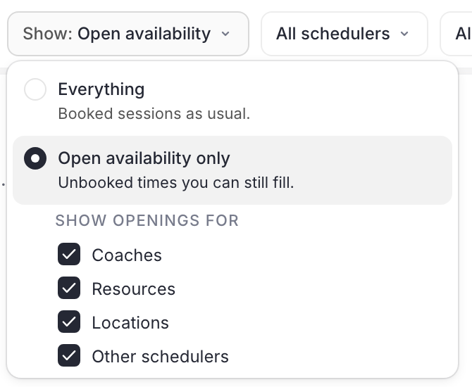
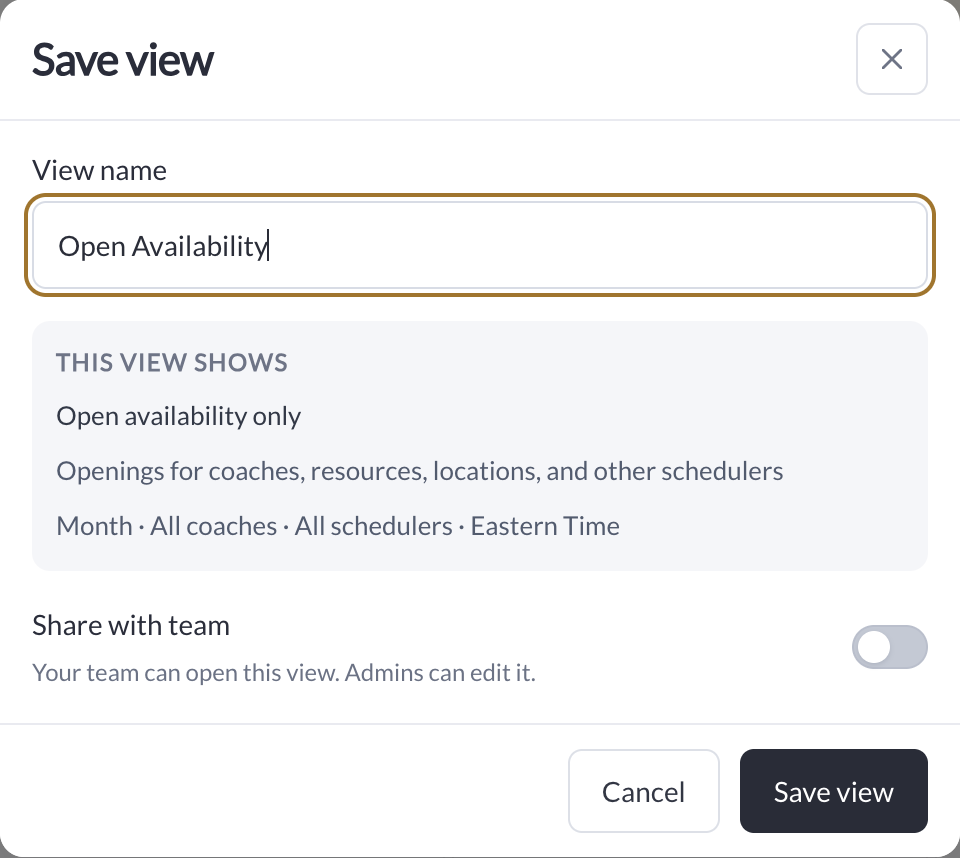
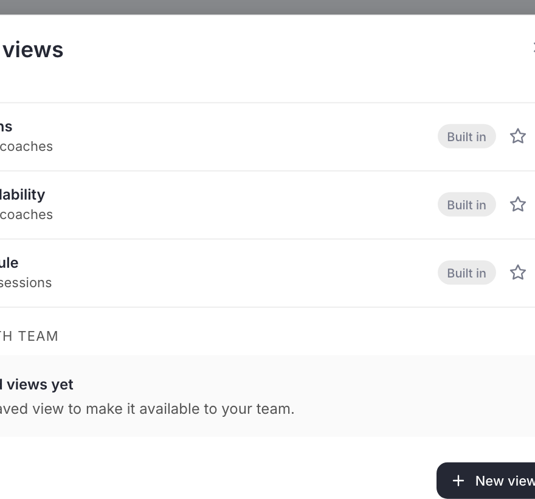

Open **Scheduling → Calendar**. The chips above the calendar let you return to saved configurations without rebuilding your filters.

## Show unbooked times

1. Open **Show** and choose **Open availability only**. (Or click the built-in **Open availability** view.)
2. Under **Show openings for**, tick the kinds of openings you want to see. With **Everything** picked these choices are folded away.
3. Narrow the **Schedulers** and **Coaches** filters, choose your date range and view, and check the timezone.

<Frame>
  
</Frame>

| Opening type | Shows |
| --- | --- |
| Coaches | Open times on schedulers with a coach. |
| Resources | Unrented courts, rooms, and equipment. |
| Locations | Open times at a set location. |
| Other schedulers | Schedulers without an attached coach, resource, or location. |

Booked sessions and rented resources stay hidden while open availability is on. An opening is an available time, not a booking or a reserved resource.

## Save your view

After changing the filters, choose **+ Save view**.

<Frame>

</Frame>

1. Give the view a name you will recognize, such as **Open Availability**.
2. Review **This view shows**, including the opening types, calendar view, coach and scheduler filters, and timezone.
3. If you want the team to use it, turn on **Share with team**. The team can open a shared view; Admins can edit it.
4. Choose **Save view**. Use its chip above the calendar to return to it.

## Manage views and set your default

Click the list icon next to your view chips to open **Manage views**. It has two lists, **My views** and **Shared with team**, with one row per view: its name, a summary such as "Month · All coaches", and a star. The three views every calendar starts with (**All sessions**, **Open availability** and **My schedule**) are marked **Built in** and can't be edited or deleted. Rename or change sharing on a view you can edit, or click **New view** to make one.

<Frame>
  
</Frame>

Star a view to make it the one that opens first when you come back to the calendar; it gets a green **Opens first** label. The default is personal, even when the view is shared with the team. Remove the star to clear it.

Your view chips also show in the CoachIQ app's calendar, where you can swipe through them.

Deleting a saved view removes that saved configuration; it does not delete bookings. Choose **All sessions** to return to the normal booked-session display.

## When you do not see openings

Check the selected period, schedulers, coaches, and opening types first. **No openings this month** means the schedulers in view are booked up or have no availability in that period; it does not mean the entire business has no openings.

Openings load progressively: a thin line across the top of the calendar shows progress, and the grid is usable as soon as the first results appear. Open times show a dashed outline, with the time first, the scheduler name, and what the opening is for (coach, resource, location). In Month view a day shows as many whole openings as fit, then **+N more**; click it to open that day. If the calendar still asks for a shorter range or fewer schedulers, narrow the request and retry.

For more on navigation and bookings, see [Use the Calendar](/scheduling/calendar-overview-and-navigation) and [How availability works](/scheduling/how-availability-works).
