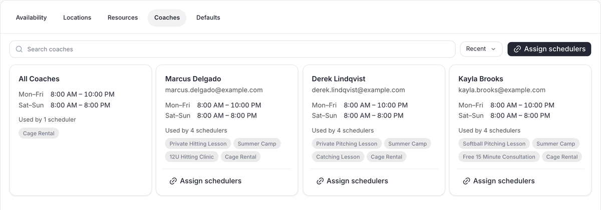

A booking time is offered only when the scheduler's hours, the coach's hours and the coach's other bookings all allow it. This page covers the coach side: who coaches what, when they work, and how their bookings block each other.

Add staff and manage what they can see under [People → Staff](/people/managing-staff). A person has to be on your staff before you can connect them to scheduling.

## See your coaches

Open **Scheduling → Setup → Coaches**. Each coach card shows the coach's working hours and **Used by N schedulers**, with the scheduler names. The **All Coaches** card shows the hours used by schedulers that aren't tied to one coach.

<Frame>
  
</Frame>

## Assign coaches to schedulers

There are two ways, with the same result:

- **From Setup:** on **Scheduling → Setup → Coaches**, click **Assign schedulers** on a coach's card (or at the top of the tab), pick the schedulers, and click **Assign**.
- **From the scheduler:** open the scheduler, go to **Coaches**, and use **Select coaches** under **Connected Coaches**. Click **Save**.

Then open the scheduler's **Preview** and check that the times match the coach's hours.

A Tuesday-afternoon service can't be booked with a coach who doesn't work Tuesday afternoons.

## Change the coach for one session

To change who coaches a single date, open the session on **Scheduling → Calendar** and use the edit button on the **Coach** row. This changes that date only, not the scheduler. See [Move and reschedule bookings](/scheduling/editing-rescheduling-bookings).

## How one coach's bookings block other sessions

When two schedulers share a coach, a booking on one removes the overlapping time from the other. That stops a coach from being booked twice.

The scheduler's **Coaches** section has two checkboxes that change this:

| Checkbox | What it does | Use it when |
| --- | --- | --- |
| **Check this box to allow bookings for this session even if the connected coaches are already scheduled for other sessions at the same time.** | This scheduler ignores the coach's other bookings | The coach really can cover both, for example supervising open cage time while giving a lesson |
| **Check this box if this session needs every coach.** | Its times close whenever any coach has another booking, and its bookings close every other session at that time | A camp or clinic that uses your whole staff |

For a scheduler with **All coaches**, leaving "needs every coach" off means it only conflicts with other All-coaches sessions. An older scheduler may still be on the automatic setting until you tick or untick the box; review it when you add staff or when a time is blocked unexpectedly.

These settings control conflicts only. They don't add seats, rotate coaches, or multiply capacity by the number of coaches.

<Note>
  An unrelated session saved with no coach no longer hides another team's open practice time. Only a real shared-coach overlap blocks it.
</Note>

## Several coaches running sessions at the same time

Coach Maya can give a hitting lesson while Coach Jordan runs a pitching clinic at the same time, as long as their hours, resources and booking rules allow it.

If both sessions need the same cage, attach that cage to both schedulers. Two coaches don't make one cage available twice. See [Resources](/scheduling/resources).

## One scheduler per coach, or one shared scheduler

Use separate schedulers, for example **Hitting with Maya** and **Pitching with Jordan**, when coaches offer different services, hours or prices. One scheduler can still offer several [session lengths and prices](/scheduling/pricing-by-session-length).

Putting several coaches on one scheduler doesn't by itself decide which coach a family gets. After a test booking, open it on the calendar and check who it's assigned to.

## Block a coach's time off

To keep a coach from being booked for an appointment or a day off, use [Block time](/scheduling/block-time#block-one-coach-or-one-resource) with **Coach**. Coaches can block their own time; only admins can block another coach.

To keep a coach's personal Google Calendar events from being booked over, see [Google Calendar](/scheduling/google-calendar-sync).

## Check the setup

Pick a time for each service and compare it with a time when the coach already has a booking:

- Open times match the coach's working hours and the service's hours.
- An existing booking blocks the services it should.
- Coaches and resources that should run side by side can.
- **Max athletes per time slot** matches your group size.

## Troubleshooting

- **Coach missing from the list:** check that they're on your staff in **People → Staff**.
- **A time you expect isn't offered:** check the coach's hours, the scheduler's availability, any [blocked time](/scheduling/block-time), and the coach's other bookings.
- **Two services block each other unexpectedly:** check their coach assignments and the two checkboxes above.
- **A coach can't change schedules:** check their access in **People → Staff**.

[Scheduling troubleshooting](/scheduling/troubleshooting) covers the other reasons a time can be hidden.
