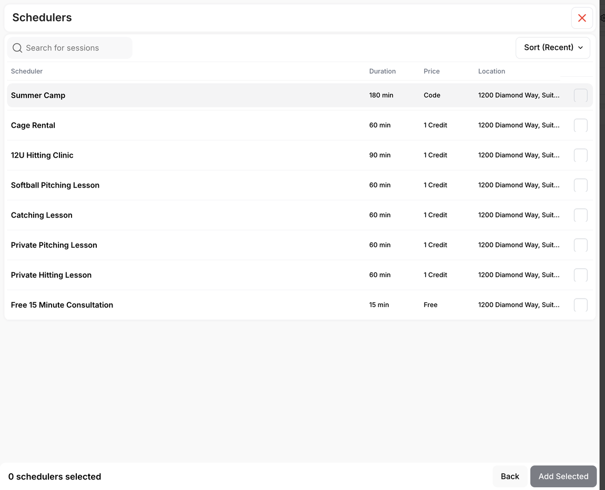

Creating a scheduler and publishing it are separate steps. Once the scheduler is ready and active, add it to your app or website, or share its direct booking link.

## Copy a scheduler link

Open **Scheduling → Schedulers** and click the chain/link icon on the scheduler card. Its tooltip is **Copy scheduler link**. Paste the link into an Inbox message, email, text, or other customer communication.

A direct link helps someone find the service. It does not override Team visibility, booking rules, availability, or payment requirements.

## Add schedulers to your app

<Steps>
  <Step title="Open the Schedule page">
    Go to **Website & App › App**, click **Edit app**, then **Schedule** in the builder's left menu. Families see this page as **Sessions** unless you rename it. Check that its **Active** switch is on.
  </Step>
  <Step title="Add your schedulers">
    Inside a section (for example Private Lessons), click **+ Add Schedule**, tick the schedulers and click **Add Selected**. Use **+ Add section** for another group.

    <Frame>
      
    </Frame>
  </Step>
  <Step title="Save">
    Check the order and the card titles, then click **Update** at the top right. Nothing changes in your app until you do.
  </Step>
</Steps>

Removing a scheduler from a section changes that page's contents. It does not delete the scheduler or cancel existing bookings. An inactive scheduler stays hidden from families until you turn it on.

See [Schedule page in your app](/athlete-portal/schedule) for the page builder's other options.

## Add a scheduler to your website

Use a scheduling section in the website builder, select the relevant scheduler or schedulers, and publish the page. Follow [Website scheduling sections](/website/section-types/scheduling) for the supported layouts.

## Check who can see and book it

Before sharing broadly, review the page as the intended customer and confirm:

1. The scheduler is active and appears on the published page you linked.
2. Its session lengths, dates, location, and payment choices are correct.
3. The viewer meets any Team visibility requirements.
4. The selected athlete has the required access or eligible credits.

When Teams is enabled, a Team-restricted scheduler is not necessarily visible to every client. [Team practices and games](/people/teams/practices-and-games) explains team scheduling.

## Keep the list easy to navigate

Use a few customer-facing sections based on what athletes want to book. Put current services first and remove seasonal offerings from the page when they are no longer relevant.

Catalog tags help you organize schedulers internally; they do not replace app sections or access settings. See [Organize schedulers](/scheduling/organizing-schedulers).

If a scheduler is missing or has no bookable times, follow [Scheduling troubleshooting](/scheduling/troubleshooting).
