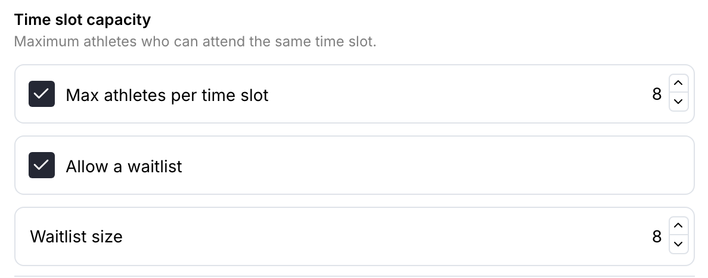
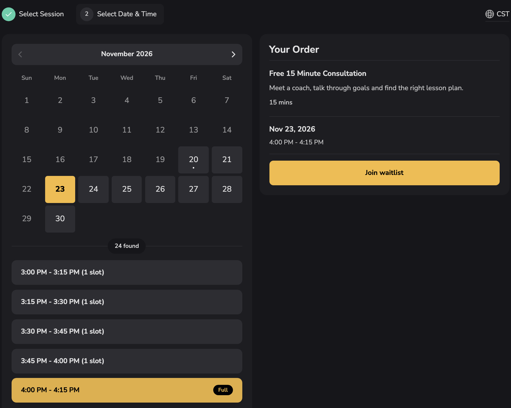
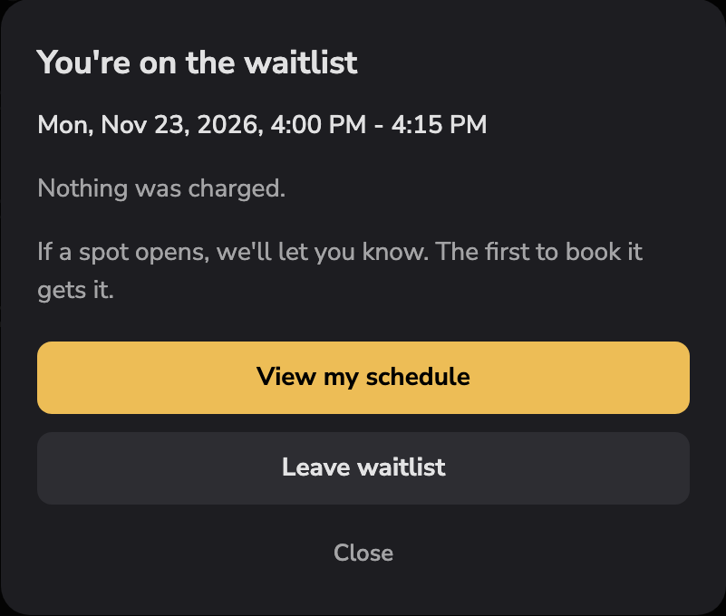
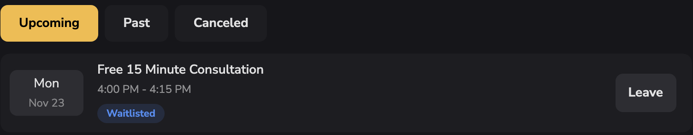
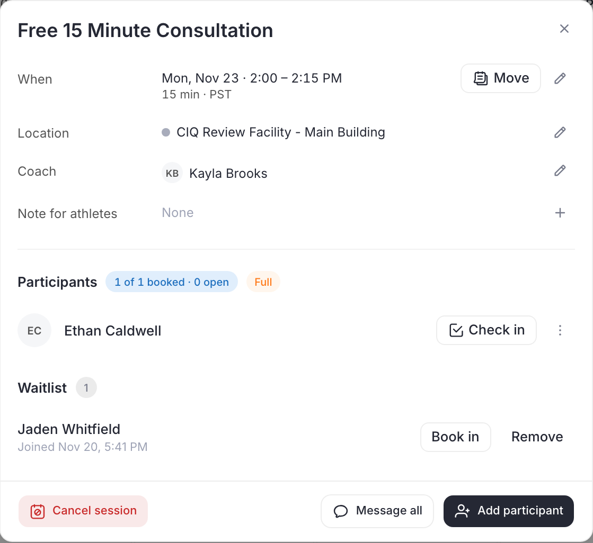

When a clinic, class or popular lesson time fills up, families no longer have to keep checking back. They join the waitlist in one tap, and when someone cancels, everyone on the list hears about it right away. The first family to book gets the spot.

You don't chase anyone, you don't keep a list in your notes app, and the empty seat gets filled.

**Where:** open a scheduler from **Scheduling → Schedulers**, then **Advanced settings → Time slot capacity**.

## How it works

1. You turn on **Allow a waitlist** for a scheduler that has a maximum per time.
2. When a time is full, families still see it, marked **Full**, with a **Join waitlist** button. Joining is free.
3. When a spot opens, everyone on that time's waitlist gets a message at the same time.
4. The first to book the open spot gets it. Nobody's place is held, and nobody is booked or charged automatically.

## Turn on the waitlist

<Steps>
  <Step title="Open the scheduler">
    Go to **Scheduling → Schedulers**, open the scheduler and choose **Advanced settings**.
  </Step>
  <Step title="Set a maximum per time">
    Under **Time slot capacity**, tick **Max athletes per time slot** and enter the number, for example 8 for a clinic or 1 for a private lesson. **Allow a waitlist** only appears once a maximum is set, because without one a time is never full.
  </Step>
  <Step title="Allow a waitlist and choose its size">
    Tick **Allow a waitlist**. **Waitlist size** is how many people can wait for each time, from 1 to 200. It starts at the same number as your maximum, so a clinic of 8 can have 8 people waiting.
  </Step>
  <Step title="Save">
    Click **Save**. The waitlist works for every time in this scheduler.
  </Step>
</Steps>

<Frame caption="A clinic with 8 athletes per time and room for 8 more on the waitlist.">
  
</Frame>

<Tip>
  Waitlists work for one-on-one lessons too. Set **Max athletes per time slot** to 1 and a small waitlist, and a family who wanted your Monday 4:00 hears about it the moment it frees up.
</Tip>

If you later clear **Max athletes per time slot**, the waitlist turns off with it.

## What families see

### A full time, and the Join waitlist button

On the booking screen in your app, a full time stays in the list with a **Full** tag instead of disappearing. When a family picks it, the button in their order changes from booking to **Join waitlist**.

<Frame caption="The 4:00 PM time is full, so the family sees Join waitlist instead of a booking button.">
  
</Frame>

Once the waitlist for that time is also full, the time shows **Full** and can't be picked. If you haven't turned the waitlist on, full times stay hidden, as before.

### You're on the waitlist

Joining takes one tap. The family sees the date and time, **Nothing was charged**, and "If a spot opens, we'll let you know. The first to book it gets it." From there they can open their schedule, leave the waitlist or close the window.

<Frame caption="The confirmation after joining.">
  
</Frame>

### In their bookings

The time appears with their upcoming bookings, tagged **Waitlisted**, with a **Leave** button if their plans change.

<Frame>
  
</Frame>

## When a spot opens

A spot opens when someone cancels, an athlete or coach moves a booking to another time, you remove a booking, or you raise the maximum. Everyone on that time's waitlist gets one message by push notification, email and text, wherever they can receive each, telling them which session and time just opened up.

The time shows as open again in your app, and **the first family to book it gets it**. Families stay on the waitlist until they book or leave, so if the first person to book is someone else, the rest are still on the list for the next opening.

Booking the open spot works like any other booking: they pay the price or use credits as usual.

## What you see as the coach

Open the session from **Scheduling → Calendar**. When it's full, **Participants** shows **Full**, and a **Waitlist** section lists everyone waiting, with when they joined.

- **Book in** opens a booking with that athlete and the time already filled in, so you can give someone the spot yourself.
- **Remove** takes someone off the waitlist without sending them a message.

<Frame caption="A full session with one person on the waitlist.">
  
</Frame>

Staff need access to the calendar to see the waitlist and use **Book in** and **Remove**. See [Staff access](/people/staff-access).

## Common questions

<AccordionGroup>
  <Accordion title="I don't see Allow a waitlist">
    Tick **Max athletes per time slot** and enter a number first. The waitlist switch only shows for schedulers with a maximum per time.
  </Accordion>
  <Accordion title="Does joining the waitlist cost anything?">
    No. Joining is free, holds no credits and creates no order. Families only pay when they book an open spot.
  </Accordion>
  <Accordion title="Does the first person on the list get the spot automatically?">
    No. Everyone on the waitlist is told at the same time and the first to book gets it. If you want to give the spot to a particular family, use **Book in** on the session.
  </Accordion>
  <Accordion title="Can a parent put a child on the waitlist?">
    Yes. A parent joins the waitlist the same way they book, choosing which child it's for.
  </Accordion>
  <Accordion title="How do families leave the waitlist?">
    From their bookings in your app, with **Leave**, or **Leave waitlist** on the confirmation window.
  </Accordion>
</AccordionGroup>

## Related

- [Scheduler settings, limits and permissions](/scheduling/scheduler-settings-limits-and-permissions)
- [Canceling bookings](/scheduling/canceling-bookings)
- [Use the calendar](/scheduling/calendar-overview-and-navigation)
