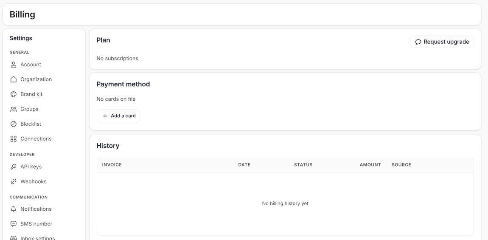

<Info>

**Where to find this**: **Settings → Billing**, in the **Payments** group of the Settings menu. Admins only.

</Info>

**Billing** is what your business pays CoachIQ: your plan, the card it's charged to, and your invoices. It's separate from [Stripe](/payments/connecting-stripe), the account your clients pay you through.

When you open Billing, CoachIQ first shows **See your plan, payment methods and billing history.** Click **Continue** to load the page.

<Frame caption="Settings → Billing in a test organization with no plan or card yet. Yours shows your plan, cards and invoices.">
  
</Frame>

## Plan

**Plan** shows your CoachIQ plan and any add-ons, such as a Personalized App, with the card each one bills to.

On a membership plan, **Total due** adds up the plan price and each add-on that's turned on, including any usage over what the add-on includes. It uses list prices, so a discount on your plan isn't taken off this figure; your invoice shows what you're actually charged. Add-ons that are turned off aren't listed. Where an add-on's usage hasn't been recorded for this billing period, it shows **Not available**.

To change your plan, click **Request upgrade**, or contact CoachIQ support from **Help** in the sidebar to change or cancel it.

## Update your card on file

<Steps>
  <Step title="Open Billing">

    Open **Settings → Billing** in the organization whose plan you want to manage, and click **Continue**.

  </Step>
  <Step title="Add a new card">
    Under **Payment method**, click **Add a card**, enter the card details and save. The form stays open until the card is saved. If it can't be saved, your details stay in the form with the reason, so you can fix it and try again.
  </Step>
  <Step title="Make it the default">

    Click **Set as default** on the new card. The card that's the default is the one your plan is charged to.

  </Step>
  <Step title="Remove the old card">

    Click the remove button on the old card and confirm. **Keep card** leaves it in place. You can't remove the only card on file; the page tells you why.

  </Step>
</Steps>

If the card processor refuses a change, the page says so, for example **We couldn't remove that card.** or **We couldn't set that card as the default.**, followed by what to do next. Nothing changed in that case: check the card and try again, or contact support.

<Note>
Saving a card doesn't pay an overdue invoice by itself. If a payment has failed, also complete the retry; see [Restore access after a failed payment](#restore-access-after-a-failed-payment).
</Note>

## Invoices

**History** lists every invoice with its **Date**, **Status**, **Amount** and **Source**, and a **Receipt** link to view or download it.

## Who can manage billing

Billing is for Admins. Coaches can't see or change the organization's cards, change the card your plan is charged to, or buy messaging credits. If a coach tries, nothing is charged or changed.

## Restore access after a failed payment

When your organization's CoachIQ membership payment fails, staff may see a billing screen instead of the admin platform, including during an existing session.

| Your situation | Next step |
| --- | --- |
| You can open Settings and want to replace a card | Use **Settings → Billing → Payment method**. |
| A failed-payment screen blocks the admin platform | An Admin must complete the payment retry there. |
| You are a Coach | Ask an organization Admin to resolve membership billing. |
| A parent cannot pay for training | Check that client's purchase and your connected Stripe account; this is separate from your CoachIQ plan. |

- **Admins:** use the billing screen to retry payment with a saved card or add a new card and complete payment. Access returns after payment succeeds. Adding a card alone does not restore access.
- **Coaches:** ask an organization Admin to resolve billing. The screen explains that an Admin needs to act.
- **No active membership:** Admins see **Choose a plan**; Coaches are asked to have an Admin activate the membership.

Paying for your organization's CoachIQ plan requires the organization's owner or an Admin account, or a payment link sent by CoachIQ. Anyone else who opens the plan payment page is asked to sign in with an Admin account or contact CoachIQ Support, and nothing is charged.

**Contact support** and **Log out** remain available. If you already paid, are billed through a parent business or franchise, or the membership shown does not match your arrangement, contact support to verify the correct billing account before buying another plan.

This concerns your business's CoachIQ subscription. It is separate from a parent's failed payment for your coaching services.

## Your connected Stripe account

**Settings → Stripe** is the account your clients pay you through: whether it's connected, its payment and payout health, and which of your Stripe products are also set up in CoachIQ. If it isn't connected yet, click **Connect Stripe** and use an existing Stripe account or create one. Your products are managed in **Payments → Products**.

See [Connect and manage Stripe](/payments/connecting-stripe) and [accepted payment methods](/settings/payment-methods).

## Common questions

<AccordionGroup>
<Accordion title="What if my subscription payment fails?">

Use the billing screen to complete the failed payment. Access can be restricted until payment succeeds; saving a replacement card alone does not clear the overdue payment.

</Accordion>
<Accordion title="Can I pay by bank account instead of card?">
Not currently. CoachIQ subscriptions support credit and debit cards only.
</Accordion>

<Accordion title="Where do I manage the Stripe connection?">

Open **Settings → Stripe**, or choose Stripe in **Settings → Connections**. Only an Admin can connect or disconnect it.

</Accordion>
</AccordionGroup>

## Related articles

<CardGroup cols={2}>
  <Card title="Setting Up Payments" icon="credit-card" href="/payments/connecting-stripe">
    Connect Stripe and start accepting payments
  </Card>
  <Card title="Stripe Dashboard" icon="chart-line" href="/payments/stripe-dashboard">
    What to check in Stripe itself
  </Card>
</CardGroup>
