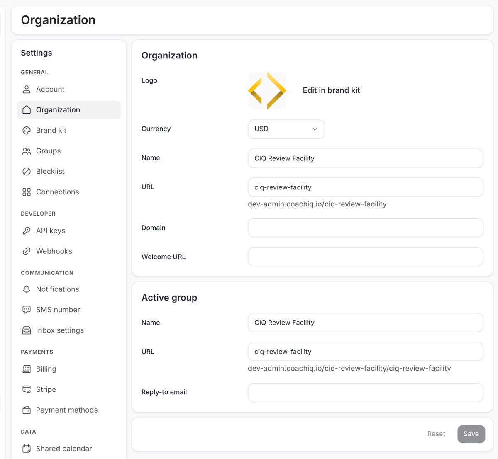

Change your organization's name, your group's name, or the web address (**URL**) of either from **Settings → Organization**. The names show across CoachIQ and on your website. The URLs are part of your admin and app addresses, so changing one breaks links you've already shared.

<Info>
**Where to find this:** **Settings** (bottom of the sidebar) → **Organization**. Admins only.
</Info>

<Steps>
  <Step title="Open Organization settings">
    Click **Settings** at the bottom of the sidebar, then **Organization** in the Settings menu.

    You'll see two editable sections: **Organization** at the top and **Active group** below it.
  </Step>

  <Step title="Update your organization name">
    Under **Organization**, change **Name**.

    The **URL** field below it is your organization's part of the `admin.coachiq.io/` address. It doesn't change when you change the name. Change it only if you also want a new address.

    <Frame>
      
    </Frame>
  </Step>

  <Step title="Update your group name">
    Scroll down to **Active group** and change **Name**.

    The **URL** below it is your group's part of the address (`admin.coachiq.io/your-organization/your-group`). Like the organization URL, it stays as it is unless you change it yourself.

    You can also update the **Reply-to email** field here -- this is the email address replies go to when you send messages from CoachIQ.
  </Step>

  <Step title="Save your changes">
    Click **Save** at the bottom of the page. **Reset** discards changes you haven't saved.
  </Step>
</Steps>

<Warning>
Changing a **URL** changes the addresses that use it, including the address of your app. Links you've already shared with families or put on your website stop working and need updating. Changing only a **Name** keeps your addresses as they are.
</Warning>

## How these names appear on your website

Your website builds its site name from both fields: **Organization name | Group name**. That's the name search engines and link previews (Facebook, iMessage, Slack and so on) can show for your site. For example, an organization called "Elite Skills Academy" with a group called "Athletes" appears as "Elite Skills Academy | Athletes".

If your group name is a generic word like "Athletes", or the same as your organization name, the site name can look odd. Weigh that against the link changes above before renaming.

<AccordionGroup>
  <Accordion title="What's the difference between Organization and Active group?">
    **Organization** is your whole CoachIQ account, with your business name and settings that apply everywhere, such as currency. The logo shown here is managed in the [Brand kit](/website/brand-kit) (choose **Edit in brand kit**).

    **Active group** is the specific group you're currently managing within your organization. You can belong to multiple groups, and each has its own name and URL slug. The Active group section shows the one you're currently operating in.
  </Accordion>

  <Accordion title="Will my athletes lose access if I change the name?">
    No. Accounts and data aren't affected. If you change a **URL**, links you've shared that use the old address (for booking or your app) stop working, so update them afterwards.
  </Accordion>

  <Accordion title="Can I change my URL without changing my name?">
    Yes. The **Name** and **URL** fields are separate. Change either one on its own, then click **Save**.
  </Accordion>
</AccordionGroup>

<CardGroup cols={2}>
  <Card title="Settings overview" href="/settings/index">
    Overview of all settings sections, including billing, notifications, and API keys.
  </Card>
  <Card title="Brand kit" href="/website/brand-kit">
    Upload your logos and set your brand colors.
  </Card>
</CardGroup>
