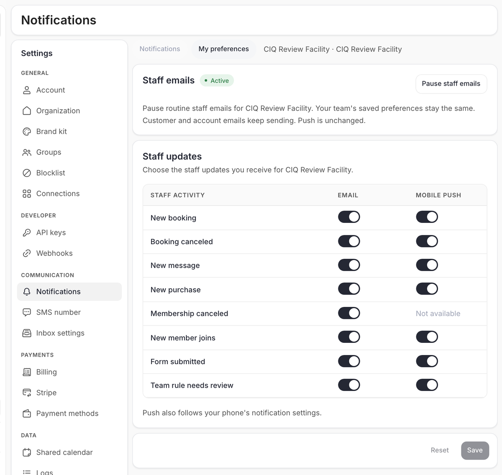

<Info>
**Where to find this**: **Settings → Communication**, which holds **Notifications**, **SMS Number**, and **Inbox Settings**.
</Info>

## Notifications

**Settings → Notifications** has two tabs. **Notifications** lists the messages CoachIQ sends to clients (bookings, messages, purchases and memberships, accounts and staff); choose **View messages** on a row to see them. **My preferences** controls the alerts you and your staff receive by email and mobile push.

### Pause staff emails for your group

As an admin, open **Settings → Notifications → My preferences** in the group you want to manage. The **Staff emails** card shows **Active** or paused. Choose **Pause staff emails** to stop routine staff emails for the group, and use the same card to resume them.

The pause applies to every admin and coach in the selected group, including staff added later. It does not change another group's settings.

Personal **Email** and **Mobile push** preferences remain saved and editable while emails are paused. Resuming staff emails uses those saved preferences. Push preferences are preserved, and customer receipts and invitations remain deliverable, including when a staff member is the buyer or inviter.

Coaches don't see the pause control. Their notification preferences show a one-line status (staff emails active or paused) with a **Delivery details** link, and their own Email and Mobile push choices sit right below it.

Use the personal controls below to change only your own notifications.

<Frame>

  

</Frame>

### Notification categories

**Staff updates** lists each alert you can receive:

| Alert | When it's sent |
|----------|----------|
| **New booking** | A client books a session |
| **Booking canceled** | A booking is canceled |
| **New message** | Your group receives a new message |
| **New purchase** | A client makes a purchase |
| **Membership canceled** | A client cancels a membership (email only) |
| **New member joins** | A new client joins your group |
| **Form submitted** | A form is submitted |
| **Team rule needs review** | A team rule needs your review |

### Identify the session in a booking email

Staff **New reservation** emails include the class or session name in the subject, opening text, and **Session** row. Use that name together with the athlete and time to identify the booking.

Changing an existing session has separate notification choices. See [Which edits send messages](/scheduling/editing-rescheduling-bookings#which-edits-send-messages) before changing a location, duration, or booking time.

### Notification channels

Each category can be toggled independently for:

- **Email**: sent to your account email address
- **Mobile push**: notifications on your phone (if you have the CoachIQ app installed). Push also follows your phone's notification settings.

<Steps>
<Step title="Navigate to Notifications">
Go to **Settings → Notifications** and open the **My preferences** tab.
</Step>

<Step title="Toggle your preferences">
Turn the **Email** and **Mobile push** switches on or off for each alert under **Staff updates**, then click **Save**. **Reset** discards changes you haven't saved.
</Step>
</Steps>

<Tip>
We recommend keeping **New purchase** and **New member joins** on so you're always aware of new revenue and new athletes joining your platform.
</Tip>

---

## Messaging credits

Open **Settings → Communication → Credits** to check your messaging balance, buy credits, manage auto-refill, and review usage. Outbound SMS and coach-written emails share this balance. Email copies of announcements and automation **Send an Email** actions use **0.1 credit per address** at the default rate; automatic notifications such as receipts and booking confirmations remain free.

When the balance runs out, an email or text that needs credits isn't sent. The coach sees a message pointing an Admin to **Settings → Credits**, and the draft stays in the composer so it can be sent once credits are added.

These credits are separate from the session credits athletes use for bookings. See [How messaging credits work](/inbox/sms-credits) for costs and delivery troubleshooting.

---

## SMS Number

Set up your dedicated business phone number for texting athletes through CoachIQ. Texts you send are paid for with SMS credits; see [How SMS credits work](/inbox/sms-credits).

### 10DLC Compliance

CoachIQ uses Twilio for SMS messaging. To send text messages, you'll need to complete 10DLC (10-digit long code) registration, which is required by mobile carriers to reduce spam.

<Steps>
<Step title="Navigate to SMS Number">
Go to **Settings → SMS Number**.
</Step>

<Step title="Select your business type">
Choose whether you're registering as a **Sole Proprietor** or a **Business**.
</Step>

<Step title="Enter your preferred area codes">
Add your primary area code and optionally a secondary area code. CoachIQ will try to assign you a number matching these codes.
</Step>

<Step title="Begin registration">
Click **Begin** to start the 10DLC compliance process.
</Step>
</Steps>

<Info>
The 10DLC registration process typically takes 1-7 business days to complete. Once approved, you'll be able to send SMS messages to your athletes directly from the CoachIQ Inbox.
</Info>

<Note>
**Policy pages are handled for you.** Carriers check a public Privacy Policy and Terms page as part of 10DLC review. CoachIQ auto-generates both on your athlete portal (`/privacy-policy` and `/terms-of-condition` under your portal address), keeps them public, and includes the SMS clauses carriers require. Nothing to write or upload; see [Get your business number](/inbox/sms-messages#get-your-business-number) for what reviewers look at.
</Note>

### After your number is assigned

The page shows your **SMS Number** and lets you set a **Call Forwarding Number**, so calls to your business texting number ring through to a phone you choose. Texts cost SMS credits — see [SMS Credits](/inbox/sms-credits).

---

## Inbox Settings

**Inbox Preferences** has one toggle today: **Show booking reminders in inbox**. It is **off by default**, which keeps the Inbox to conversations athletes started or you started; the reminders are still delivered to athletes, they just do not appear as threads in your Inbox or in the athlete's conversation with you. Turn it on to see the automated session reminders as threads in the **Automated** folder. See [Automated messages](/inbox/inbox-overview#automated-messages) in the Inbox overview.

---

## Common questions

<AccordionGroup>
<Accordion title="How long does SMS setup take?">
The 10DLC compliance registration typically takes 1-7 business days. You'll receive a notification once your number is ready to use.
</Accordion>
</AccordionGroup>

## Related articles

<CardGroup cols={2}>
  <Card title="SMS Messaging" icon="comment-sms" href="/inbox/sms-messages">
    Send text messages to athletes
  </Card>
  <Card title="Inbox Overview" icon="inbox" href="/inbox/inbox-overview">
    Folders, channels, and how messages flow
  </Card>
</CardGroup>
