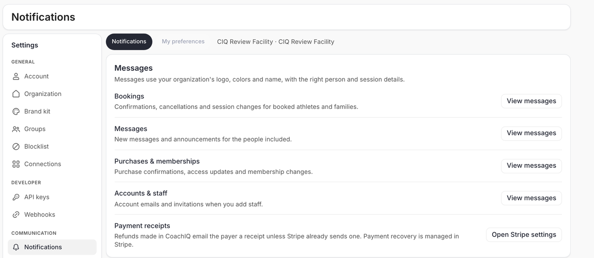

<Info>
**Where to find this**: **Settings → Communication**, which holds **Notifications**, **SMS number** and **Inbox settings**.
</Info>

## Notifications

**Settings → Notifications** has two tabs:

- **Notifications**: the messages CoachIQ sends your clients for you.
- **My preferences**: the alerts you and your staff receive.

### Messages your clients get

The **Notifications** tab lists what CoachIQ sends your clients automatically. Every message uses your organization's logo, colors and name, with the right person and session details filled in.

| Group | What's in it |
|---|---|
| **Bookings** | Confirmations, cancellations and session changes for booked athletes and families |
| **Messages** | New messages and announcements for the people included |
| **Purchases & memberships** | Purchase confirmations, access updates and membership changes |
| **Accounts & staff** | Account emails, and invitations when you add staff |
| **Payment receipts** | Refunds made in CoachIQ email the payer a receipt unless Stripe already sends one. Payment recovery emails are managed in Stripe: click **Open Stripe settings** |

Click **View messages** on a group to see each message in it and when it's sent. For example, **Bookings** lists **Session confirmation**, **Session cancellation**, **Booking payment refunded** and **Session changed**, plus the staff alerts **New booking** and **Booking canceled**. Click **Back to notifications** to return.

<Frame caption="The Notifications tab: the messages your clients get, grouped.">
  
</Frame>

### My preferences

#### Pause staff emails for your group

As an admin, open **Settings → Notifications → My preferences** in the group you want to manage. The **Staff emails** card shows **Active** or paused. Choose **Pause staff emails** to stop routine staff emails for the group, and use the same card to resume them.

The pause applies to every admin and coach in the selected group, including staff added later. It does not change another group's settings.

Personal **Email** and **Mobile push** preferences remain saved and editable while emails are paused. Resuming staff emails uses those saved preferences. Push preferences are preserved, and customer receipts and invitations remain deliverable, including when a staff member is the buyer or inviter.

Coaches don't see the pause control. Their notification preferences show a one-line status (staff emails active or paused) with a **Delivery details** link, and their own Email and Mobile push choices sit right below it.

Use the personal controls below to change only your own notifications.

<Frame>

  

</Frame>

#### Staff updates

**Staff updates** lists each alert you can receive. **Membership canceled** is email only.

| Alert | When it's sent |
|----------|----------|
| **New booking** | A client books a session |
| **Booking canceled** | A booking is canceled |
| **New message** | Your group receives a new message |
| **New purchase** | A client makes a purchase |
| **Membership canceled** | A client cancels a membership (email only) |
| **New member joins** | A new client joins your group |
| **Form submitted** | A form is submitted |
| **Team rule needs review** | A team rule needs your review |

#### Identify the session in a booking email

Staff **New reservation** emails include the class or session name in the subject, opening text, and **Session** row. Use that name together with the athlete and time to identify the booking.

Changing an existing session has separate notification choices. See [Which edits send messages](/scheduling/editing-rescheduling-bookings#which-edits-send-messages) before changing a location, duration, or booking time.

#### Email and mobile push

Each category can be toggled independently for:

- **Email**: sent to your account email address
- **Mobile push**: notifications on your phone (if you have the CoachIQ app installed). Push also follows your phone's notification settings.

<Steps>
<Step title="Navigate to Notifications">
Go to **Settings → Notifications** and open the **My preferences** tab.
</Step>

<Step title="Toggle your preferences">
Turn the **Email** and **Mobile push** switches on or off for each alert under **Staff updates**, then click **Save**. **Reset** discards changes you haven't saved.
</Step>
</Steps>

<Tip>
We recommend keeping **New purchase** and **New member joins** on so you're always aware of new revenue and new athletes joining your platform.
</Tip>

---

## Messaging credits

Texts and the emails you write in CoachIQ use your organization's messaging credits. Automatic notifications, such as receipts and booking confirmations, are free. See [How messaging credits work](/inbox/sms-credits) for what each send costs and what happens when the balance runs out.

The **Credits** page, where you see your balance and buy more, isn't in the Settings menu for every organization yet. If you don't see it and a send is refused for credits, contact CoachIQ support from **Help** in the sidebar.

Only Admins can buy credits.

These credits are separate from the session credits athletes use for bookings.

---

## SMS number

Set up your dedicated business phone number for texting athletes through CoachIQ. Texts you send are paid for with SMS credits; see [How SMS credits work](/inbox/sms-credits).

### 10DLC Compliance

CoachIQ uses Twilio for SMS messaging. To send text messages, you'll need to complete 10DLC (10-digit long code) registration, which is required by mobile carriers to reduce spam.

<Steps>
<Step title="Open SMS number">
Go to **Settings → SMS number**.
</Step>

<Step title="Select your business type">
Under **10DLC Compliance**, choose whether you're registering as a **Sole Proprietor** or a **Business**.
</Step>

<Step title="Enter your preferred area codes">
Under **Preferred Area Codes**, add your primary area code and, if you like, a second one. CoachIQ will try to assign you a number matching these codes.
</Step>

<Step title="Begin registration">
Click **Begin** to start the 10DLC compliance process.
</Step>
</Steps>

<Info>
The 10DLC registration process typically takes 1-7 business days to complete. Once approved, you'll be able to send SMS messages to your athletes directly from the CoachIQ Inbox.
</Info>

<Note>
**Policy pages are handled for you.** Carriers check a public Privacy Policy and Terms page as part of 10DLC review. CoachIQ auto-generates both in your app (`/privacy-policy` and `/terms-of-condition` under your app address), keeps them public, and includes the SMS clauses carriers require. Nothing to write or upload; see [Get your business number](/inbox/sms-messages#get-your-business-number) for what reviewers look at.
</Note>

### After your number is assigned

The page shows your **SMS Number** and lets you set a **Call Forwarding Number**, so calls to your business texting number ring through to a phone you choose. Texts cost SMS credits — see [SMS Credits](/inbox/sms-credits).

---

## Inbox settings

**Settings → Inbox settings** has three parts:

- **Reminders**: **Booking reminders** shows the automatic session reminders in your Inbox. It's off by default; the reminders still reach your clients either way. See [Automated messages](/inbox/inbox-overview#automated-messages).
- **Email replies**: a **Signature** added to the end of every email reply and forward. Click **Save** after changing it. **Replies land in the Inbox** reads **Not available yet** while CoachIQ finishes setting up email for clubs.
- **Can't get email**: the people your club's emails skip because their address bounced, they reported spam or they unsubscribed. Receipts and account emails still reach them. See [People who can't get your email](/inbox/email#people-who-cant-get-your-email).

---

## Common questions

<AccordionGroup>
<Accordion title="How long does SMS setup take?">
The 10DLC compliance registration typically takes 1-7 business days. You'll receive a notification once your number is ready to use.
</Accordion>
</AccordionGroup>

## Related articles

<CardGroup cols={2}>
  <Card title="SMS Messaging" icon="comment-sms" href="/inbox/sms-messages">
    Send text messages to athletes
  </Card>
  <Card title="Inbox Overview" icon="inbox" href="/inbox/inbox-overview">
    Folders, channels, and how messages flow
  </Card>
</CardGroup>
