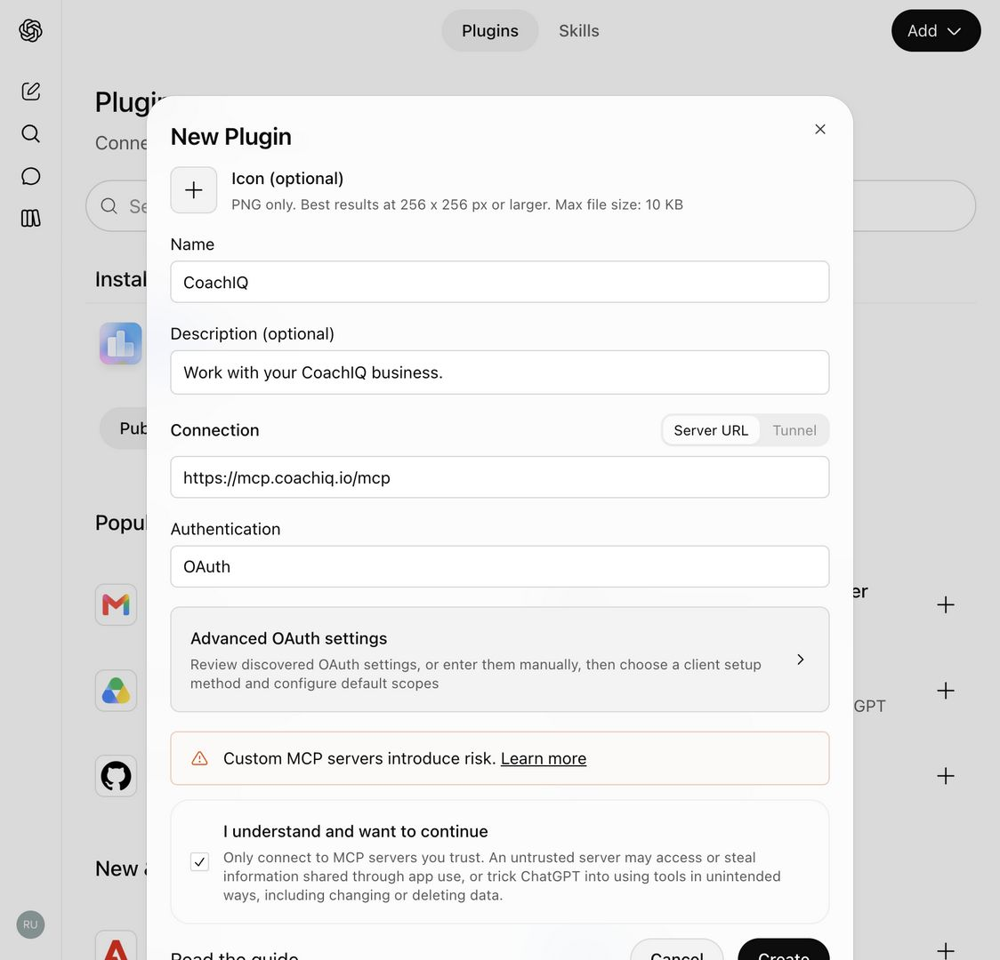
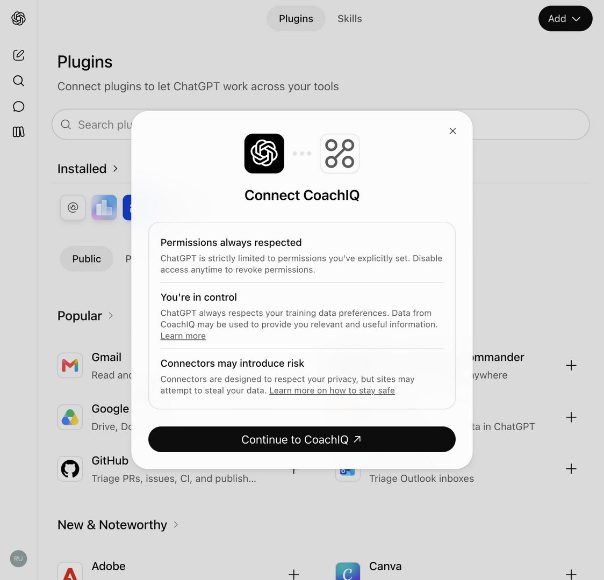

Connect ChatGPT to CoachIQ, confirm it works, then use one setup prompt to create a personal Project around your business and the way you work.

<Tip>
  **Already connected?** [Confirm the connection](#2-confirm-the-connection), then [paste the Project setup prompt](#3-set-up-your-personal-project). You can skip the initial connection steps.
</Tip>

<Note>
  Start on **ChatGPT in a desktop web browser**. The connection is added through ChatGPT's app/plugin setup, followed by CoachIQ authorization. The setup prompt later in this guide helps build your business context; it does not replace those account setup steps.
</Note>

## Before you begin

Have your CoachIQ staff login ready and choose the group this connection should use. ChatGPT's current developer-mode documentation lists Plus, Pro, Business, Enterprise, and Education web accounts. Managed workspaces may also require administrator access or approval. Check your account's available controls before purchasing or changing a plan. [ChatGPT developer mode](https://developers.openai.com/api/docs/guides/developer-mode).

CoachIQ's MCP server address is:

```text wrap
https://mcp.coachiq.io/mcp
```

Use **OAuth** for sign-in. You do not need to paste a CoachIQ API key into ChatGPT.

## 1. Connect CoachIQ

Open [ChatGPT Plugins](https://chatgpt.com/plugins), choose **Add → Create MCP App**, and enter these details. If your account uses the developer-mode app interface instead, follow [OpenAI's developer-mode setup](https://developers.openai.com/api/docs/guides/developer-mode) to enable that interface first. You do not need to look for a developer-mode switch when **Create MCP App** is already available.

| Field | Enter |
| --- | --- |
| Name | CoachIQ |
| MCP server URL | `https://mcp.coachiq.io/mcp` |
| Authentication | OAuth |
| OAuth registration, if asked | Automatic/dynamic registration; no custom client ID or secret |

<Frame caption="Create the CoachIQ plugin with the hosted MCP URL and OAuth. Review ChatGPT's connection notice before continuing.">
  
</Frame>

Complete the connection details. If it appears in your personal plugins but is not installed, open it and use its install control. OpenAI's current walkthrough shows installing the personal plugin and using it in a new **Work** chat. [Official connection walkthrough](https://developers.openai.com/plugins/quickstart).

<Frame caption="Continue to CoachIQ opens the separate sign-in and group-approval step. The plugin is not authenticated until that flow is complete.">
  
</Frame>

### Choose your group and access

Sign in through the CoachIQ page that opens. Confirm the organization, group, and role before approving access.

The approval screen shows who is connecting, which group, which app, what access, and where it returns. The group ID and connection address are tucked under **Technical details** if you need them. If you change your mind, choose **Cancel** on the sign-in, group choice or approval screen. The app is told you declined, even when the screen opened in a new tab or popup, and no access is granted.

A CoachIQ connection covers **one group**. To work with another group, use a separately named connection authorized for that group. Project names do not change the group a connector can reach.

If you want supported changes, select **I allow this assistant to make supported changes in this group** on the CoachIQ approval screen. Leaving it unchecked grants read-only access. Read the final access summary and button before continuing.

<Info>
  Verify the access actually granted in the next step. A connected badge does not prove write access, and approval does not make every CoachIQ feature available through ChatGPT. Read-only access is enough for the business-brief setup below.
</Info>

ChatGPT shows you each change before it runs, and nothing is saved until you approve it. Everything it changes is listed in **Settings → General → Connections → App activity**, where you can review or undo a session's work. See [Approvals, activity and limits](/settings/ai-approvals-and-activity) and [What your connected assistant can do](/settings/ai-what-it-can-do).

## 2. Confirm the connection

Start a new chat and select CoachIQ. The current developer-mode route uses the composer **+ → Developer mode** app selection. In **ChatGPT Work**, you can invoke an installed plugin with **@CoachIQ**. Use the controls available in your account; if CoachIQ is missing, return to its installation and workspace settings. [Using developer-mode apps](https://developers.openai.com/api/docs/guides/developer-mode).

Ask ChatGPT to check the connection:

> “Check my CoachIQ connection with a small live read. Confirm my business, group, and whether you can read only or make supported changes. Don’t change anything.”

Once it confirms the correct business and a successful live read, continue below. If it cannot access CoachIQ, use the troubleshooting steps at the end of this guide.

## 3. Set up your personal Project

Once CoachIQ is connected, **copy and paste this prompt into the connected chat**. It will help ChatGPT learn your business through MCP, consult [help.coachiq.io](https://help.coachiq.io), and prepare a Project tailored to how you work.

```text wrap
I'm a CoachIQ customer. Help me set up a private Project that understands my business and how I work.

First, use my connected CoachIQ MCP for a small live read. Confirm my business, group, and available access. If it isn't connected, guide me through the appropriate guide at https://help.coachiq.io/getting-started/use-coachiq-with-ai before continuing.

Read https://help.coachiq.io/llms.txt to find the relevant CoachIQ guides, then read those pages to understand how the features work. Use the available MCP tools to learn about my services, coaches, locations, scheduling, and products. Keep this focused; don't pull my entire client list or message history. Tell me if you can't access a source.

Ask up to three questions about my goals and working preferences. Then prepare a concise Business Brief, five useful requests tailored to me, and ready-to-paste Project Instructions.

The instructions should use the Help Center for feature guidance and the MCP for current business facts and supported actions. Stay within the connected group, ask before making changes or sending messages, and verify results. Keep private client details out of saved context. Only read data during this setup.

Suggest a Project name and help me save the brief and instructions. If you can save them directly, do so; otherwise give me the finished content and exact steps. Finish by checking that a new Project chat can use both the saved context and the live CoachIQ connection.
```

Answer its questions, then follow its directions to save your Project. It prepares the content for you; you may need to create the Project and paste or upload that content yourself.

### Save your Project

1. Create a private ChatGPT Project using the suggested name.
2. Paste the generated instructions into the Project's instructions and add the Business Brief to **Sources**.
3. Open a new chat inside the Project and select CoachIQ.

[More about ChatGPT Projects](https://learn.chatgpt.com/docs/projects).

In that new chat, ask it to summarize your priorities from the saved brief and check your CoachIQ connection. You're ready when it can use both your saved context and live business information.

If CoachIQ is unavailable in your Project's current chat mode, use a supported connected chat until you can verify live access in the Project.

### Start using it

Try one of the five requests in your Business Brief, or ask: **“What can you help me with in CoachIQ this week, based on my goals?”**

Use the same Project for ongoing work. The Help Center explains features; the MCP provides current business information and supported actions. Review proposed changes before approving them, and update your brief when your goals change.

<Tip>
  Keep each request focused on one outcome. Your assistant's usage limits are separate from CoachIQ, and actions such as SMS can use [messaging credits](/inbox/sms-credits).
</Tip>

## Troubleshooting

<AccordionGroup>
  <Accordion title="CoachIQ says No eligible groups">
    Check the CoachIQ account shown on the approval page. MCP requires an **accepted Admin or Coach membership** in the intended group. An invitation that has not been accepted, a parent/athlete account, or access to a different group does not qualify. Sign in with the correct staff account, or ask your group administrator to check your membership, then retry the connection.
  </Accordion>
  <Accordion title="I cannot find Developer mode or add a custom connection">
    Check that you are using ChatGPT on the web, in the correct account and workspace. Review its current eligibility and workspace controls. A workspace administrator may need to allow or configure the connection. The official instructions above are the reference for menus that differ from your account.
  </Accordion>
  <Accordion title="The prompt says CoachIQ is not available">
    Finish adding and installing the connection, then select it in the current chat. If you are using Work, try invoking the installed CoachIQ plugin with @. The prompt cannot substitute for sign-in or tool selection.
  </Accordion>
  <Accordion title="ChatGPT asks me to reconnect, or Connect CoachIQ shows an error">
    ChatGPT asks you to approve CoachIQ again about once a month. Choose **Reconnect** when it asks, sign in to CoachIQ and approve, and the connection keeps working. If CoachIQ can't accept the request, it opens a page with the steps to reconnect. If reconnecting still fails, remove CoachIQ from ChatGPT's app settings and add it again with the steps above, then start a new chat.
  </Accordion>
  <Accordion title="I approved changes, but ChatGPT still says read-only or has no change tool">
    First check that the connection really allows changes: ask ChatGPT to check its live access, or look for **Can make changes** next to ChatGPT under **Connected apps** in **Settings → General → Connections**. If it's read only, reconnect and tick the changes option. If the approval page shows no changes option, remove CoachIQ from ChatGPT and add it again.

    If the connection allows changes but ChatGPT says it has no tool to make them, it's using the tool list it saved while the connection was read only. Refresh the CoachIQ app in ChatGPT's app settings, or disconnect and connect it again, then **start a new chat**. An open chat keeps the tools it started with. In a ChatGPT Business or Enterprise workspace, an admin may need to refresh the app and allow its changes.
  </Accordion>
  <Accordion title="A browser error appears at the MCP URL">
    Enter the full address in the MCP connection form, not as an ordinary webpage or a link for ChatGPT to browse. CoachIQ uses the authorization flow to grant access; opening the address directly is not a connection test.
  </Accordion>
  <Accordion title="I see the wrong business or group">
    Stop before approving a change. Use a connection authorized for the intended group and verify it again. Keep separate business briefs for separate groups.
  </Accordion>
  <Accordion title="My new Project chat cannot access CoachIQ">
    Check the selected app/plugin and chat mode in that new conversation. Project files can provide context even when live tools are unavailable; ask the assistant to distinguish the two. Check saved context and live access in the new chat before relying on live operations from the Project.
  </Accordion>
  <Accordion title="The assistant proposed a change, but CoachIQ did not update">
    A proposal is not a completed write. Check whether you approved the tool action and whether it returned success. If the outcome is unclear, inspect the original record before retrying to avoid duplicate work.
  </Accordion>
</AccordionGroup>

To stop using the connection, choose **Disconnect** next to ChatGPT under **Connected apps** in **Settings → General → Connections**, or remove CoachIQ from ChatGPT's app settings. [More about disconnecting](/settings/ai-approvals-and-activity#see-and-disconnect-your-connected-apps). Files and conversations you saved in ChatGPT stay there until you delete them.

## Put the connection to work

Use [AI workflows](/settings/ai-workflows) for prompts to check availability, change a booking, message a group, update website text and organize media, each with a step to check the result. [What your connected assistant can do](/settings/ai-what-it-can-do) lists every supported change.

## Related guides

- [Use CoachIQ with AI](/getting-started/use-coachiq-with-ai)
- [What your connected assistant can do](/settings/ai-what-it-can-do)
- [Approvals, activity and limits](/settings/ai-approvals-and-activity)
- [Manage your connections](/settings/connections)
- [Connect CoachIQ to Claude](/settings/connect-claude)
- [Messaging credits](/inbox/sms-credits)
