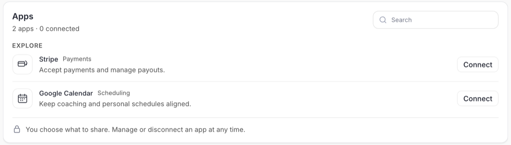

Open **Settings → General → Connections**. The **Apps** card lists the apps you can connect, with a count of how many are connected, and **Search** finds an app by name. Connected apps appear first; the rest are under **Explore**.

<Frame caption="Settings → General → Connections, before anything is connected.">
  
</Frame>

| Connection | What you can do |
| --- | --- |
| Stripe | Accept payments and manage payouts. Choose **Connect** to set it up, or **Manage** once it's connected. Only an Admin can connect or disconnect it. See [Stripe settings](/payments/connecting-stripe). |
| Google Calendar | Keep coaching and personal schedules aligned. Link a Google account and add more. You remove access from your Google account's permissions, not from CoachIQ. See [Google Calendar sync](/scheduling/google-calendar-sync). |

A card or button alone doesn't confirm a connection. Finish the service's sign-in and approval, then check its status here.

## Connect ChatGPT or Claude

ChatGPT and Claude aren't in the Apps list. You start the connection in the assistant, then sign in to CoachIQ when its approval page opens. Any Admin or Coach can connect their own assistant. The guides live in the Help Center's **AI** section, starting with [Use CoachIQ with ChatGPT or Claude](/getting-started/use-coachiq-with-ai).

<CardGroup cols={2}>
  <Card title="Connect to ChatGPT" icon="plug" href="/settings/connect-chatgpt">
    Add CoachIQ in ChatGPT, approve access, and set up a Project for your business.
  </Card>
  <Card title="Connect to Claude" icon="plug" href="/settings/connect-claude">
    Add the CoachIQ connector in Claude, approve access, and set up a Project.
  </Card>
</CardGroup>

The CoachIQ approval page shows who is connecting, which group, which app and what access, with IDs and addresses under **Technical details**. Leave **I allow this assistant to make supported changes in this group** unticked for read-only access. **Cancel** tells the app you declined and grants nothing.

## See what your AI apps did

Once you've connected an assistant, two more parts appear on this page:

- **Connected apps** lists each AI app you approved for this group, whether it's **Read only** or **Can make changes**, when you approved it and last used it, and when it needs approving again. **Disconnect** ends its access. Each staff member sees only their own apps.
- **App activity** appears once an app has changed something. **Review** lists what it did in each session, approves or declines removals waiting for you, and puts back removed items for 30 days. **Undo this session** takes a session's changes back.

[Approvals, activity and limits](/settings/ai-approvals-and-activity) explains each of these. [What ChatGPT and Claude can do](/settings/ai-what-it-can-do) lists every supported change, and [AI workflows](/settings/ai-workflows) has prompts to get started.
