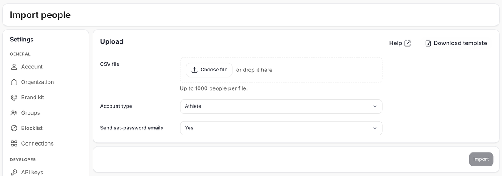

<Info>
**Where to find this**: **Settings → Data**, which holds **Shared calendar**, **Logs**, **Import people** and **Import bookings**.
</Info>

## Shared calendar

If your organization runs more than one group out of the same facility, organization owners can link two groups' calendars so a booking in one blocks that same time slot in the other — no more double-booked cages or rooms.

Under **Linked groups**, pick the groups to link, then choose what crosses between their calendars: **all busy time**, or **resources only**, which gives both groups one shared resource list: add each court, cage, field, or room once, and a booking in either group blocks that resource for the other. Busy time without a resource stays private.

<Note>
Only an organization owner can update this setting.
</Note>

For the full walkthrough, see [Share a Calendar Across Two Groups](/scheduling/shared-calendar-across-groups).

---

## Logs

**Settings → Logs** shows what happened in your account over the last 30 days: who did what, from which device, and when. Times are shown in your time zone (for example, **times in PT**).

| Column | What it shows |
|--------|-------------|
| **Action** | What happened, with the area it belongs to underneath (for example, **Integrations**) |
| **Person** | The email of the person who did it |
| **Device** | Operating system and device type |
| **IP** | The internet address it came from |
| **Time** | When it happened |

Use **All roles** above the list to show only **Admin**, **Coach**, **Parent** or **Athlete** activity. Long names wrap instead of being cut off, and rows don't repeat as you scroll back through older pages.

### Changes from connected AI assistants

When someone uses a connected AI assistant such as ChatGPT or Claude, its activity is logged under the staff member who approved it, with the app's name. Two labels help you read those rows:

| Label | What it means |
|--------|-------------|
| **Outside app** | The change came through an outside app such as Claude or ChatGPT, not CoachIQ's own Assistant. Outside apps name themselves, and CoachIQ doesn't verify those names. |
| **Refused** (red) | CoachIQ refused the request, so nothing changed. Changes that went through show no label. |

Some attempts never reach CoachIQ, so they leave no line in Logs. That happens when CoachIQ's Assistant declines a request on its own (for example, an admin-only change asked for by a coach), or when a connected app stops an attempt itself because the approval didn't match the preview or your role can't use that action. A connected assistant reports times with the year and time zone, so they match what you see in Logs. For what an app changed in a session, and how to undo it, see [Approvals, activity and limits](/settings/ai-approvals-and-activity).

<Note>
Logs keep **30 days**. If you need records for longer, copy what you need before it ages out.
</Note>

---

## Import people

Bring clients over from a spreadsheet or another system in one go.

<Frame caption="Settings → Import people.">
  
</Frame>

<Steps>
<Step title="Download the template">
Go to **Settings → Import people** and click **Download template**. The file has the columns **Email**, **Phone**, **First Name**, **Last Name** and **Tags (comma separated)**.
</Step>

<Step title="Fill it in">
Add one row per person. **Email is required on every row**; rows without one aren't imported. Put several tags in one cell, separated by commas. A file can hold up to 1,000 people; split a bigger list into several files.
</Step>

<Step title="Upload it">
Under **CSV file**, click **Choose file** or drop the file on the box.
</Step>

<Step title="Choose the account type and emails">
**Account type** is the role everyone in this file gets, such as **Athlete**. Import each role as its own file.

**Send set-password emails** is **Yes** by default: each new person gets an email with a link to set a password and sign in. Choose **No** to import quietly, for example while you set up your products, and invite people later.
</Step>

<Step title="Import">
Click **Import**.
</Step>
</Steps>

**Someone with that email already has a CoachIQ account?** They aren't duplicated. Their existing account is added to your group, and importing the same file twice doesn't create copies.

**Imported with No?** Send the set-password email later from each client's profile: the **Sign-in** section shows **Has not set a password yet** with **Send set-password email**. See [Add and edit clients](/people/adding-editing-clients).

Click **Help** at the top of the page for more on formatting the file.

---

## Import bookings

Move existing bookings over from another platform.

<Steps>
<Step title="Download the template">
Go to **Settings → Import bookings** and click **Download template**. The columns are **Email**, **Phone**, **First Name**, **Last Name**, **Session Title**, **Start Date/Time** and **End Date/Time**.
</Step>

<Step title="Fill it in">
Add one row per booking. **Session Title** must match the session in CoachIQ. A file can hold up to 1,000 bookings.

<Warning>
Leave time zones out of the dates (no PST, EST and so on). CoachIQ uses the scheduler's time zone.
</Warning>
</Step>

<Step title="Upload and import">
Under **CSV file**, click **Choose file** or drop the file. Choose whether to **Send set-password emails** to people the import adds, then click **Import**.
</Step>
</Steps>

### What happens to each row

- **The person is already in your group:** they're booked.
- **The person isn't in your group yet:** they're added to your group first, the same way Import people adds them, then booked.
- Every booked row reads **Booking created**.
- **The person can't be added**, for example when a Coach imports someone who isn't in the group: the row says **This person could not be added. An Admin can add them to the group first.** Nothing is booked for that row.
- A session that has no scheduler of its own is booked under your group's default scheduler.
- If the file can't be read, you're told before anything is imported, and incomplete rows are skipped.

---

## Related articles

<CardGroup cols={2}>
  <Card title="Add and edit clients" icon="user-plus" href="/people/adding-editing-clients">
    Add clients one at a time
  </Card>
  <Card title="Share a Calendar Across Two Groups" icon="calendar-days" href="/scheduling/shared-calendar-across-groups">
    The full shared-calendar setup
  </Card>
</CardGroup>
