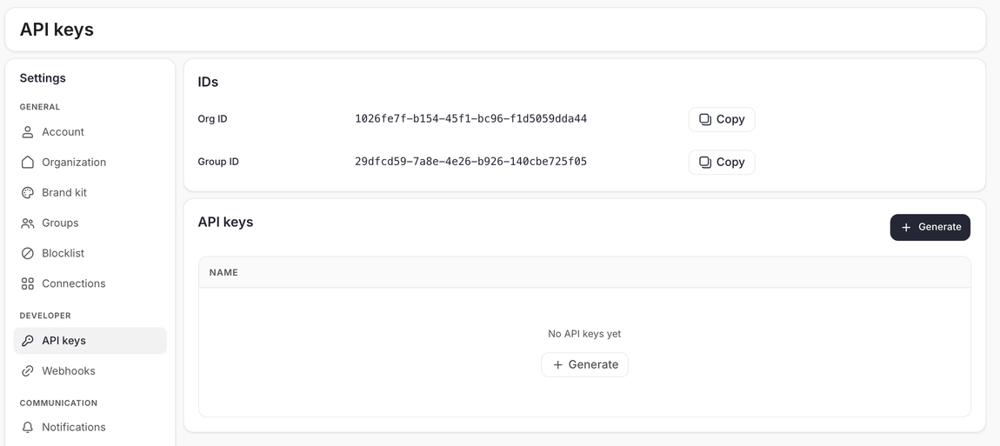
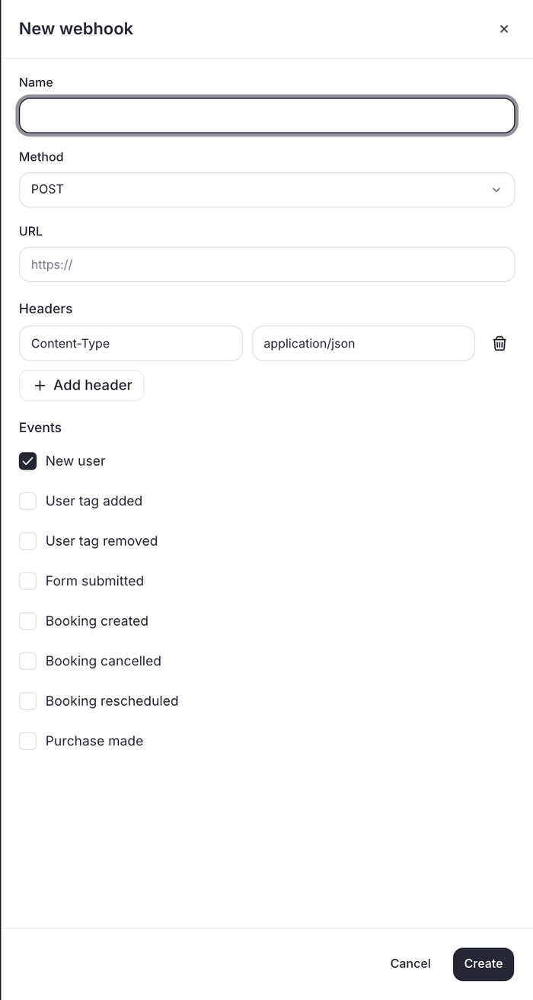

<Info>
**Where to find this**: **Settings → Developer**, which holds **API keys** and **Webhooks**.
</Info>

You only need this page to connect CoachIQ to another tool, such as Zapier, or to send events to your own system. To connect ChatGPT or Claude, use [Connections](/settings/connections) instead; they don't need an API key.

## API keys

<Frame caption="Settings → API keys, with your IDs at the top and your keys below.">
  
</Frame>

### Your IDs

The **IDs** card shows your **Org ID** (your whole organization) and **Group ID** (the group you're in now). Click **Copy** next to either one. Most tools ask for the Group ID.

### Generate a key

<Steps>
<Step title="Open API keys">
Go to **Settings → API keys**.
</Step>
<Step title="Generate">
Click **Generate**. CoachIQ asks **Generate a new API key?** Click **Generate key**.
</Step>
<Step title="Store it">
The new key appears in the list. Copy it from its row into the tool you're connecting, such as Zapier; you can copy it again later. Treat it like a password: anyone with the key can reach your CoachIQ data. Each group can have up to 10 keys.
</Step>
</Steps>

Your keys are listed by **Name**. Use a key's actions to remove it when you stop using that tool or think it has leaked; anything using it stops working.

<Tip>
Connecting to Zapier? Follow [Zapier Integration](/tools/automations/zapier-integration) for the full steps.
</Tip>

---

## Webhooks

A webhook sends the details of an event, such as a new booking, to a web address you choose the moment it happens. Use it to connect CoachIQ to your own systems or tools that Zapier doesn't cover.

### Creating a webhook

<Steps>
<Step title="Open Webhooks">
Go to **Settings → Webhooks** and click **Add**.
</Step>
<Step title="Fill in the details">

| Field | What to enter |
|-------|-------------|
| **Name** | A name you'll recognize, such as "Bookings to our CRM" |
| **Method** | **POST** (usual) or **GET** |
| **URL** | The address that receives the event, starting with `https://` |
| **Headers** | Optional. **Content-Type: application/json** is filled in; use **Add header** for others, such as a secret your system checks |

</Step>
<Step title="Choose the events">
Tick each event that should send to this URL: **New user**, **User tag added**, **User tag removed**, **Form submitted**, **Booking created**, **Booking cancelled**, **Booking rescheduled** and **Purchase made**.
</Step>
<Step title="Create">
Click **Create**. The webhook appears in the list with its **Name**, **URL** and **Method**.
</Step>
</Steps>

<Frame caption="The New webhook window.">
  
</Frame>

<Note>
Webhooks are for developers or a system you already run. For everyday follow-ups, such as a message after a booking, use [Automations](/tools/automations/what-are-automations) instead.
</Note>

---

## Common questions

<AccordionGroup>
<Accordion title="What's the difference between Org ID and Group ID?">
Your **Org ID** identifies your whole CoachIQ organization. Your **Group ID** identifies one group inside it. Most integrations need the Group ID. If you run several groups, switch to the right one first.
</Accordion>
</AccordionGroup>

## Related articles

<CardGroup cols={2}>
  <Card title="Zapier Integration" icon="bolt" href="/tools/automations/zapier-integration">
    Connect CoachIQ to 5,000+ apps
  </Card>
  <Card title="Zapier troubleshooting" icon="bug" href="/tools/automations/zapier-troubleshooting">
    Every Zapier error message explained
  </Card>
  <Card title="Automations" icon="wand-magic-sparkles" href="/tools/automations/what-are-automations">
    Automated follow-ups without webhooks
  </Card>
</CardGroup>
