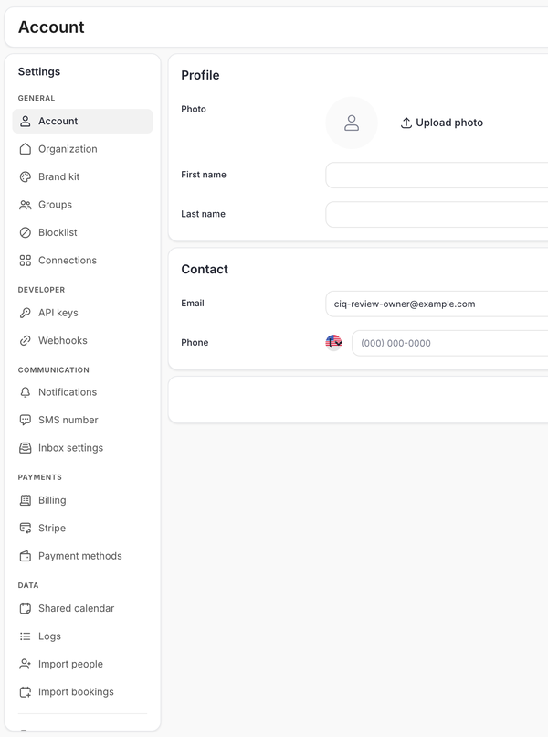

<Info>
**Where to find this**: click **Settings** at the bottom of the sidebar.
</Info>

Settings opens with its own menu on the left, in five groups. This Help Center follows the same groups. Most of Settings is for Admins; your own profile and notification preferences are yours to change whatever your role.

<Frame caption="The Settings menu, open on Account.">
  
</Frame>

## Settings at a glance

<CardGroup cols={2}>
  <Card title="General" icon="user-gear" href="/settings/general">
    **Account · Organization · Brand kit · Groups · Blocklist · Connections**: your profile, business name and currency, logos and colors, switching groups, blocking someone, connected apps
  </Card>
  <Card title="Developer" icon="code" href="/settings/developer">
    **API keys · Webhooks**: your Org ID and Group ID, keys for Zapier, sending events to another system
  </Card>
  <Card title="Communication" icon="bell" href="/settings/communication">
    **Notifications · SMS number · Inbox settings**: the messages clients get, your own alerts, your business texting number, Inbox reminders and signature
  </Card>
  <Card title="Payments" icon="credit-card" href="/settings/billing">
    **Billing · Stripe · Payment methods**: your CoachIQ plan and card, the Stripe account your clients pay into, what clients can pay with
  </Card>
  <Card title="Data" icon="database" href="/settings/data">
    **Shared calendar · Logs · Import people · Import bookings**: share busy time between groups, see who did what, bring clients and bookings over from a spreadsheet
  </Card>
  <Card title="Rename your organization or group" icon="pen" href="/settings/change-organization-group-name">
    Change a name or web address safely, and know which links change
  </Card>
</CardGroup>

**Log out** is at the bottom of the Settings menu.

## Where each setting is

| I want to… | Go to |
|---|---|
| Change my name, email, phone or photo | [Settings → Account](/settings/general#account) |
| Change the business name, currency or reply-to email | [Settings → Organization](/settings/general#organization) |
| Upload my logo or set brand colors | [Settings → Brand kit](/website/brand-kit) |
| Switch to another group I work in | [Settings → Groups](/settings/general#groups) |
| Block someone from my group | [Settings → Blocklist](/settings/general#blocklist) |
| Connect Stripe, Google Calendar, ChatGPT or Claude | [Settings → Connections](/settings/connections) |
| Get an API key for Zapier | [Settings → API keys](/settings/developer#api-keys) |
| Choose which emails and push alerts I get | [Settings → Notifications](/settings/communication#my-preferences) |
| Get a business texting number | [Settings → SMS number](/settings/communication#sms-number) |
| Update the card that pays for CoachIQ | [Settings → Billing](/settings/billing) |
| Connect or check Stripe | [Settings → Stripe](/payments/connecting-stripe) |
| Turn on Link or bank payments at checkout | [Settings → Payment methods](/settings/payment-methods) |
| Stop double bookings between two groups | [Settings → Shared calendar](/settings/data#shared-calendar) |
| See who changed something | [Settings → Logs](/settings/data#logs) |
| Move clients or bookings over from another system | [Settings → Import people / Import bookings](/settings/data#import-people) |

## Not in Settings

- **Your staff and what they can see** are under **People → Staff**. See [Add and manage staff](/people/managing-staff) and [Staff access](/people/staff-access).
- **What families fill in when they sign up** is under **People → Sign-up & Profile**. See [Sign-up and profile](/people/sign-up-and-profile).
- **Your products and prices** are under **Payments → Products**. See [Products](/payments/product-overview).
- **Services from the CoachIQ team**, such as a branded app, are in [Power Ups](/power-ups/index).
