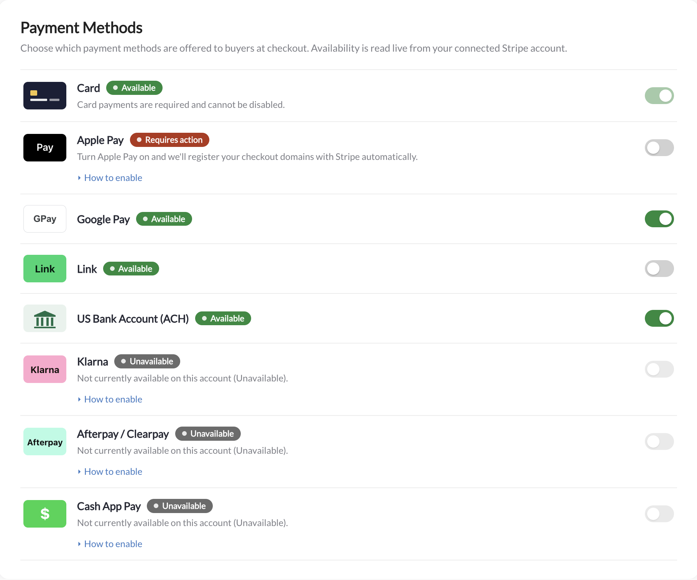

Admins can open **Settings → Payment methods**, in the **Payments** group of the Settings menu, to choose what your clients can pay with at checkout.

<Frame>

</Frame>

## Read the status before changing a method

| What you see | What it means |
| --- | --- |
| Available | Stripe supports the method for this account. Check the switch to see whether you have enabled it. |
| Requires action | Read **How to enable** and complete the displayed setup before relying on the method. |
| Unavailable | The account cannot currently use the method; its switch is disabled. |

For bank (ACH) payments, **How to enable** explains what to expect: a bank payment takes 3–5 business days to clear, shows as **Processing** in the meantime, and is complete only once it reaches **Succeeded**.

For example, **Link** is available but switched off in the screenshot. Card is required and cannot be switched off. Your account's available methods can differ from this example.

If you see **Connect Stripe to set up payment methods**, the switches stay locked until a Stripe account is connected. Click **Open Stripe settings** and connect it first; see [Connect Stripe](/payments/connecting-stripe).

## Change an available method

1. Open Payment Methods in the correct organization.
2. Enable or disable an available optional method, such as Link.
3. Reopen the page to confirm your choice remains saved.

Required card payments and methods that are unavailable for your setup cannot be disabled or enabled arbitrarily. The available controls reflect your payment configuration.

This page controls what clients can use at checkout. It does not change the card that pays your business's CoachIQ subscription. To replace that card, use [Billing](/settings/billing#update-your-card-on-file).
