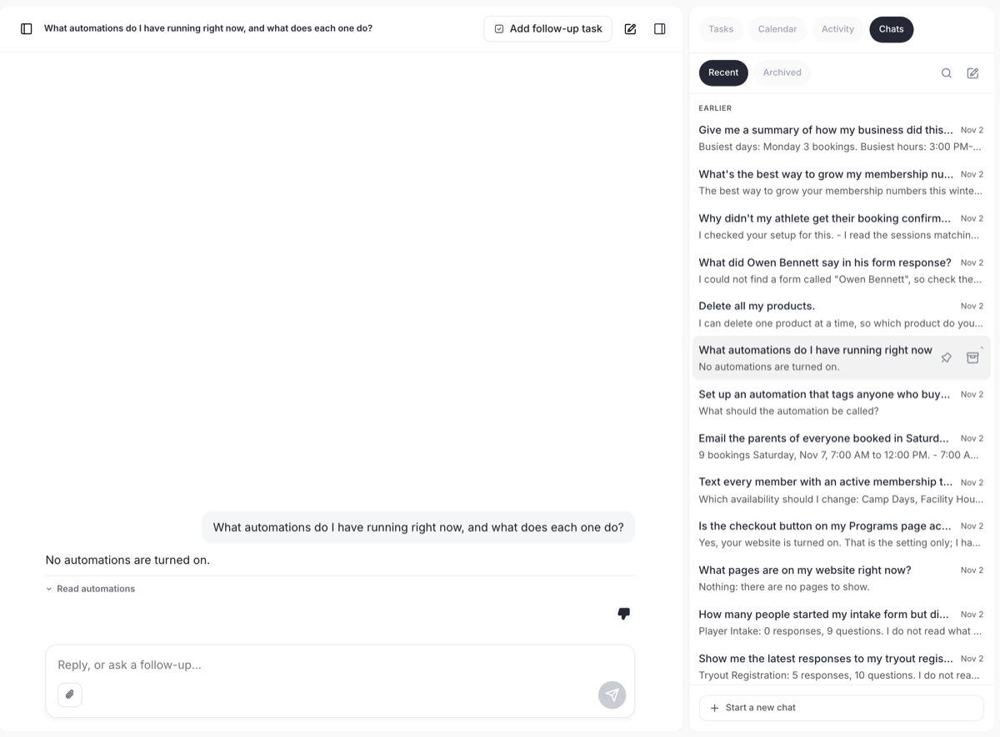

<Info>
  **Where to find this**: **Tools → Assistant**. In clubs with the new [Home](/home/overview), which is turning on club by club, the Assistant is in the centre of Home instead.
</Info>

This page covers the Assistant built into CoachIQ. For ChatGPT or Claude connected to your account, see [Use CoachIQ with ChatGPT or Claude](/getting-started/use-coachiq-with-ai).

The Assistant is a chat built into CoachIQ. Ask it a question about your business and it answers from your own records: your schedule, clients, credits, payments, forms, programs and website. Tell it to change something and it prepares the change as a card. **Nothing saves until you approve the card.**

The Assistant is for your staff. Families never see it. It used to be called Copilot.

This page covers the chat itself. The other two pages cover the rest:

<CardGroup cols={2}>
  <Card title="What the Assistant can do" icon="list-check" href="/tools/assistant/what-it-can-do">
    Questions it answers and changes it can make, by area, with example requests and what it won't do.
  </Card>
  <Card title="Approvals, undo and limits" icon="circle-check" href="/tools/assistant/approvals">
    How to read a card, what Approve does, undo, and the limits that keep changes safe.
  </Card>
</CardGroup>

<Frame caption="A chat with the Chats list open on the right. The line under the answer (Read automations) shows what the Assistant looked at.">
  
</Frame>

## Ask your first question

<Steps>
  <Step title="Type in the message box">
    Ask a question or say what you want done, the way you'd ask a colleague: "Who's booked tomorrow?", "How much did we collect last month?", "Give Sam Lee 2 credits on her 10 Lesson Pack."
  </Step>
  <Step title="Read the answer">
    The answer comes from your own records. Under it, a short line such as **Read automations** shows what the Assistant looked at. Click it to see each step. When the answer is about records, a card under it may show them (a list of people, one client's payments, this week's bookings). Clicking a card never sends or changes anything.
  </Step>
  <Step title="Follow up in the same chat">
    The Assistant follows the conversation. "Them", "it", "that booking" and "their next session" mean the person or record you were just talking about. If it asked you a question ("Which one do you mean?"), answer with the name, "the second one" or "No, I meant…".
  </Step>
  <Step title="Approve any change">
    If you asked for a change, a card marked **Needs your approval** shows exactly what will change. Check it, then choose **Approve** or **Decline**. See [Approvals, undo and limits](/tools/assistant/approvals).
  </Step>
</Steps>

Press **Stop** while the Assistant is still answering to end the reply. It is marked **Stopped**, and no change from that reply is left waiting for approval.

## Attach images

Click the paperclip to attach up to 4 images from the Media Hub, or drop or paste them on the message box (PNG, JPEG, WebP or GIF, up to 10 MB each). The Assistant reads what's in an attached image, for example the questions on a paper registration form so it can add them to a form in CoachIQ.

It can't read a Media Hub file just from its name. To ask about what's in a picture, attach it.

Text inside an image, a booking note or a form answer is treated as content, never as an instruction to the Assistant.

## Your chats

The **Chats** tab in the right panel lists your conversations.

- **Recent** and **Archived** sort your chats. Hover a chat to **pin** it to the top or **archive** it.
- The **search** icon searches chat titles and every question you asked.
- Each chat shows how it ended, for example "Declined, nothing was changed."
- **Start a new chat** (or the pencil icon) starts a fresh conversation. Start one when you switch topics, so earlier records don't carry into the new request.

Chats belong to you and to the group you're in. Your colleagues don't see them.

## Tasks, Calendar and Activity

The right panel also has **Tasks** (your to-do list, including follow-up tasks you make from a chat), **Calendar** (one day of your schedule) and **Activity** (recent bookings, orders, form responses and new clients). They work the same here as on Home. See [Home](/home/overview#the-panels-on-the-right).

## Flag a wrong answer

Every finished answer has a thumbs up and a thumbs down. The thumbs down (**Wrong answer**) sends that question and answer to the CoachIQ team for review, with names removed. The thumb fills in and stays that way after a reload. Rating an answer changes nothing in your account.

## Who can use it

- **Admins** can use everything on these pages.
- **Coaches** can use the Assistant too, within their [staff access](/people/staff-access). A coach limited to certain clients only reaches those clients. When a question needs a page that's blocked for them, the Assistant names the page, for example "Content - Programs is blocked for your staff account", and suggests asking an admin. Some changes are admin-only; the Assistant says so and where an admin makes them.
- An admin can block the Assistant for a coach in Staff Access. It is listed there as **Tools, Assistant**.

Each chat works in the group you're in. To ask about another group, switch to it first.

## Privacy

Before your message reaches the AI model, the Assistant hides contact details such as phone numbers and street addresses. Approval cards still show the full details, so you can check them before you approve.

The Assistant won't give medical or injury-rehab advice. It suggests a doctor, physical therapist or athletic trainer. It also declines general writing that isn't about your business.

## Getting good results

- **Name the exact record**: the client's full name, the product, scheduler or form as it's titled in CoachIQ.
- **Give dates and times**: "Thursday, 11/19 at 4 PM" beats "later this week".
- **Say what should stay the same**: "Change only the price. Keep the credits and description."
- **One change per message.** If you ask for two booking changes at once, the Assistant names both and does one at a time.
- **Check the saved result** before building on it. Open the record in CoachIQ, especially before a second change that depends on the first.
- **Ask how**: "How do I set up a waitlist?" gets the real steps and menu path for your account.

## The Assistant inside builders

The availability builder and the booking window have their own Assistant panel that fills in fields from a plain description. It is separate from your chats. Review what it fills, then use that builder's own **Save**, **Create** or **Book** button. Nothing saves until you do.

- [Create your availability](/scheduling/create-your-availability#generate-a-pattern-with-copilot): describe the days and hours and click **Generate Availability**.
- [Manually booking athletes](/scheduling/manually-booking-athletes#using-copilot-for-faster-booking): describe the booking and click **Fill in**.
- [Recurring bookings](/scheduling/recurring-bookings)

## ChatGPT and Claude

You can also connect ChatGPT or Claude to CoachIQ. That's a separate connection with its own list of actions and its own limits. See [Use CoachIQ with ChatGPT or Claude](/getting-started/use-coachiq-with-ai) and [What ChatGPT and Claude can do](/settings/ai-what-it-can-do). [AI in CoachIQ](/ai/overview) compares the two.

## Common questions

<AccordionGroup>
  <Accordion title="I don't see Tools → Assistant">
    If your club has the new [Home](/home/overview), the Assistant is on Home. Otherwise an admin may have blocked **Tools, Assistant** for your staff account; ask them to check [Staff Access](/people/staff-access).
  </Accordion>
  <Accordion title="The Assistant asks me to wait">
    You've reached a request limit. The **Try again** button counts down and turns on when you can ask again. A daily limit resets at midnight UTC.
  </Accordion>
  <Accordion title="The answer failed">
    If a lookup didn't come back, the reply ends with **Try again**, which asks the same question again without retyping. If a new chat's first question never reached the Assistant, the chat says "Nothing was sent." and keeps your question so you can send it again.
  </Accordion>
  <Accordion title="Can families use the Assistant?">
    No. It's for your staff. Families keep booking, paying and messaging in [your app](/athlete-portal/understanding-your-athlete-portal).
  </Accordion>
</AccordionGroup>
