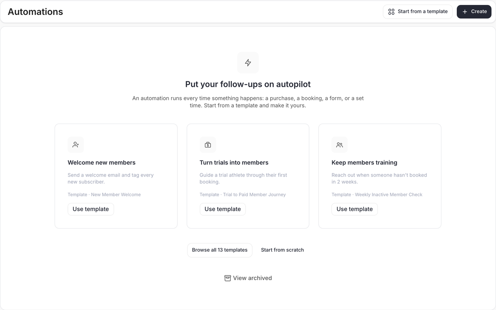
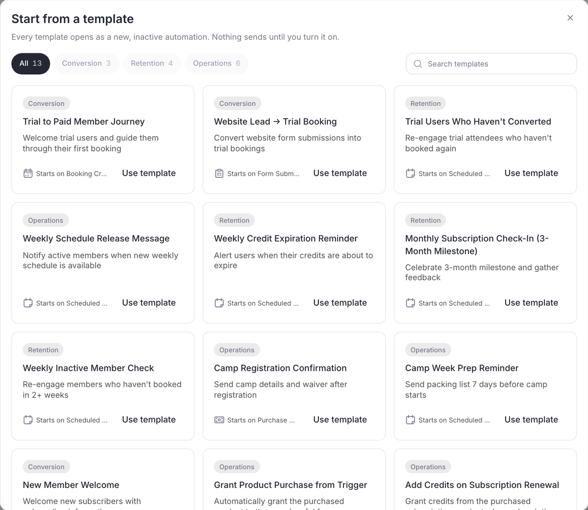

<Info>
  **Where to find this**: **Tools → Automations → Start from a template**
</Info>

## Why start from a template

A template is a complete automation: trigger, conditions and steps already set up, with a message written for the situation. Pick one, swap in your product and your wording, turn it on. It's the quickest way to start without learning the builder first.

<Frame>
  
</Frame>

## The library

<Frame>
  
</Frame>

Click **Start from a template** on the Automations page (or **Browse all 13 templates** if you have no automations yet). The window reads "Every template opens as a new, inactive automation. Nothing sends until you turn it on." Tabs filter by **All**, **Conversion**, **Retention** and **Operations**, **Search templates** finds one by name, and each template says what starts it, for example **Starts on Purchase Made**.

Before you have any automations, the Automations page also suggests three: **Welcome new members** (New Member Welcome), **Turn trials into members** (Trial to Paid Member Journey) and **Keep members training** (Weekly Inactive Member Check).

### Conversion

Turn leads and trials into paying members.

| Template | What it does |
|---|---|
| **Trial to Paid Member Journey** | Welcome trial users and guide them through their first booking |
| **Website Lead → Trial Booking** | Convert website form submissions into trial bookings |
| **New Member Welcome** | Welcome new subscribers with onboarding information |

### Retention

Keep current members engaged and paying.

| Template | What it does |
|---|---|
| **Trial Users Who Haven't Converted** | Re-engage trial attendees who haven't booked again |
| **Weekly Credit Expiration Reminder** | Alert users when their credits are about to expire |
| **Monthly Subscription Check-In (3-Month Milestone)** | Celebrate the 3-month milestone and gather feedback |
| **Weekly Inactive Member Check** | Re-engage members who haven't booked in 2+ weeks |

### Operations

Run the week without remembering to send things.

| Template | What it does |
|---|---|
| **Weekly Schedule Release Message** | Notify active members when the new weekly schedule is available |
| **Camp Registration Confirmation** | Send camp details and the waiver after registration |
| **Camp Week Prep Reminder** | Send the packing list 7 days before camp starts |
| **Grant Product Purchase from Trigger** | Automatically grant the purchased product to the user (useful for access codes or manual processing) |
| **Add Credits on Subscription Renewal** | Grant credits from the purchased subscription product when the subscription renews |
| **Daily Trial Bookings Summary (Coach Alert)** | Notify the coach of trial sessions scheduled for today |

## Using a template

<Steps>
  <Step title="Open the library">
    Go to **Tools → Automations** and click **Start from a template**. Use the tabs to narrow the list.
  </Step>
  <Step title="Click Use template">
    The template opens in the builder, ready to edit. Nothing is saved until you click **Save**, and it stays off until you turn it on.
  </Step>
  <Step title="Point it at your products and people">
    Every field that needs one of your records (a tag, session, product, form or coach) starts empty, so pick your own on the **When**, **Only if** and step cards. A conversion template may reference "a trial product" or "a membership"; select yours. The automation can't be saved until each of these is filled in, so a leftover example name never slips through. See [Builder reference](/tools/automations/builder-reference) for what each card does.

    Pick an active tag. If a tag step uses a tag that was removed from People, saving stops with a message naming the step, for example "3-Month Member: that tag was removed. Choose an active tag." Choose another tag, or add the tag again from People.
  </Step>
  <Step title="Rewrite the message in your voice">
    Open each step card. Keep the dynamic fields (the `@` CoachIQ fields such as the athlete's first name) and change the rest. For SMS, watch the counter: past 160 characters the text still sends, but as two billed segments.
  </Step>
  <Step title="Save and test">
    Click **Save**, then **Test run** to send it to yourself and check the message reads well and the fields fill in. Test run skips any **Wait/Delay** step and runs the later steps straight away.
  </Step>
  <Step title="Turn it on">
    Switch **Off** to **On** in the top bar and click **Turn on** to confirm. The automation shows as **Active** in the list.
  </Step>
</Steps>

<Tip>
  The [Automation playbook](/tools/automations/automation-playbook) walks through the thinking behind each of these templates, with example messages you can borrow.
</Tip>

## Start from a team

When you open templates from a team's automation area, the new rule keeps its team context, including **Athlete joins team** for a team-join automation. Use the back control to return to that team. Before enabling a template, confirm the selected team, trigger, recipient, and actions; a template still needs your review.

After a qualifying event, check [Activity](/tools/automations/builder-reference#activity) to see what actually ran.

Pipeline templates (such as **Trial membership**) also come with automations. Ones that text parents start off and carry a **Texts parents** label; turn them on once the starter message reads right. This applies to pipelines created from a template from now on.

## Common questions

<AccordionGroup>
  <Accordion title="Can I edit a template after I've turned it on?">
    Yes. It's a normal automation once saved. Open it from the Automations list, change anything, and click **Save**.
  </Accordion>
  <Accordion title="Will using a template again create a duplicate?">
    Yes, each saved **Use template** is a new automation. Archive the extras from the Automations list.
  </Accordion>
  <Accordion title="Weekly Schedule Release Message: who gets it?">
    It sends one announcement to each member its scheduled check finds, as its description says. If you switch the announcement to specific tags or roles, pick at least one before saving.
  </Accordion>
  <Accordion title="Do templates send anything when I click Use template?">
    No. Nothing is saved until you click **Save**, and every template starts off. Nothing goes out until you turn it on, and scheduled templates run at their next scheduled time after that.
  </Accordion>
</AccordionGroup>

## Related articles

<CardGroup cols={2}>
  <Card title="Builder reference" icon="wrench" href="/tools/automations/builder-reference">
    Every section of the automation builder explained
  </Card>
  <Card title="Automation playbook" icon="book" href="/tools/automations/automation-playbook">
    Strategy and example messages for each scenario
  </Card>
  <Card title="Build your first automation" icon="play" href="/tools/automations/build-your-first-automation">
    Start from scratch instead
  </Card>
  <Card title="Scheduled automations" icon="clock" href="/tools/automations/scheduled-automations">
    How the weekly and monthly templates run
  </Card>
</CardGroup>
