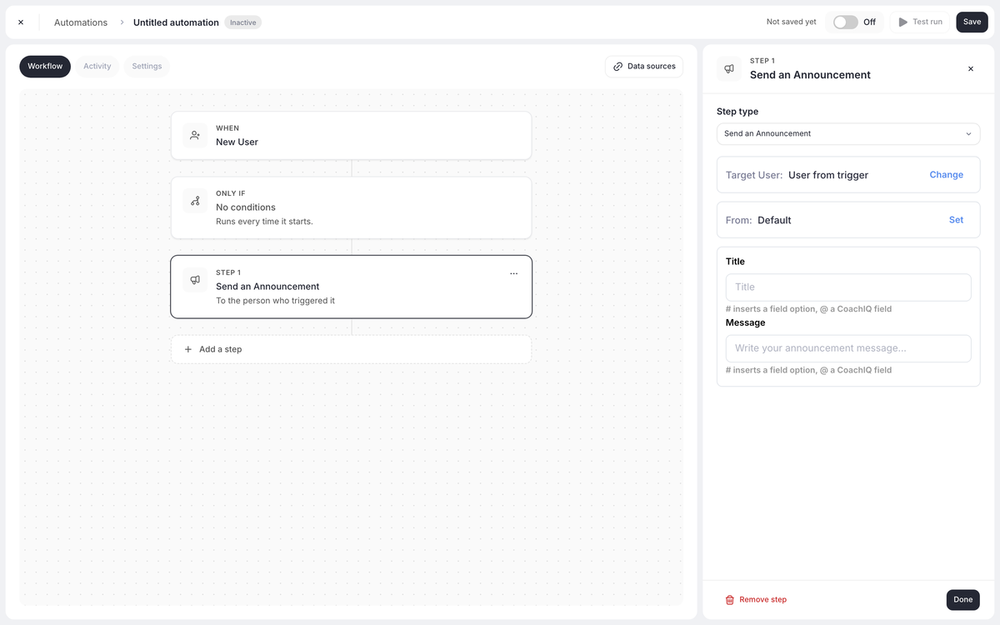

<Info>
**Where to find this**: **Tools → Automations → Create**
</Info>

By the end of this guide, each new subscription sends the buyer a welcome email with a link to [book their first session](/scheduling/overview) and [tags](/people/tags-filters) them **Active Member** so you can find them later. You'll build it from scratch to see how the parts fit together.

## What you're building

| When | Only if | Steps |
| --- | --- | --- |
| **Purchase Made** | Is subscription | 1. **Send an Email** with your booking link |
| | | 2. **Add a Tag to a User**: Active Member |

## Step by step

<Steps>
  <Step title="Start a new automation">
    Go to **Tools → Automations** and click **Create** (or **Start from scratch** if you have none yet). The builder opens full screen as a column of cards: **When**, **Only if** and the steps. It's off and **Not saved yet**.

    <Frame>
      
    </Frame>

    If a step is already there, you'll change it in step 5.
  </Step>
  <Step title="Name it">
    Open the **Settings** tab and type an **Automation name**, such as **New Member Welcome**. This is the name in the Automations list and in Activity. Go back to **Workflow**.
  </Step>
  <Step title="Choose the trigger">
    Click the **When** card, then **Change**. Under **Payments & forms**, choose **Purchase Made** ("Someone buys any product") and click **Done**.

    The buyer becomes the **user from trigger** that the steps act on. On products that ask for an athlete at checkout, it's the athlete instead.
  </Step>
  <Step title="Add a condition">
    You only want this for subscriptions, not camps or drop-ins. Click the **Only if** card, then **Add Condition**, and choose **Is subscription** in the field list. Click **Done**.
  </Step>
  <Step title="Add the email">
    Click **Add a step** and choose **Send an Email** under **Messages**. If a **Step 1** card is already there, click it and change **Step type** to **Send an Email** instead. Fill in:

    | Field | What to enter |
    | --- | --- |
    | **Target User** | **User from trigger** (the default) |
    | **Subject** | Welcome to the team, then type `@` and pick the first name field |
    | **Message** | The text below |

    ```text wrap
    Hey [@ first name],

    You're officially part of the team!

    Book your first session here: [paste your session's booking link]

    Any questions, just reply to this email.

    See you soon,
    [Your name]
    ```

    Type `@` wherever you want a CoachIQ field such as the first name. It fills in for each person. Click **Done**.
  </Step>
  <Step title="Add the tag">
    Click **Add a step** and choose **Add a Tag to a User** under **Tags & profile**. Keep **User from trigger** and pick the **Active Member** tag (create it in [People](/people/tags-filters) first if you don't have it). Click **Done**.
  </Step>
  <Step title="Save">
    Click **Save**. The automation is saved but still off, so nothing runs yet.
  </Step>
  <Step title="Test it">
    Follow the checklist in [Test before you turn it on](#test-before-you-turn-it-on).
  </Step>
  <Step title="Turn it on">
    Switch **Off** to **On** in the top bar. CoachIQ shows **When: Purchase Made** and **Then:** your steps. Click **Turn on**.

    <Check>
      **That's it.** The next person who buys a subscription gets your welcome email and the Active Member tag.
    </Check>
  </Step>
</Steps>

## Test before you turn it on

Email, text, booking, credit and purchase steps do real things the moment they run, so check your work first.

1. **Use a test profile.** Pick a profile with an email you can read, not a real member. For **Purchase Made**, its latest purchase must be a subscription, or the condition won't pass.
2. **Click Test run** in the top bar (it's available once the automation is saved), pick the test profile and click **Run Test Now**. The test really sends.
3. **Open Activity.** Expand the run to see whether the condition passed and what each step did (**Delivered**, **Queued** and so on).
4. **Check the inbox** of the test profile to see how the email reads.
5. **Then turn it on.**

## Check it's working

- **Activity** lists every run, who it was for and what each step did. See [Activity](/tools/automations/builder-reference#activity).
- The tag shows on the client's profile in **People**.
- A new account on its own doesn't start this automation. It needs a purchase.

## What you just learned

Every automation uses the same pattern:

- **When**: the event that starts it (a purchase, a booking, a [form submission](/tools/forms/overview), a schedule)
- **Only if**: who it applies to (only subscriptions, only first-time buyers)
- **Steps**: what CoachIQ does (send [messages](/inbox/inbox-overview), add tags, manage credits)
- **Data sources** (optional): extra details, such as a credit balance, for conditions and messages to use

## What's next?

<CardGroup cols={2}>
  <Card title="Automation templates" icon="layer-group" href="/tools/automations/automation-templates">
    Thirteen ready-made automations to start from
  </Card>
  <Card title="Scheduled automations" icon="calendar" href="/tools/automations/scheduled-automations">
    Weekly check-ins, credit reminders and other timed automations
  </Card>
  <Card title="Builder reference" icon="wrench" href="/tools/automations/builder-reference">
    Every part of the builder, Test run and Activity
  </Card>
  <Card title="Triggers and actions reference" icon="list" href="/tools/automations/triggers-actions-reference">
    Every trigger, condition, step and field
  </Card>
</CardGroup>
