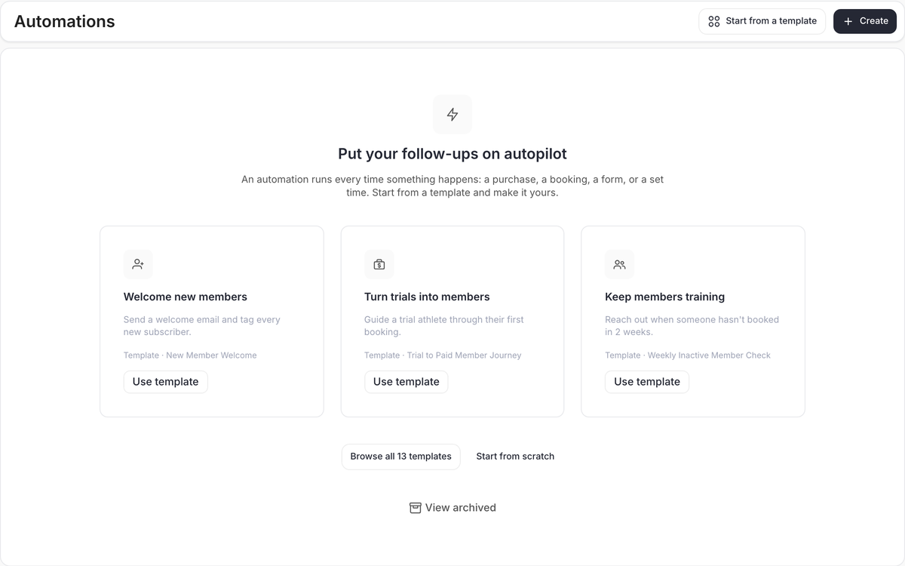
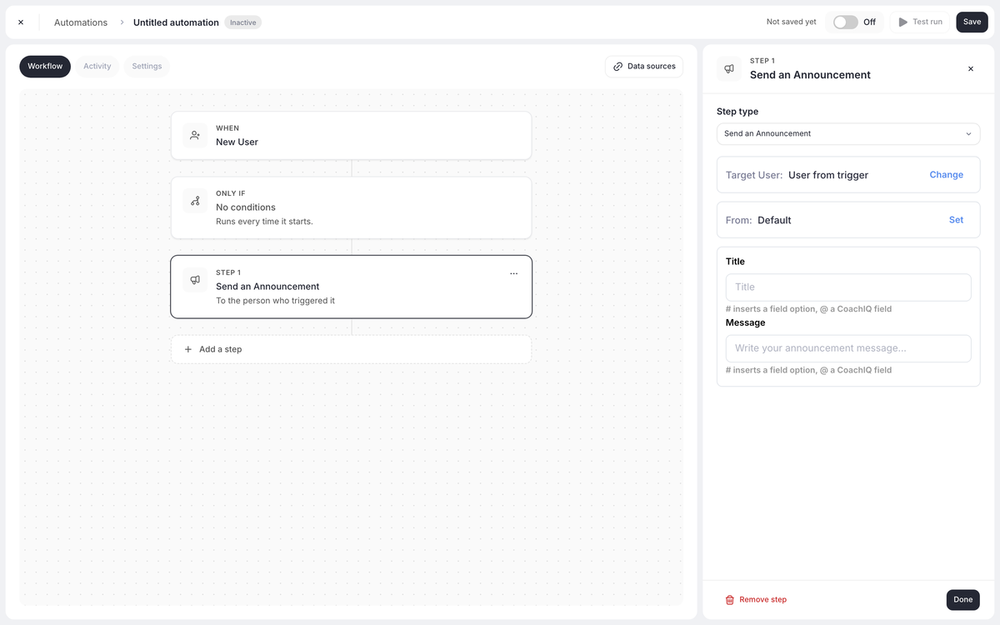
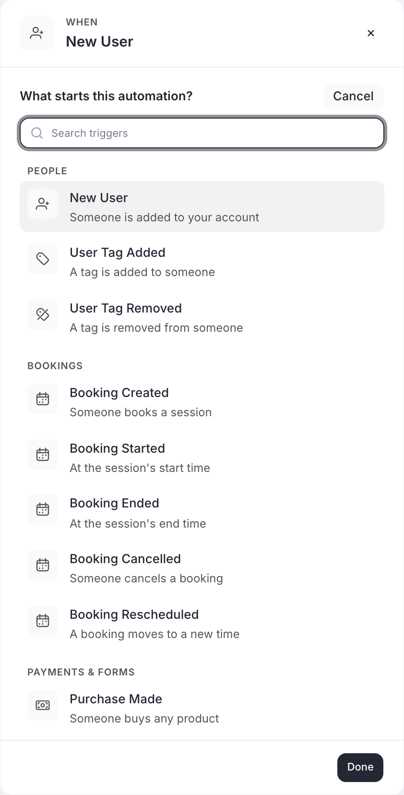
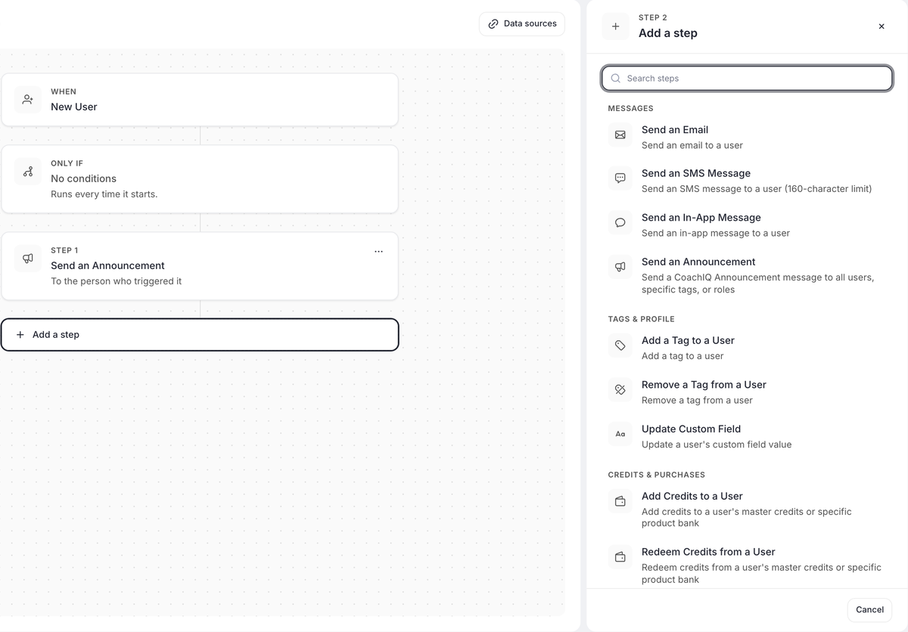
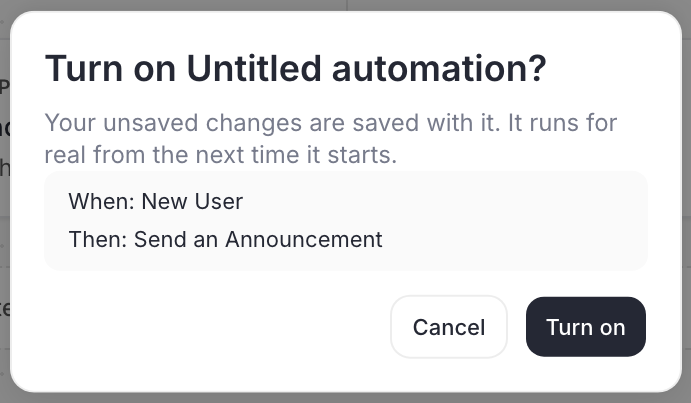

<Info>
  **Where to find this**: **Tools → Automations**, then open an automation or click **Create**
</Info>

## The Automations list

**Tools → Automations** lists every automation with search, status tabs and sorting. Each row has a **…** menu, where you archive an automation. At the top right:

- **Start from a template** opens the [template library](/tools/automations/automation-templates).
- **Create** starts a new automation.

If you haven't made any automations yet, the page offers three popular templates (**Welcome new members**, **Turn trials into members**, **Keep members training**), **Browse all 13 templates** and **Start from scratch**.

<Frame>
  
</Frame>

### Archive and restore

Archive automations you're done with (last season's registration flow, a one-off campaign) so the list shows only what's in use. An archived automation stops running and keeps its settings and Activity.

To get one back, open the archived automations (the **Archived** tab, or **View archived** when everything is archived), open it and restore it. It comes back **turned off**, so check it and turn it on again when you're ready.

## The builder

An automation opens full screen as a column of cards: what starts it, its conditions, and its numbered steps. Click a card to open its settings in the panel on the right, then click **Done**.

<Frame>
  
</Frame>

The top bar shows the automation's name and status (**Inactive** or **Active**), the save state (**Not saved yet**, **Unsaved changes**), the **On/Off** switch, **Test run** and **Save**. The tabs under it are **Workflow** (the cards), **Activity** and **Settings**, with **Data sources** on the right.

Nothing is saved until you click **Save**, and the builder stays open after saving. If you close it with unsaved changes, it asks first.

### When

The trigger: what starts the automation. Click the **When** card, then **Change**, to see **What starts this automation?** Search or pick from the list, grouped as **People**, **Bookings**, **Payments & forms**, **Sales pipeline** and **Timing & other tools**.

<Frame>
  
</Frame>

One trigger per automation. To start the same steps from a second event, make a second automation. The person the event happened to becomes the **user from trigger** that later steps act on.

For **Purchase Made**, the user from trigger is the athlete chosen at checkout on products that ask for an athlete, and the buyer on every other purchase. A tag or message step lands on that one athlete, never on every child in the family.

Every trigger and what it carries is listed in the [Triggers and actions reference](/tools/automations/triggers-actions-reference#all-triggers).

### Only if

Conditions that decide whether the automation carries on. **No conditions** means it runs every time it starts.

Click the **Only if** card, then **Add Condition**. Each rule compares a field to a value, for example **Product Label · Equal To · "Summer Camp"**. Rules sit in groups:

- **And**: every rule in the group must be true
- **Or**: any one rule is enough

Groups can sit inside groups, so you can say "(bought a membership **or** a credit pack) **and** has no future booking". A group with no rules left can't be saved; remove it or add a rule.

A **Scheduled Check** needs at least one condition to decide who it runs for. See [Scheduled automations](/tools/automations/scheduled-automations).

### Steps

What happens when the conditions pass. Click **Add a step** and search or pick from **Messages**, **Tags & profile**, **Credits & purchases**, **Programs & bookings**, **Sales pipeline** and **Timing & other tools**. Steps run in order, top to bottom. Put the message you most want delivered first.

<Frame>
  
</Frame>

The **…** menu on a step card moves, duplicates or removes it. **Remove step** is also at the bottom of the step's panel.

Most steps start with **Target User**:

- **User from trigger** (the default): the person the event happened to.
- **Trigger user and their guardians**: also reaches the parent when the athlete is a child with no email or login of their own. A parent who triggers the automation is a single target; this never adds children.
- A specific person you pick after clicking **Change**.

In any message field, type `#` to insert a **field option** from the trigger or a data source (such as a form answer or the product bought), or `@` to insert a **CoachIQ field** such as the athlete's first name, the session title or the booking time. Fields fill in for each person when the automation runs.

Rules worth knowing:

- **Send an SMS Message** has a 160-character counter. Longer texts still send, as more than one segment, and each segment uses [SMS credits](/inbox/sms-credits).
- An email step whose message is empty can't be saved. An email with no visible text once its fields are filled in isn't sent and uses no email credits. Blank lines you leave in an email body come through in the email.
- **Wait/Delay** pauses the automation for that person for the time you set (minutes up to weeks; waits over 25 days work) or until a date and time. If it has a "continue only if" condition, CoachIQ checks it when the wait ends. If the person no longer matches, for example a lead tag was removed because they booked, the steps after the wait don't run. If you turn the automation off while someone is waiting, their run stops there.
- **Grant Program Access to a User** adds the person to a private program until you revoke it. It doesn't change who else can open the program. Older automations saved with an access length show a note that the length isn't applied.
- **Block Time** closes a window on your availability. **Unblock Time** reopens a window closed by Block Time with the same name and times.
- **Add a Product Purchase to a User** is skipped, with a note in Activity, for someone whose membership is Suspended or Declined. The rest of the automation carries on.

Every step and its fields are in the [Triggers and actions reference](/tools/automations/triggers-actions-reference#all-actions).

### Data sources

Extra records fetched before the conditions run, for when a condition or message needs something the trigger doesn't carry, such as the person's current credit balance or upcoming bookings. Click **Data sources** at the top right, then **Add Data Source**. Its fields become available in **Only if** and as `#` fields in steps.

## Settings

The **Settings** tab holds the **Automation name**, shown in the Automations list and in Activity, and the **On** switch. Use letters, numbers, spaces and ordinary punctuation; a name with emoji or symbols such as arrows can't be saved.

## Turn it on

New automations, including ones made from templates or by Copilot, start **off**: nothing runs or sends. When you're ready, switch **Off** to **On** in the top bar. CoachIQ shows what it will do (**When: …**, **Then: …**) and saves your unsaved changes with it. Click **Turn on**. It runs for real from the next time it starts.

<Frame>
  
</Frame>

Turning it off stops automatic runs. It doesn't stop a **Test run** from doing real things.

## Test run

**Test run** is available once the automation is saved. Pick the person to run it for. The window says plainly: "The test runs each step for this person, so messages are sent and their records can change." Use a test profile with an email and phone you control.

- **Wait/Delay** steps are skipped in a test and marked **Skipped** ("Wait skipped in test run"), so the steps after them run straight away. Nothing is sent again later.
- For **Purchase Made** and similar triggers, pick someone whose latest purchase or booking matches your conditions.
- The window scrolls on a small screen; **Cancel** and **Run Test Now** stay at the bottom. Email steps show their message as readable text.

Check the result in **Activity** and on the test profile before you turn the automation on.

## Activity

**Activity** lists every run, newest first, with what started it and when. It shows once the automation is saved. Expand a run to see each step. Steps that send something say what happened:

| Result | Meaning |
| --- | --- |
| **Delivered** | Sent |
| **Queued** | A text or email was accepted by the provider for delivery |
| **Suppressed** | Sending is turned off where it ran, so nothing went out |
| **Outcome unknown** | CoachIQ couldn't confirm what happened |
| **Delivered 1 of 2** | Partly sent, with the reason |

Other run results:

- **Stopped: condition no longer met**: a Wait ended and the person no longer matched. This is normal, not a failure.
- **Stopped: automation switched off**, under a **Wait resume** heading: the automation was turned off during a wait.
- **Failed**: something went wrong. Expand it for the reason before running anything again, so you don't repeat a step that already worked.

An automation with a Wait shows the run in two parts: the steps before the wait, then the rest when it ends. Runs recorded before this update keep their older wording, such as **Success**.

## Common questions

<AccordionGroup>
  <Accordion title="My automation ran but nobody got the message">
    Open **Activity** and expand the run. **Suppressed** means sending was off; a failed condition means the person didn't match; **Failed** on a step gives the reason, such as no phone number for a text.
  </Accordion>
  <Accordion title="Save shows an error">
    The builder names the problem: a name with emoji or symbols, a **Scheduled Check** with no condition, an empty condition group, an empty email, or a step that still needs a tag, session, product or form picked. A failed save doesn't leave a copy behind. If the automation was deleted in another tab, the save says "Automation not found. Reload the page and try again." and creates nothing.
  </Accordion>
  <Accordion title="My follow-up went out even though the person already booked">
    Put the follow-up after a **Wait/Delay** with a "continue only if" condition, such as a lead tag that another automation removes when they book. The condition is checked when the wait ends.
  </Accordion>
  <Accordion title="Can one automation have two triggers?">
    No. Make a second automation with the other trigger. [Templates](/tools/automations/automation-templates) make that quick.
  </Accordion>
  <Accordion title="What's the difference between # and @ fields?">
    `#` fields come from the event or a data source (the product bought, the form answers). `@` fields are standard CoachIQ fields about the person and your business (first name, session title, your group name).
  </Accordion>
</AccordionGroup>

## Related articles

<CardGroup cols={2}>
  <Card title="Triggers and actions reference" icon="list" href="/tools/automations/triggers-actions-reference">
    Every trigger, step and dynamic field
  </Card>
  <Card title="Build your first automation" icon="play" href="/tools/automations/build-your-first-automation">
    A guided first build
  </Card>
  <Card title="Automation templates" icon="layer-group" href="/tools/automations/automation-templates">
    Ready-made automations to start from
  </Card>
  <Card title="Scheduled automations" icon="clock" href="/tools/automations/scheduled-automations">
    Automations that run on a timer
  </Card>
</CardGroup>
