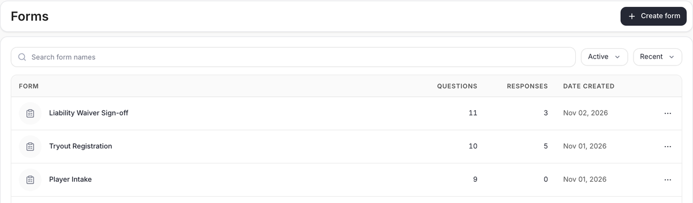
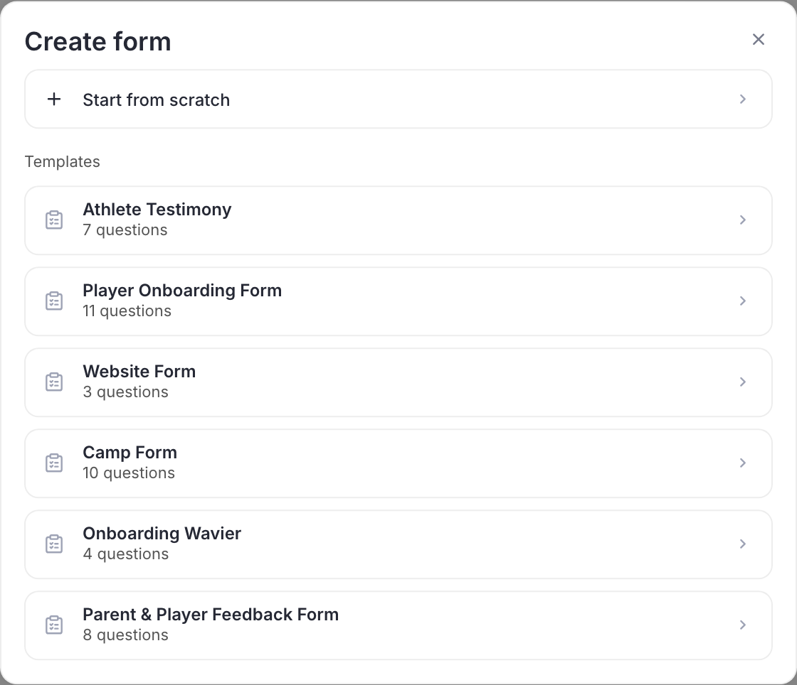
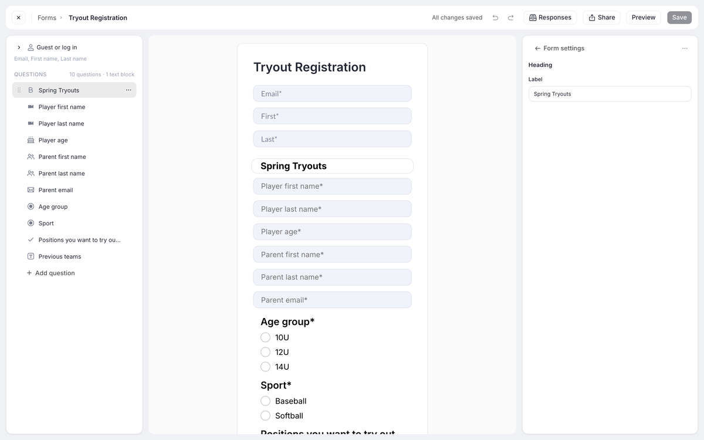
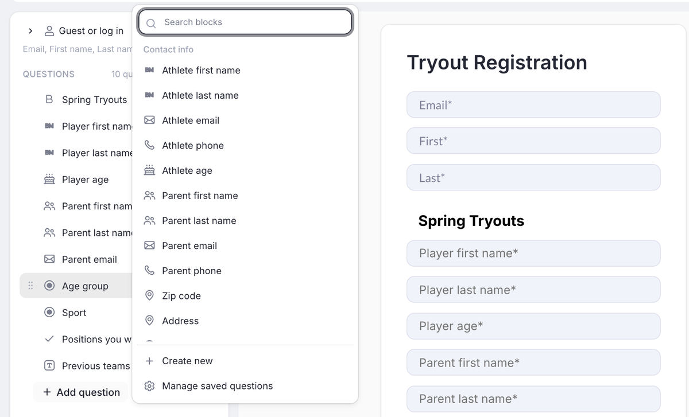
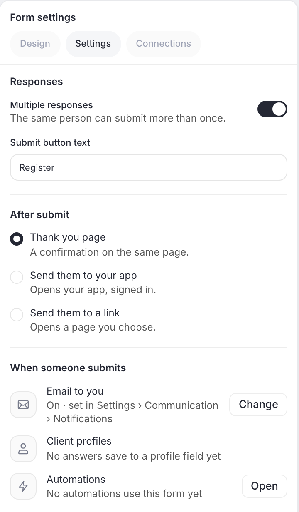

This page walks through the form builder from top to bottom: the Forms list, creating a form, adding questions, the form's design and settings, and saving. Payments, bookings and who has to log in are on [Guests, payments and bookings](/tools/forms/payments-and-bookings). Sharing is on [Share a form](/tools/forms/sharing-forms).

<Info>
  **Where to find this**: **Tools → Forms**
</Info>

## The Forms list

**Tools → Forms** lists your forms with their number of **Questions**, **Responses** and the **Date created**.

<Frame>
  
</Frame>

- **Search form names** looks at form names only. When nothing matches, **Clear search** brings the list back.
- The **Active** menu switches to **Archived** forms.
- The **Recent** menu changes the sort order.
- Click a form to open it in the builder. The **…** menu on each row has **Edit**, **Responses**, **Share**, **Copy link**, **Duplicate** and **Archive**.

## Create a form

<Steps>
  <Step title="Click Create form">
    Go to **Tools → Forms** and click **Create form** in the top right.
  </Step>
  <Step title="Pick a starting point">
    Choose **Start from scratch** or one of the templates. Each template shows how many questions it has.

    <Frame>
      
    </Frame>

    | Template | Best for |
    | --- | --- |
    | **Athlete Testimony** | Collecting reviews and permission to share them |
    | **Player Onboarding Form** | New athlete intake: contact details, goals, experience, parent details |
    | **Website Form** | A short lead form for your website |
    | **Camp Form** | Camp or clinic registration |
    | **Onboarding Wavier** | A waiver to accept before the first session |
    | **Parent & Player Feedback Form** | Feedback after a program or season |
  </Step>
  <Step title="Fill in the template's placeholders">
    Some template questions contain placeholder text in quotes. The builder marks each one **Fill in** in the outline and under the question's **Label**, and Share lists them until you replace the words and save.
  </Step>
  <Step title="Name it and save">
    Type the form's name at the top of the page and click **Create form**. A form can't be saved with a blank name. After the first save the button reads **Save**.
  </Step>
</Steps>

Nothing is saved until you click **Create form** or **Save**. If you close a new form made from a template, **Leave** discards the draft and **Keep editing** returns you to it.

## The builder

The builder has three columns, with the form drawn in the middle at phone width, the way families see it.

<Frame>
  
</Frame>

| Area | What it's for |
| --- | --- |
| **Top bar** | Close (**X**), the save status, **Undo** and **Redo**, **Responses**, **Share**, **Preview** and **Save** |
| **Outline** (left) | Every question in order. Drag to reorder, click to select, **Add question** to add more |
| **Page** (middle) | The form as families see it. Click any question on it to edit it |
| **Panel** (right) | The selected question's settings, or **Form settings** with the **Design**, **Settings** and **Connections** tabs |

The status beside **Undo** tells you where you are: **Not saved yet** for a new form, **Unsaved changes** after an edit, and **All changes saved** once it's saved. If you try to leave with unsaved changes, the builder asks first.

The outline counts questions the same way as the Forms list. Headings and text blocks are counted separately, for example **10 questions · 1 text block**.

When the form takes a payment or books a session, it gets a second page. The pages show as tabs above the form (**1 · Questions**, **2 · Products**) and as groups in the outline. See [Guests, payments and bookings](/tools/forms/payments-and-bookings).

On a tablet or phone, the outline and the panel open as sheets over the page.

## Add questions

Click **Add question** at the bottom of the outline, or the **+** between two questions, to open the question menu. Type in **Search blocks** to find one quickly.

<Frame>
  
</Frame>

| Group | Questions |
| --- | --- |
| **Contact info** | Athlete first name, Athlete last name, Athlete email, Athlete phone, Athlete age, Parent first name, Parent last name, Parent email, Parent phone, Zip code, Address, Country, Instagram, Twitter, and **Custom field** (fills one of your clients' custom fields) |
| **General** | Media, Heading, Text block, Upload file, Waiver, Consent |
| **Choices** | Checkboxes, Yes / No |
| **Saved questions** | Your saved question sets, such as the questions from each template, with their question counts |

**Create new** at the bottom makes your own question: give it a **Title**, pick its **Type** (for example **Short answer**, **Checkboxes** or **Single choice**) and click **Create New Field**. **Manage saved questions** is where you delete a saved question. It asks before deleting. The menu itself only adds questions.

A question type has the same name everywhere: in this menu, in the outline and at the top of the panel.

**Heading** and **Text block** are not questions. They never appear in responses and they don't label the question below them.

Forms don't have a date, number or signature question. For a signature, use a **Waiver** question (see [Waivers](/tools/waivers/waivers#add-a-waiver-to-a-form)).

To ask for a date such as a date of birth, use a text question and set **Save to profile field** to a date field on the profile. That question then checks the answer: it takes dates like 03/14/2016 or 2016-03-14 and saves them to the athlete, and refuses a day that doesn't exist (such as 02/30/2016), a two-digit year, words, a year before 1900 or a day in the future, with a message like: Enter a real date for "Date of birth", like 03/14/2016. The answers stay on the page until the date is fixed. This works on standalone forms, checkout registration forms and forms with a scheduler. A text question not saved to a date field takes any text.

## Edit a question

Click a question in the outline or on the page. The panel shows its settings.

| Setting | What it does |
| --- | --- |
| **Label** | The question families read. It's also the column title in Responses and exports and the name automations see |
| **Required** | Families must answer before they can submit. Required questions show an asterisk (\*) |
| **Options** | For choice questions: each answer, in order. Drag to reorder, **×** to remove, **Add option** to add one |
| **Save to profile field** | Copies the answer into a field on the client's profile. **Not saved** keeps it on the response only |

The **…** menu on a question in the outline has **Duplicate**, **Move to page** and **Delete**.

<Warning>
  **Put the question in the Label.** A question without a label shows its type as a grey stand-in on the page, and when you save, the builder warns you, for example: Question 2 has no label; visitors will see "Text". Give every choice a label too, or Responses can only show it as "Option 1", "Option 2".
</Warning>

A few rules the builder checks for you:

- A choice question needs at least one option.
- A **Waiver** question needs a waiver picked before the form can be saved. With more than one waiver on a required question, families must tick every one. See [Waivers](/tools/waivers/waivers#add-a-waiver-to-a-form).
- Before you delete a question, the builder shows any automations that use it, each with a link to open and check it. If a team's registration rule uses the question, it says so. Past responses keep their answers either way.
- If every question on a form without a payment or booking is optional, someone who submits it blank sees "Answer at least one question before submitting." The message clears as soon as they answer one.

## Design

Click **Form settings** (with the back arrow) at the top of the panel, then **Design**.

| Setting | What it controls |
| --- | --- |
| **Theme** | **Light** or **Dark** background for the form |
| **Button color** | The submit button's background |
| **Button text color** | The submit button's text |

Forms that take a payment or book a session use your organization's app theme instead, so the checkout pages match. The **Design** tab says so when that applies.

## Settings

**Form settings → Settings** controls responses and what happens after someone submits.

<Frame>
  
</Frame>

**Responses**

- **Multiple responses**: on, the same person can submit more than once (good for check-ins and feedback). Off, each person keeps one response: if they submit again, their response is updated with their latest answers, even after you add, rename or remove questions.
- **Submit button text**: the words on the button, for example **Register**.

**After submit**

| Choice | What happens |
| --- | --- |
| **Thank you page** | A confirmation on the same page |
| **Send them to your app** | Opens your app, signed in |
| **Send them to a link** | Opens a page you choose. The link box appears only for this choice |

**When someone submits** shows everything the form sets off, in one place:

- **Email to you**: whether you get an email for each submission. **Change** takes you to **Settings → Communication → Notifications** (see [Email for new submissions](/tools/forms/responses-and-automations#email-for-new-submissions)).
- **Client profiles**: which answers are saved to a profile field.
- **Automations**: which automations use this form. **Open** opens Automations in a new tab, so your unsaved changes stay here.

## Preview

Click **Preview** for a full-screen view of the form. Switch between **Phone** and **Desktop**, then **Exit preview**. Preview shows the real sign-in step, never creates a person and never sends anything. Choices, checkboxes and waivers can be ticked with the keyboard.

## Duplicate, archive and delete

- **Duplicate** (row menu) copies the questions, choices and settings. The copy starts with no responses. Rename it and check its connections before you share it.
- **Archive** (row menu) takes a form out of use. Its links stop accepting submissions, and the form and all its responses are kept. Find it again with the **Archived** filter and restore it from there. Restoring is never blocked.
- A form can't be archived while a product that's on sale needs it at checkout. The message names the product. Remove the form from that product first, or archive the product.
- A form that has responses, or that a product requires at checkout, can't be deleted. Archive it instead.

Editing questions never erases past answers. Removed questions and choices stay readable on earlier responses, and questions you add later are blank on them. See [Responses](/tools/forms/responses-and-automations#manage-response-history).

## Tips

<AccordionGroup>
  <Accordion title="Keep forms short">
    Every question you add lowers the number of people who finish. Ask what you need now; you can collect more later.
  </Accordion>
  <Accordion title="Lead with easy questions">
    Names and email first, longer questions like goals and experience after.
  </Accordion>
  <Accordion title="Use headings to group questions">
    On longer forms, add a **Heading** for each part: "Athlete", "Parent or guardian", "Training preferences".
  </Accordion>
  <Accordion title="Preview on Phone before sharing">
    Most families open forms on a phone. Check every page in **Preview** and fix anything **Share** flags before you send the link.
  </Accordion>
</AccordionGroup>

## What forms can't do yet

- Show or hide questions based on an earlier answer. Use an automation's **Only if** conditions on the answers instead (see [Responses and automations](/tools/forms/responses-and-automations#automations-triggered-by-forms)).
- Save a half-finished response for later.
- Add page breaks. The only extra pages come from taking a payment or booking a session.

## Related articles

<CardGroup cols={2}>
  <Card title="Guests, payments and bookings" icon="credit-card" href="/tools/forms/payments-and-bookings">
    Who has to log in, taking a payment and booking a session
  </Card>
  <Card title="Share a form" icon="share" href="/tools/forms/sharing-forms">
    The ready check, the link, sending it and embedding it
  </Card>
  <Card title="Responses and automations" icon="bolt" href="/tools/forms/responses-and-automations">
    Read, search and export answers, and act on them
  </Card>
  <Card title="Waivers" icon="file-contract" href="/tools/waivers/waivers">
    Add a waiver question and track who has signed
  </Card>
</CardGroup>
