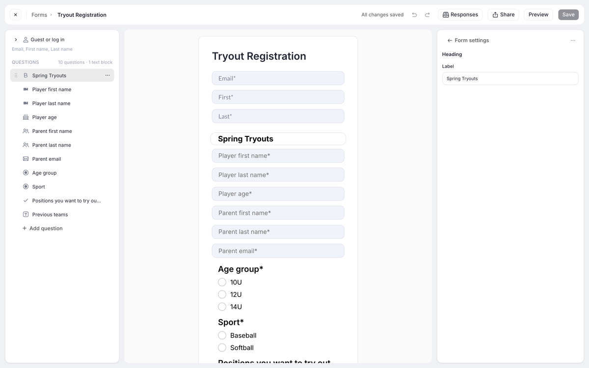

Forms are how you collect information from athletes and parents, without back-and-forth texts, typing it in yourself, or answers spread across Google Docs.

<Info>
  **Where to find Forms**: Tools → Forms in the main navigation
</Info>

## What forms do

You build a form once, share its link, and every response is saved in CoachIQ, on the form and on the client's profile.

Common uses:

- **Lead capture**: "I'm interested in training" inquiries from your website
- **New athlete intake**: contact details, goals, experience, parent details
- **Camp or event registration**: sign-up and payment in one go
- **Waivers**: agreements before the first session
- **Feedback**: end-of-program surveys and testimonials

<Frame>
  
</Frame>

## How forms connect to CoachIQ

Forms connect to the rest of CoachIQ.

<CardGroup cols={2}>
  <Card title="People" icon="users" href="/people/overview">
    Responses from people with an account appear on their profile, and answers can fill profile fields. Returning visitors are asked to [sign in part-way through](/tools/forms/returning-visitor-sign-in).
  </Card>
  <Card title="Products" icon="credit-card" href="/payments/product-overview">
    Take a payment as part of the form, for camp fees or registration fees. Products can also require a form at checkout.
  </Card>
  <Card title="Schedulers" icon="calendar" href="/scheduling/creating-your-first-scheduler">
    Let athletes book a session, such as an evaluation, right after your questions.
  </Card>
  <Card title="Automations" icon="bolt" href="/tools/automations/what-are-automations">
    Start an automation when a form is submitted: send a welcome message, add a tag or add credits.
  </Card>
</CardGroup>

<Note>
  **How the pages work**: visitors enter their details, answer your questions, then go to a **Products** page if the form takes a payment or a **Sessions** page if it books a session. A form does one or the other. See [Guests, payments and bookings](/tools/forms/payments-and-bookings).
</Note>

## Why use CoachIQ forms vs. external tools

If you've used Google Forms, Typeform or JotForm, here's the difference:

| External Tools                       | CoachIQ Forms                      |
| ------------------------------------ | ---------------------------------- |
| Data lives in a separate system      | Data connects to athlete profiles  |
| Manual copy/paste to track responses | Responses appear in one dashboard  |
| Can't collect payments               | Add products for registration fees |
| Can't book sessions                  | Embed schedulers directly          |
| Generic branding                     | Matches your CoachIQ website and app |
| No automation triggers               | Triggers automations on submission |

<Tip>
  When an athlete submits a form, you don't have to add them anywhere by hand. Their details, payment and booking are already in CoachIQ.
</Tip>

## What you can build with forms

### Lead capture form

Embed on your website to capture interested families. Typical fields: "I am the" (Parent/Athlete), name, email, phone, "How did you hear about us?"

### New athlete onboarding

Collect everything before the first session: contact info, athlete age, experience level, goals, parent details, and a waiver agreement.

### Camp registration with payment

Combine info collection with payment: athlete details, t-shirt size, emergency contact, plus a product for the camp fee.

### Waiver/liability form

Add a **Waiver** question and require agreement before training begins. With guests turned off, the signed waiver is on their profile and in the waiver's report.

### Testimonial collection

Ask for a review and permission to share it on your website.

## What forms can't do

- **Show or hide questions based on an answer.** Automations can act on answers instead: the **Form Submitted** trigger offers each question as an **Answer field**, so "if they picked Instagram, add the Instagram Lead tag" is built in [Automations](/tools/forms/responses-and-automations#automations-triggered-by-forms).
- **Save a half-finished response.** Families complete the form in one go.
- **Take a payment and book a session on the same form.** Pick one.
- **Show drop-off.** You see responses, not how many people started and left.

## Quick glossary

| Term                    | Meaning                                                                                    |
| ----------------------- | ------------------------------------------------------------------------------------------ |
| **Question** | One item on your form. Headings and text blocks are on the form too but aren't questions |
| **Contact info** | Ready-made questions (names, email, phone, address) for athletes and parents |
| **Saved questions** | Question sets you can add to any form, including your own from **Create new** |
| **Connections** | Who fills it in, and whether it takes a payment or books a session |
| **Response** | One submission |

## Next steps

<CardGroup cols={2}>
  <Card title="Build a form" icon="rocket" href="/tools/forms/creating-forms">
    Create a form and add your questions
  </Card>
  <Card title="Guests, payments and bookings" icon="credit-card" href="/tools/forms/payments-and-bookings">
    Take a payment or book a session
  </Card>
</CardGroup>

## Team registration

If Teams is enabled for your organization, a team can connect an existing registration form. Families register the participating athlete, and the completed submission can add that athlete to the team. See [team registration](/people/teams/registration-and-messaging).

## Related articles

<CardGroup cols={2}>
  <Card title="What Are Automations?" icon="bolt" href="/tools/automations/what-are-automations">
    Learn how automated workflows trigger when forms are submitted
  </Card>
  <Card title="Product Overview" icon="credit-card" href="/payments/product-overview">
    Understand the products you can attach to forms for payment collection
  </Card>
  <Card title="Creating Your First Scheduler" icon="calendar" href="/scheduling/creating-your-first-scheduler">
    Build a scheduler to embed in your form flow for session bookings
  </Card>
  <Card title="People Overview" icon="users" href="/people/overview">
    See where form responses show on a client's profile
  </Card>
</CardGroup>