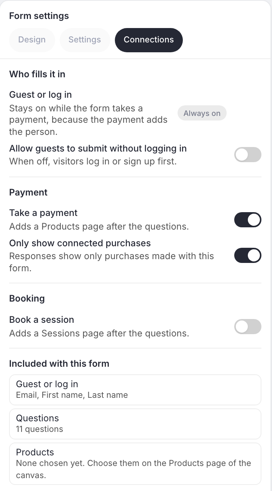

A form's **Connections** tab decides who fills it in and whether it takes a payment or books a session. Each choice adds a page to the form after your questions.

<Info>
  **Where to find this**: open a form in **Tools → Forms**, click **Form settings** at the top of the right panel, then **Connections**
</Info>

<Frame>
  
</Frame>

## Who fills it in

Every form starts with **Guest or log in**: visitors enter their details before your questions. **Email** is always asked for, because the email identifies each response. Click **Guest or log in** at the top of the outline to choose whether to also ask for **First name**, **Last name** and **Phone**, and which of them are required.

**Allow guests to submit without logging in** decides what happens next:

| Setting | What visitors do |
| --- | --- |
| **On** | Fill in their details and submit, without an account |
| **Off** | Log in or sign up first. Use this for anything you want on a client's profile for sure: waivers, registrations, onboarding |

When someone enters an email that already has an account with you, they're asked to sign in part-way through. That's expected; see [What returning visitors see](/tools/forms/returning-visitor-sign-in).

## Take a payment

Use this for camp fees, registration fees and trial sessions.

<Steps>
  <Step title="Turn on Take a payment">
    In **Connections**, switch on **Take a payment**. A **Products** page is added after the questions, and **Guest or log in** shows **Always on**, because the payment adds the person to your clients.
  </Step>
  <Step title="Choose the products">
    Click **2 · Products** above the form, then **Add products**. Search or filter by type, tick the products families can pick from, and click **Add products** (the button shows how many you picked). Only products you've already made in [Payments → Products](/payments/product-overview) are listed.
  </Step>
  <Step title="Save">
    Click **Save**. The product's real name and price show on the page straight away.
  </Step>
</Steps>

On the live form, families answer your questions, pick a product, then pay. **Only show connected purchases** (on by default) means the form's Responses show only purchases made through this form.

## Book a session

Use this for evaluations, trial sessions and first lessons. Switch on **Book a session** in **Connections**. A **Sessions** page is added after the questions, where you pick the scheduler families book from. Only schedulers you've already made in [Schedulers](/scheduling/creating-your-first-scheduler) are listed.

On the live form, families answer your questions, then choose a time.

<Note>
  **A form takes a payment or books a session, not both.** You can't turn both on; the builder explains why if you try. To charge for a session, set the price on the scheduler itself (see [Payment options](/scheduling/setting-up-payment-options)) and share the scheduler's link. Older forms that were connected to both still open and save; their session page is marked as not shown to visitors.
</Note>

## Require a form when someone buys a product

You can also start from the product: open it in **Payments → Products**, go to **Advanced → Add a form**, pick the form and save. See [Attach a registration form to a product](/payments/product-builder#attach-a-registration-form-to-a-product).

- The buyer fills in the form, reviews their details, then pays.
- A parent or athlete who already completed the form for that product skips it on a repeat purchase and sees a note, for example: You already completed "Intake form". Any waiver is still required.
- The form is asked for each athlete. A parent buying for a second child fills it in for that child, and each child's answers are saved under that child.
- While a product on sale needs the form, the form can't be archived or deleted. The message names the product.

## When the response is saved

For a booking that needs registration, answers are held while payment goes through. A declined or abandoned payment doesn't create a response. After a successful payment the booking and its response are saved together. A booking covered by credits or a membership saves the response when the booking is confirmed.

If a payment is declined, the family can fix their card and try the same checkout again. Check whether the payment or booking went through before asking them to start over.

## Where the payment and booking show up

- **Payments**: the purchase is in **Payments → Transactions** and on the client's profile.
- **Bookings**: the session is on your **Calendar** and in the client's bookings. In the session's details, the participant's **Actions** menu has **View form response**.
- **Responses**: every submission is in the form's **Responses**. A response on its own doesn't prove a payment or booking; check the purchase or the roster before confirming a spot to a family. See [Responses and automations](/tools/forms/responses-and-automations#check-the-connected-purchase-or-booking).

## Common setups

| Form | Allow guests | Payment or booking |
| --- | --- | --- |
| Website lead form | On | Neither |
| Waiver | Off | Neither |
| New athlete onboarding | Off | **Book a session** (evaluation) |
| Camp registration | Off (always on with a payment) | **Take a payment** (camp product) |

## Tips

<AccordionGroup>
  <Accordion title="Make the product or scheduler first">
    The pickers only list products and schedulers that already exist.
  </Accordion>
  <Accordion title="Go through it yourself">
    Open the form's link and go through every page, including the payment or booking, before you share it.
  </Accordion>
  <Accordion title="Keep the questions short">
    The payment or booking page adds a step. Ask only what you need before it.
  </Accordion>
</AccordionGroup>

## Related articles

<CardGroup cols={2}>
  <Card title="Build a form" icon="hammer" href="/tools/forms/creating-forms">
    Questions, design and settings
  </Card>
  <Card title="Share a form" icon="share" href="/tools/forms/sharing-forms">
    The ready check, the link, sending it and embedding it
  </Card>
  <Card title="Product builder" icon="box" href="/payments/product-builder">
    Make the product a form charges for
  </Card>
  <Card title="Create your first scheduler" icon="calendar" href="/scheduling/creating-your-first-scheduler">
    Make the scheduler a form books from
  </Card>
</CardGroup>
