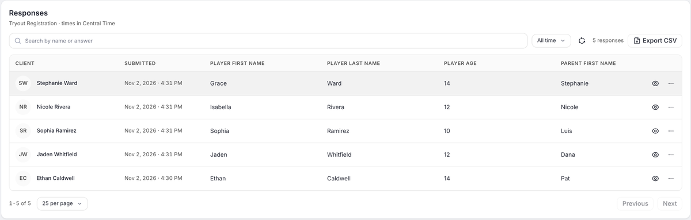

Every submission is saved as a response. This page covers finding and reading them, exporting them, and acting on them.

<Info>
  **Where to find this**: open a form and click **Responses** in the top bar, or choose **Responses** from the form's **…** menu in **Tools → Forms**
</Info>

## The Responses page

<Frame>
  
</Frame>

Each row is one submission. The table starts with the **Client** and when it was **Submitted**, followed by one column per question. Times are shown in your organization's time zone, which is named under the page title.

- **Search by name or answer** finds responses by the client's name or anything they typed.
- The date range menu (**All time**) narrows the list. The count beside it shows how many responses match.
- The refresh button reloads the list. If an older response seems missing, choose **All time** and refresh before changing the form.
- Choose how many rows to show per page at the bottom (**25 per page**), and use **Previous** and **Next** to move between pages.
- A long question heading keeps its column narrow; hover over it to read the whole question.

Extra columns appear when they apply:

| Column | When it appears |
| --- | --- |
| **Registered for** | A parent filled in the form for a child. Shows the child's name |
| **Signed** | The form has a waiver. Shows the date it was signed |

Waiver ticks and every choice a person picked show in the table, the response and the export, and all three agree. A choice you left without a label shows as "Option 1", "Option 2" (or "Waiver 1").

## Open one response

Click the eye icon on a row. The response opens in a side panel with:

- who it's for and, when a parent filled it in, **For** the child with **Submitted by** the parent
- **Submitted** with the date and time
- every answer as plain text
- a **Signature** block for a waiver: who agreed, when, and what they agreed to

Waiver and form text stays folded until you open it.

### Open a response from the calendar

When a session asks for a form, open the session on your **Calendar**. Each participant's **Actions** menu has **View form response**, which opens their answers. If a session has more than one form, each entry names its form (for example **View Intake response**). For a repeating booking it reads **View latest form response** and opens their most recent answers. If they haven't filled it in, it says **No form response on file**.

Coaches limited to their own clients see this only for those clients.

### Check the connected purchase or booking

A response shows what someone typed. It doesn't prove they paid or booked. Before you confirm a spot to a family:

| Check | Where |
| --- | --- |
| The purchase went through | **Payments → Transactions**, or the client's profile |
| The booking went through | The session's roster on the **Calendar** |
| What they actually answered | The response's side panel |

Answers to a booking's required form are saved only when the booking completes. See [When the response is saved](/tools/forms/payments-and-bookings#when-the-response-is-saved).

## Export responses

Click **Export CSV**, then choose the responses shown (after your search and date range) or all responses. Open the file in Excel, Google Sheets or Numbers. The export includes the **Registered for** and **Signed** columns when they apply.

An answer that starts with `=`, `+`, `-` or `@` is saved in the file as text, so it can't run as a formula when you open it.

## Manage response history

- Removing a question or choice keeps its past answers readable. A question you add later is blank on earlier responses.
- On a form with **Multiple responses** off, a person who submits again keeps one row with their latest answers.
- Duplicating a form starts the copy with no responses. Archiving and restoring a form keeps its responses.

### Delete a response

Choose **Delete** in the row's **…** menu and confirm. Deleting one response doesn't remove purchases, bookings, signed waivers or other responses. Export a copy first if you need it.

Some responses can't be deleted because they're the record of something else: the response where a person first accepted a waiver, and responses linked to a purchase or booking. **Delete** explains why and the response stays. A later response where the person only re-ticked a waiver they'd already accepted can be deleted; their acceptance stays.

## Email for new submissions

When the **Forms** notification is on in **Settings → Communication → Notifications**, every submission sends you a **Form Submitted** email with the answers listed question by question, so you can read and reply from your own inbox. It links to the form's Responses. File uploads come through as links. The form's [Settings tab](/tools/forms/creating-forms#settings) shows whether this is on, with a **Change** button.

See [Communication settings](/settings/communication#notifications).

## Responses on a client's profile

When the person submitting has an account (they logged in, or the form doesn't allow guests), the response is linked to their profile. Open the client in **People → Clients**, go to **All Activity** and choose the **Forms** filter to see every form they've submitted, and open one to read it. Answers you set to **Save to profile field** also fill in that field on their profile.

## Automations triggered by forms

A form can start an [automation](/tools/automations/what-are-automations) each time it's submitted: send a message, add a tag, add credits and more. The form's [Settings tab](/tools/forms/creating-forms#settings) lists the automations that use it.

<Steps>
  <Step title="Create the automation">
    Go to **Tools → Automations** and click **Create**.
  </Step>
  <Step title="Choose the trigger">
    Click the **When** card, then **Change**, and choose **Form Submitted**.
  </Step>
  <Step title="Pick the form, and filter on an answer if you want">
    Click the **Only if** card, add a condition and pick the form. Once the form is picked, you can add a condition on one of its questions. Each question appears as an **Answer field**. Example: "How did you hear about us?" equal to "Instagram". Checkbox, consent and waiver questions default to **Contains**.
  </Step>
  <Step title="Add the steps">
    Add a step such as **Send an Email** or **Add a Tag to a User**. In a message, type `#` and pick a question to put that person's answer in.
  </Step>
  <Step title="Save, test, turn on">
    Click **Save**. New automations start off. Test it, then turn it on. See [Build your first automation](/tools/automations/build-your-first-automation).
  </Step>
</Steps>

Headings, media and text blocks aren't offered as Answer fields. The automation needs to know who submitted, so personal messages and tags work only when the response has an email.

### Recipes

| Form | Steps |
| --- | --- |
| Website lead form | Add tag "New Lead", then send a text with your booking link |
| Waiver | Add tag "Waiver Signed", remove tag "Needs Waiver" |
| Camp registration | Add tag "Summer Camp", then send an in-app message with what to bring |
| Feedback form | Add tag "Feedback Received", then ask for a Google review |

## What you can't see yet

Forms show the number of responses and every answer, but not how many people started the form and left, or charts of the answers. Export to a spreadsheet for deeper analysis.

## Related articles

<CardGroup cols={2}>
  <Card title="Build a form" icon="hammer" href="/tools/forms/creating-forms">
    Questions, design, settings and saving
  </Card>
  <Card title="Guests, payments and bookings" icon="credit-card" href="/tools/forms/payments-and-bookings">
    Who logs in, taking a payment and booking a session
  </Card>
  <Card title="Triggers and actions reference" icon="list" href="/tools/automations/triggers-actions-reference">
    Every trigger, condition and step, including form answers
  </Card>
  <Card title="Waivers" icon="file-contract" href="/tools/waivers/waivers">
    Track who has signed each waiver
  </Card>
</CardGroup>
