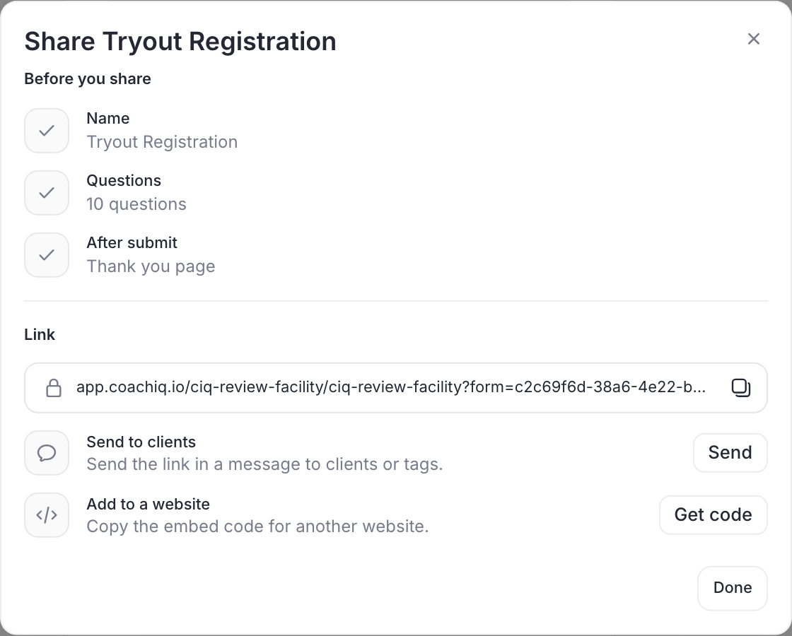
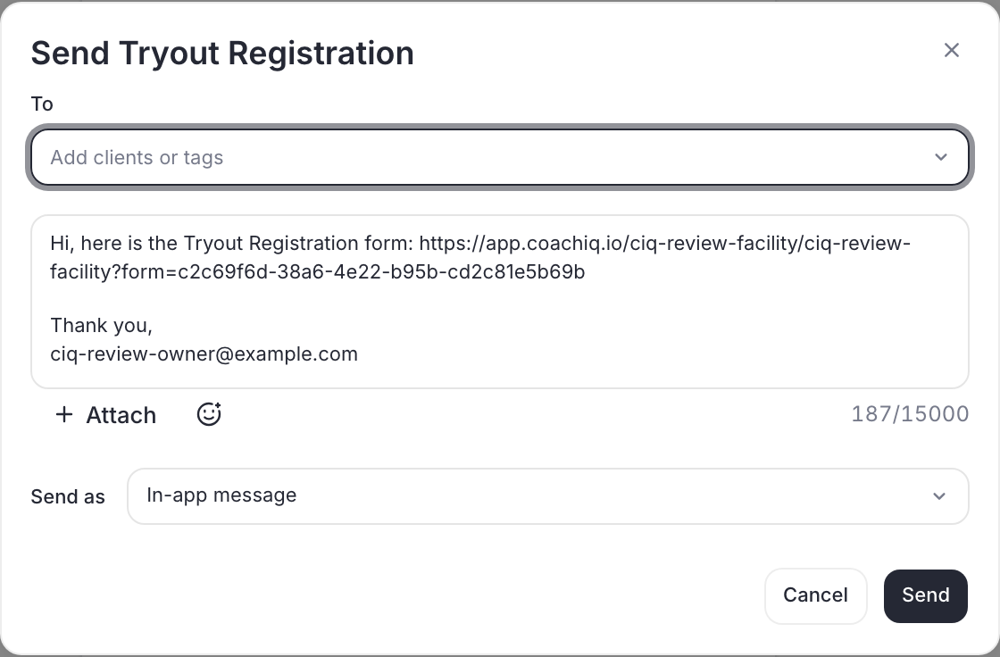

**Share** checks your form, gives you its link, and lets you send it or put it on a website.

<Info>
  **Where to find this**: open a form and click **Share** in the top bar, or choose **Share** from the form's **…** menu in **Tools → Forms**. **Copy link** in the same menu copies the link without opening anything.
</Info>

<Frame>
  
</Frame>

## Before you share

The top of the window is a short check of the form: its **Name**, how many **Questions** it has, and what happens **After submit**. It also points out anything that would trip families up:

- unsaved changes
- a question with no label, or a choice question with no options
- a waiver question with no waiver picked
- template placeholder text you haven't replaced
- a payment with no products, or a booking with no sessions

Click **Fix** next to a problem to go straight to the question or setting. Save, then open **Share** again.

## Copy the link

Click the copy button at the end of the **Link** box. You'll see **Link copied**, and the window stays open.

Anyone with the link can open the form. Use it in texts and emails, your Instagram bio, a QR code on a flyer, or a team group chat.

Links to older CoachIQ form pages, from an old message or website, now open the form's current page, so families can still fill it in.

## Send it to clients

<Steps>
  <Step title="Click Send">
    Next to **Send to clients**, click **Send**.
  </Step>
  <Step title="Pick who gets it">
    In **To**, add clients or tags.
  </Step>
  <Step title="Check the message">
    The message starts with "Hi, here is the [form name] form:" and the link, and signs off with your name. Edit it if you like. **Attach** adds a file.
  </Step>
  <Step title="Choose how it's sent and send">
    Pick the channel in **Send as** (for example **In-app message**) and click **Send**. Someone who isn't on the app yet gets a **Text instead** or **Email instead** button on their row, so the form still reaches them.
  </Step>
</Steps>

<Frame>
  
</Frame>

Good times to send a form: a waiver to a new signup before their first session, an intake form to a new lead, a feedback form when a program ends.

You can also attach a form to any message in [Inbox](/inbox/attaching-forms-schedulers-and-products).

## Add it to your CoachIQ website

Use a **Form** section in the website builder. The form takes on your site's look. See [Form sections](/website/section-types/forms).

## Embed it on another website

For a site outside CoachIQ (Wix, Squarespace, WordPress and so on):

<Steps>
  <Step title="Get the code">
    In **Share**, next to **Add to a website**, click **Get code**.
  </Step>
  <Step title="Copy it">
    Click **Copy code**. You'll see **Code copied**. Close the window to go back to Share.
  </Step>
  <Step title="Paste it on your site">
    Paste the code into an HTML or custom code block where the form should appear, then publish your site and test the form there.
  </Step>
</Steps>

If the form asks for an email first, the embed window reminds you that visitors enter their email first, so custom field and waiver answers attach to them.

An older embed that can't show the form on another site shows a button that opens the form in a new tab.

## Stop taking submissions

There's no publish switch: a form is live as soon as it's saved. To stop it, [archive it](/tools/forms/creating-forms#duplicate-archive-and-delete). Archived forms stop accepting submissions on every link, embed and website section, and keep all their responses. Restore it any time from the **Archived** filter.

## Tips

<AccordionGroup>
  <Accordion title="Test the link yourself">
    Open the link on your phone and submit a test response before you send it out. On a form with a payment or booking, go through every page.
  </Accordion>
  <Accordion title="Send waivers early">
    Send the waiver when someone signs up, not on the day they arrive.
  </Accordion>
  <Accordion title="Match After submit to the form">
    Lead form: **Thank you page**. Onboarding form: **Send them to your app**. Camp registration: **Send them to a link** with a what-to-bring page. Set it in [Settings](/tools/forms/creating-forms#settings).
  </Accordion>
</AccordionGroup>

## Related articles

<CardGroup cols={2}>
  <Card title="Build a form" icon="hammer" href="/tools/forms/creating-forms">
    Questions, design, settings and saving
  </Card>
  <Card title="Responses and automations" icon="bolt" href="/tools/forms/responses-and-automations">
    See who filled it in and act on their answers
  </Card>
  <Card title="Form sections" icon="globe" href="/website/section-types/forms">
    Put a form on your CoachIQ website
  </Card>
  <Card title="Attach forms in Inbox" icon="inbox" href="/inbox/attaching-forms-schedulers-and-products">
    Add a form to any message
  </Card>
</CardGroup>
