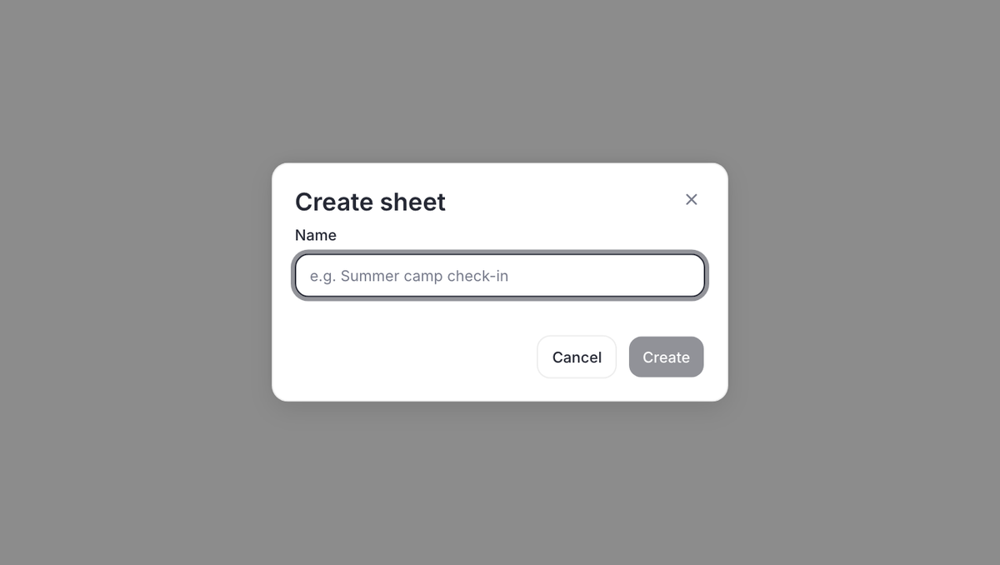
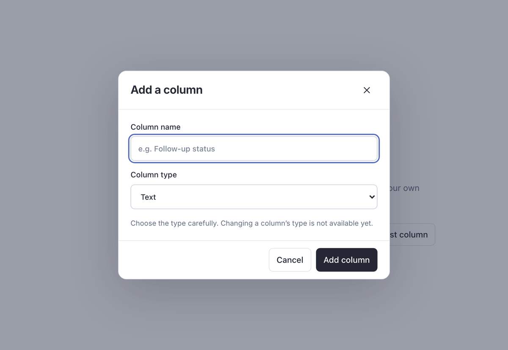

Start with a manual sheet when you want to track information you enter yourself. For live records from CoachIQ, use [Connect live data](/tools/sheets/connect-live-data).

## Create your sheet

1. Open **Tools → Sheets** as an organization Admin.
2. Select **Create** at the top right.
3. Enter a descriptive **Name**, such as **Fall camp equipment** or **Client follow-ups**.
4. Select **Create** to open the grid.

<Frame caption="Name the sheet before opening its grid.">
  
</Frame>

## Add columns

Choose **Add column** (**Add your first column** on a new sheet), enter the **Column name**, pick the **Column type**, and select **Add column**. Pick a type that matches the information you want to enter:

| Type | Example |
| --- | --- |
| Text | Equipment name or a follow-up note |
| Number | Quantity or a score |
| Date | A target follow-up date |
| Single select | One status: Not started, In progress, Complete |
| Multiple select | Several relevant categories |

For select columns, enter the available options in the column setup. A new column is available across the sheet's rows.

<Frame caption="Choose the column's type before entering values.">
  
</Frame>

<Note>
  Changing an existing column's type is not currently available. If you chose the wrong type, add a new column with the correct type and move the information you need before removing the old column.
</Note>

## Add rows and edit cells

Use **Add row** in a manual sheet. Double-click a custom cell to edit it, then use **Save** or **Cancel** in the editor. Enter values that match the column type; for example, a Number column expects a number.

A simple equipment checklist might contain **Item** (Text), **Quantity** (Number), **Needed by** (Date), and **Status** (Single select). Each row is one item. Start with a few rows so you can check the structure before adding the rest.

Custom columns can also sit beside connected data. Live source values are read-only; edit them through the source record rather than trying to overwrite them in the grid.

## Rename, sort, and hide columns

Open the column's menu to rename it, sort, filter, hide it, or delete a custom column. Hiding a column changes the view; deleting it removes that column's saved values. Live columns have different controls because the source owns them.

Use the sheet's column visibility controls to show a hidden column again. For filters and totals, see [Use your sheet](/tools/sheets/use-your-sheet).

## Keyboard controls

Open **Shortcuts** in the sheet to see the available keys. The grid supports arrow-key navigation, **Enter** or **F2** to edit, **Escape** to cancel, and **Cmd/Ctrl+F** for search. Follow the editor's Save/Cancel controls when entering values.

## Manage the sheet

Open the **⋯** menu at the top right of the sheet for rename, export, duplicate, column visibility, shortcuts and delete. You can also **Rename**, **Duplicate** or **Delete** a sheet from its row in the Sheets list. Give duplicated sheets a name that makes their purpose clear.

To let a coach see or work in the sheet, click **Share** next to the menu. See [Share a sheet with a coach](/tools/sheets/overview#share-a-sheet-with-a-coach).

Deleting a sheet is irreversible. It removes the sheet's tracking information, while connected CoachIQ source records remain. Export any information you need before confirming deletion.

<Card title="Bring CoachIQ records into a sheet" icon="link" href="/tools/sheets/connect-live-data">
  Learn the difference between all matching records, selected records, and your custom columns.
</Card>
