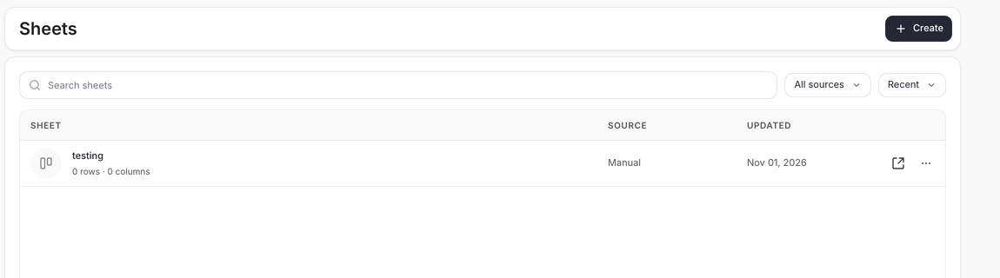
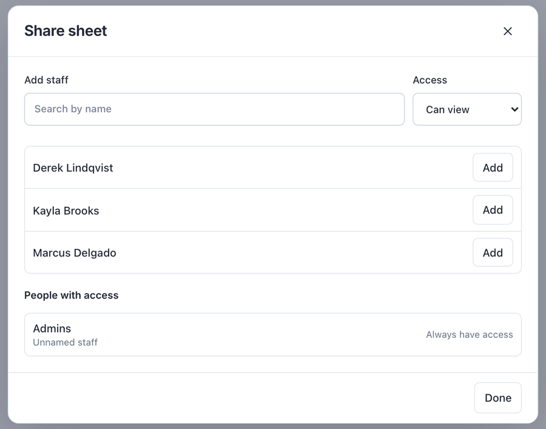

Sheets gives you a flexible grid inside CoachIQ. Start with your own rows and columns, or connect a sheet to CoachIQ records and add the extra information your business needs beside them.

<Info>
  Open **Tools → Sheets**. Sheets is for Admins: they create sheets and see all of them. A Coach sees only the sheets an Admin has [shared with them](#share-a-sheet-with-a-coach), and sees **Nothing is shared with you yet.** until then.
</Info>

## Why we built Sheets

Running a coaching business creates tracking work that doesn't fit neatly into a standard profile or report: which families need a follow-up, what equipment is ready for camp, or what extra notes your team needs beside a list of clients.

A separate spreadsheet means copying records out of CoachIQ and keeping that copy current. Sheets brings that work into the same system. Connected columns show CoachIQ data, your custom columns hold the details you add, and a linked row can take you back to its original record.

Use it to organize the information you need and take the next step without rebuilding the same list in another tool.

## Two ways to start

| Start with | Best for | How it works |
| --- | --- | --- |
| A manual sheet | Equipment checklists, internal planning, or information you enter yourself | Create columns and add rows. You control the values. |
| Connected CoachIQ data | A client follow-up list or a working view of schedulers, products, or other records | Choose a source and which records to include. Live columns reflect that source; custom columns hold your own tracking information. |

For example, connect **People** and add a **Follow-up status** column and a **Coach notes** column. Filter to the rows you need, open the original profiles, or review a messaging audience from your selection. The custom status is information in your sheet; it does not change a client's tags or send a message by itself.

## What you can do

- Create text, number, date, single-select, and multiple-select columns.
- Connect to CoachIQ records and keep your notes beside their live values.
- Search, filter, sort, and show or hide columns.
- Read numeric sums and other column counts in the Totals row.
- Export the current view or selected rows.
- Open a linked record in CoachIQ and review eligible message recipients from selected rows.
- Share a sheet with a coach as **Can view** or **Can edit**.

## Your sheets

**Tools → Sheets** lists your sheets with their **Source** (**Manual**, or the CoachIQ data they're connected to) and when each was **Updated**. Under each name you see how many rows and columns it has. A live-data refresh can change **Updated**, so it isn't only the last time someone typed in a cell.

<Frame caption="The Sheets list.">
  
</Frame>

- **Search sheets** finds a sheet by name.
- **All sources** shows only sheets with one source, such as **Manual**.
- **Recent** sorts the list by most recently updated; switch it to **Name** to sort A to Z.
- **Create** starts a new sheet. See [Create and edit a sheet](/tools/sheets/create-and-edit).

Open a sheet's **⋯** menu on its row to **Open**, **Rename**, **Duplicate** or **Delete** it without loading the whole sheet, so even very large sheets are quick to manage. If someone changed the sheet while you had the window open, CoachIQ tells you instead of overwriting their change.

## Share a sheet with a coach

Admins can share one sheet at a time with chosen staff.

<Steps>
  <Step title="Open Share">
    Open the sheet and click **Share** at the top.
  </Step>
  <Step title="Add staff">
    Under **Add staff**, search by name or pick from the list. Set **Access** to **Can view** or **Can edit**, then click **Add** next to each person.
  </Step>
  <Step title="Check who has access">
    **People with access** lists everyone the sheet is shared with. **Admins** always have access. Click **Done**.
  </Step>
</Steps>

<Frame caption="The Share sheet window.">
  
</Frame>

The coach then finds the sheet in their own Sheets list. With **Can view** they can read it but not add or change rows; with **Can edit** they can also add and change rows. Coaches don't get the **Share** button, so they can't share it further.

If a coach is limited to clients with certain access tags, they see only the rows for their own clients. The Share window shows how many rows that coach will see and which tags give them access, for example **Coach · sees 21 rows (Pitching)**. See [Staff access](/people/staff-access).

If you change a coach's role, sheets shared with them as a coach are no longer shared.

## Start with one useful sheet

<CardGroup cols={2}>
  <Card title="Create and edit a sheet" icon="table" href="/tools/sheets/create-and-edit">
    Name your sheet, choose column types, and enter your own information.
  </Card>
  <Card title="Connect live CoachIQ data" icon="link" href="/tools/sheets/connect-live-data">
    Choose a source, understand record selection, and work with live columns.
  </Card>
  <Card title="Filter, export, and take action" icon="filter" href="/tools/sheets/use-your-sheet">
    Turn a grid into a focused list and review the next action.
  </Card>
</CardGroup>

## How Sheets fits with other tools

Use **People** to maintain client profiles, **Scheduling** to manage sessions, and **Payments** to manage transactions and subscriptions. Sheets gives you a working view of those records; edit connected values in the original area.

The current Sheets release does not include spreadsheet formulas, CSV import, automatic form-response ingestion, or AI-built dashboards. Connecting **Forms** lists form records; it does not turn every submitted answer into a sheet row. Use [form responses](/tools/forms/responses-and-automations) to review submissions and [data tools](/settings/data) for supported imports.

## Common questions

<AccordionGroup>
  <Accordion title="Does everyone on my staff get Sheets?">
    Admins see every sheet. Coaches see only the sheets an Admin shares with them. If an Admin has blocked **Sheets** for a coach in [Staff access](/people/staff-access), they don't see it at all.
  </Accordion>
  <Accordion title="Can I edit a client's name in a connected sheet?">
    Live values are read-only in Sheets. Use the row's Open in CoachIQ action and edit the source record. Your custom columns remain editable in the sheet.
  </Accordion>
  <Accordion title="Does deleting a sheet delete my CoachIQ records?">
    No. Deleting the sheet removes that sheet and its custom tracking information, not its connected source records. Export anything you need to retain before deleting it.
  </Accordion>
</AccordionGroup>
