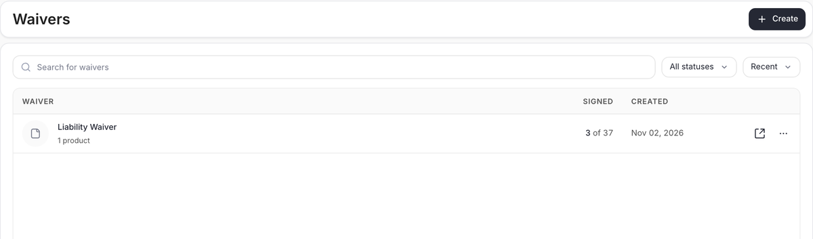
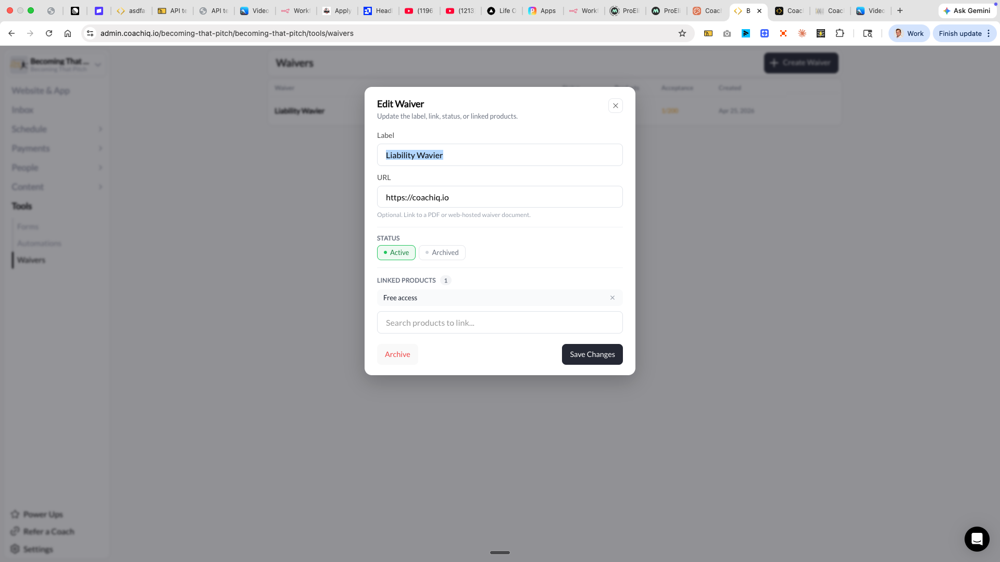
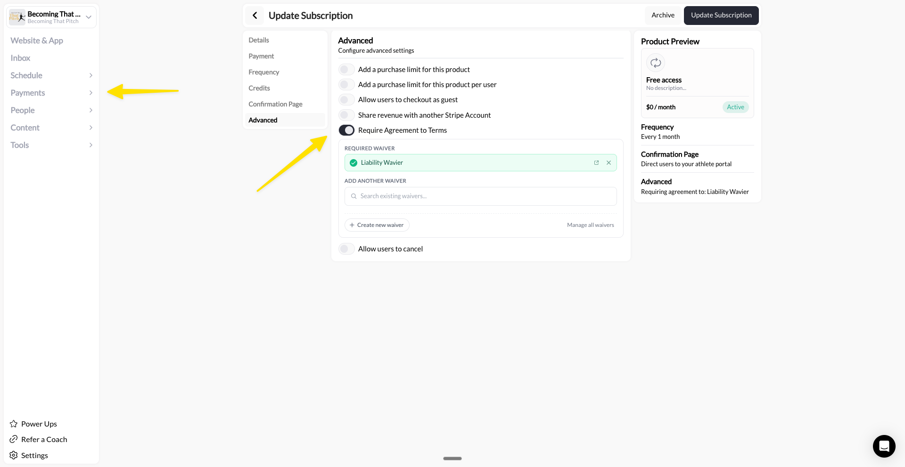
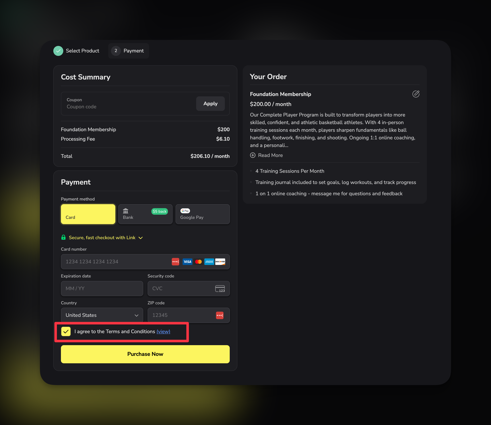
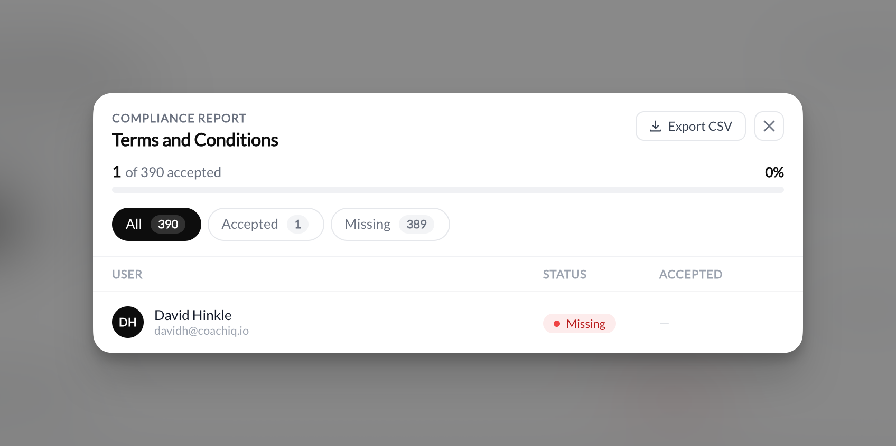

<Info>
  **Where to find this**: Tools → Waivers
</Info>

CoachIQ's waiver system lets you create waivers, attach them to products and forms, and track exactly who has accepted — all from one place.

## The waivers dashboard

Navigate to **Tools → Waivers** to see all your waivers at a glance.

<Frame>
  
</Frame>

| Column | What it shows |
|--------|---------------|
| **Waiver** | The waiver's name, and how many products require it |
| **Signed** | How many clients have accepted it out of everyone it covers, for example **3 of 37**. This matches the waiver's report |
| **Created** | When the waiver was made |
| **Actions** | **View report** and **Edit** |

Use **All statuses** to show active or archived waivers, and **Recent** to change the order. The buttons on each row open on the first click or tap.

---

## Create a waiver

<Steps>
  <Step title="Go to Tools → Waivers">
    Click **Create** in the top-right corner.
  </Step>

  <Step title="Fill in the waiver details">
    - **Label** — Give your waiver a clear name (e.g., "Liability Waiver", "Cancellation Policy")
    - **URL** — Link to the full waiver document. This can be a page on your CoachIQ website, a Google Drive link, a PDF, or any public URL.

    <Frame>
      
    </Frame>

    <Tip>
      Host your waiver on your CoachIQ website using [legal page templates](/website/pages-navigation/legal-pages) — it keeps everything in one place and looks professional.
    </Tip>
  </Step>

  <Step title="Save the waiver">
    Click **Save Changes**. Your waiver is now active and ready to attach to products or forms.
  </Step>
</Steps>

---

## Require a waiver at checkout

Attach a waiver to any product so clients must agree before purchasing.

<Steps>
  <Step title="Open the product">
    Go to **Payments → Products** and select the product you want to add a waiver to.
  </Step>

  <Step title="Go to Advanced settings">
    Click **Advanced** in the left sidebar of the product editor.
  </Step>

  <Step title="Toggle on Require Agreement to Terms">
    Enable the toggle, then select your waiver from the dropdown. You can also search for existing waivers or create a new one directly from here.

    <Frame>
      
    </Frame>
  </Step>

  <Step title="Save the product">
    Click **Update Subscription** (or **Create**) to save.

    <Check>
      **Done!** Clients will now see a checkbox at checkout: "I agree to the [Waiver Name]." They must check it before they can purchase.
    </Check>
  </Step>
</Steps>

<Frame>
  
</Frame>

When a client clicks the waiver name at checkout, it opens the URL you set — so they can read the full document before agreeing.

---

## Add a waiver to a form

You can also require waiver acceptance on any form — useful for registration forms, intake forms, or onboarding flows.

<Steps>
  <Step title="Open your form">
    Go to **Tools → Forms** and select the form you want to edit.
  </Step>

  <Step title="Add a Waiver question">
    In the form builder, click **Add question** and choose **Waiver** under **General**.
  </Step>

  <Step title="Pick the waiver">
    In the question's panel, choose the waiver to require. The form shows a checkbox with a link to the waiver document. Turn on **Required** so the form can't be sent without it. The form can't be saved until a waiver is picked.
  </Step>

  <Step title="Save the form">
    Click **Save**.

    <Check>
      **Done!** Anyone submitting this form must accept the waiver first. If the question has more than one waiver, they must tick every one, and the message under the question names the one still to accept.
    </Check>
  </Step>
</Steps>

---

## Track waiver compliance

The compliance report shows exactly who has accepted each waiver and who hasn't — so you always know where you stand.

<Steps>
  <Step title="Open the compliance report">
    Go to **Tools → Waivers** and click **View report** on the waiver's row.
  </Step>

  <Step title="Review acceptance status">
    The compliance report shows:

    - **All** — Every client in your system
    - **Accepted** — Clients who have agreed to the waiver (with the date)
    - **Missing** — Clients who have not yet accepted

    When a parent accepts a waiver while buying for their child, the child shows as signed, with the date the parent signed. The CoachIQ app's report shows the same list.

    <Frame>
      
    </Frame>
  </Step>

  <Step title="Export the report">
    Click **Export CSV** to download the full compliance list. Use this for your records, insurance requirements, or audits.
  </Step>
</Steps>

<Tip>
  Filter by **Missing** to quickly identify clients who still need to accept. You can then send them a message through the Inbox with a link to the product or form that includes the waiver.
</Tip>

---

## Edit or archive a waiver

Each waiver's row has **View report** and **Edit**. On a computer they appear when you hover over the row; on tablets and phones they're always visible. Click **Edit** (or the waiver) to change it. You can update:

- **Label** — Rename the waiver
- **URL** — Point to an updated document
- **Status** — Set to Active or Archived
- **Linked Products** — See and manage which products require this waiver

Click **Archive** to deactivate a waiver without deleting it. Archived waivers are removed from checkout and forms but their acceptance records are preserved.

---

## Common questions

<AccordionGroup>
  <Accordion title="Can I use different waivers for different products?">
    Yes. Each product can require its own waiver. For example, use a liability waiver for training sessions and a cancellation policy for memberships.
  </Accordion>

  <Accordion title="What happens when a client agrees to a waiver?">
    The system records who accepted, when they accepted, and how (via purchase or via form). This shows up in the compliance report and on the client's activity feed.
  </Accordion>

  <Accordion title="Can clients skip the waiver checkbox?">
    No. When a waiver is required, the checkbox is mandatory. Clients cannot complete the purchase or submit the form without checking it.
  </Accordion>

  <Accordion title="Why can't I delete a form response that includes a waiver?">
    The submission where a person first accepted a waiver is kept as the record of that acceptance, so **Delete** explains why and leaves it saved. This also applies on forms that allow one response per person after the person resubmits. A later submission where they only re-ticked a waiver they had already accepted can be deleted, and their acceptance stays.
  </Accordion>

  <Accordion title="What URL should I use for my waiver?">
    Any publicly accessible link works — a page on your CoachIQ website, a Google Doc, a PDF hosted on Google Drive, or an external website. Just make sure the link works for anyone who clicks it.
  </Accordion>

  <Accordion title="Does this work with guest checkout?">
    Yes. The waiver checkbox appears for both logged-in clients and guest checkout.
  </Accordion>

  <Accordion title="Can I see waiver acceptance on a specific client?">
    Yes. Open the client's profile and click the **Waivers** tab. It shows a count such as **1/2 accepted** and lets you record an acceptance you collected in person. See [the Waivers tab](/people/client-profiles/client-profiles-waivers).
  </Accordion>

  <Accordion title="A staff member marked a waiver accepted by mistake">
    An Admin can undo it. On the client's **Waivers** tab, a waiver marked by staff shows **Manual** with an **Undo** button next to **Accepted**. Undo asks first, sets the waiver back to not accepted, and records who undid it and when. Waivers the client accepted themselves have no Undo.
  </Accordion>

  <Accordion title="Where do I see the signature on a form response?">
    Open the response from the form's **Responses**. A **Signature** block shows who agreed, when and to what, and the table and export have a **Signed** column. See [Responses](/tools/forms/responses-and-automations#open-one-response).
  </Accordion>
</AccordionGroup>

---

## Related articles

<CardGroup cols={2}>
  <Card title="Legal Pages" icon="scale-balanced" href="/website/pages-navigation/legal-pages">
    Create terms, privacy policy, and disclaimers on your website
  </Card>
  <Card title="Product Builder" icon="box" href="/payments/product-builder">
    All product settings including Advanced options
  </Card>
  <Card title="Creating Forms" icon="rectangle-list" href="/tools/forms/creating-forms">
    Build forms with waiver components and more
  </Card>
  <Card title="Forms Overview" icon="file-lines" href="/tools/forms/overview">
    Everything you can do with CoachIQ forms
  </Card>
</CardGroup>
