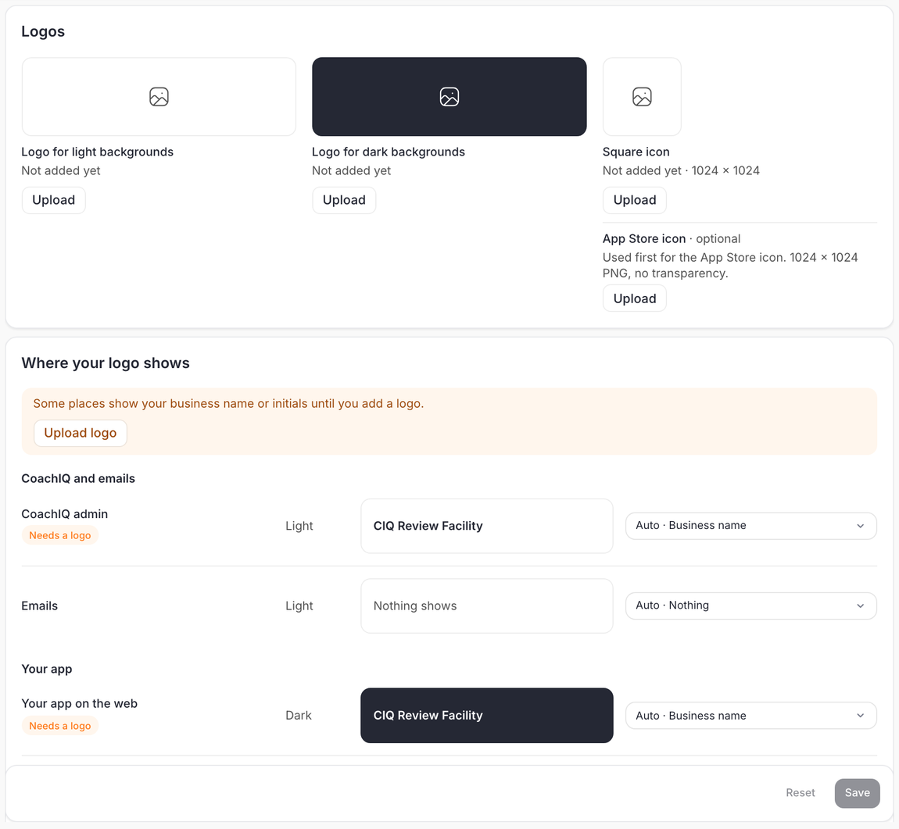

<Info>
**Where to find this:** sidebar → **Settings** → **General** → **Brand kit**
</Info>

The Brand Kit holds your logos, colors, fonts and style in one place. Your app, your emails, the CoachIQ admin and your website all read from it, so you set your brand once instead of in each builder. Each group has its own Brand Kit. A new group starts from your organization's branding.

<Frame>
  
</Frame>

## Logos

The **Logos** card has three uploads and one optional one:

| Logo | Use it for |
|---|---|
| **Logo for light backgrounds** | Your usual logo, usually dark or full color. Shows on white and light screens, such as the CoachIQ admin and emails. |
| **Logo for dark backgrounds** | A white or light version that reads on dark screens, such as a dark app or website header. |
| **Square icon** | A square mark, 1024 × 1024. Used for your app icon, sign-in screen and group picker. |
| **App Store icon** (optional) | For a [branded app](/power-ups/personalized-app). 1024 × 1024 PNG, no transparency. If you don't upload one, the square icon is used. Images the App Store would reject are refused when you upload them. |

Click **Upload** under a logo to add or replace it. If you pick several files quickly, the last one you picked is the one kept.

## Where your logo shows

Below the logos, **Where your logo shows** lists every place your logo appears, with a preview on that place's own background:

- **CoachIQ and emails:** **CoachIQ admin** (the top left of the admin), **Emails**
- **Your app:** **Your app on the web**, **Sign-in and group picker**, **Your app on iPhone and Android**, **App icon**, **App Store icon**
- **Website:** **Website header**, **Website footer**

Each place starts on **Auto**, which picks the logo that shows up on that background: light places use the logo for light backgrounds, your app follows its theme, square places use the square icon, and the website rows follow each website's theme. To choose for yourself, open the menu on a row and pick a logo or **Business name**.

When a place has no logo to show, it never shows an invisible logo. Wide places show your business name, and square places show your initials. Those rows are tagged **Needs a logo** or **Needs an icon**, and a notice at the top offers **Upload logo**.

<Note>
- A logo you set in the website builder's header or footer still wins on that website. The website row says so and offers **Use Brand Kit** to go back to the Brand Kit logo.
- A logo you pick in the email composer still wins for that email.
- If your organization has several programs, each program's notification and invite emails show that program's own logo once its Brand Kit has one.
- The iPhone and Android apps pick up your choices with the next app update.
- If you've never used this list, every place keeps showing what it showed before.
</Note>

## Colors

- **Theme:** **Light** or **Dark**.
- **Primary:** buttons and highlights.
- **Secondary:** a second brand color some sections use.
- **Button text:** the text color on your buttons. If it would be hard to read on your primary color, a warning shows under it. The warning doesn't stop you saving.

## Fonts

**Heading font** and **Paragraph font** set the type across your website. Click a font box to open the list, pick a font, and the **Preview** under it updates.

A font name can only use letters, digits, spaces and hyphens, up to 60 characters. Names with an apostrophe or other symbols, such as "Ma'am Script", are refused with a short message, because the website couldn't show them. Spaces at the start or end are removed.

Your app keeps its own app font. The Brand Kit fonts apply to your website.

## Style

- **Media style:** **Rounded** or **Square** corners on photos and videos.
- **Shadows:** a soft shadow on cards and buttons.

## Save your Brand Kit

1. Make your changes. **Save** turns on once something has changed. **Reset** puts back what was saved.
2. Click **Save**, then choose:
   - **Save and publish website**: your app updates and your website goes live with the new branding.
   - **Save only**: your app updates, and the website keeps the changes waiting until you publish. The message that confirms the save has a **Publish** button.

Logos, colors and fonts reach your app straight away. Website changes only go live when they're published, from here or from the website builder.

If you leave the page with unsaved changes, CoachIQ asks before dropping them. If a save fails, your edits stay on screen with a message.

## How your website uses the Brand Kit

Your website's **Design** panel follows the Brand Kit. If you change a setting there, such as the primary color, that setting shows **Changed for this website**, and it no longer follows the Brand Kit. Click **Use Brand Kit** under it to follow the Brand Kit again. See [Settings & Design](/website/settings-and-design#design).

## Related articles

<CardGroup cols={2}>
<Card title="Website Settings & Design" icon="sliders" href="/website/settings-and-design">
  Change design settings for your website only.
</Card>
<Card title="Favicon & Share Images" icon="image" href="/website/seo-marketing/favicon-share-images">
  The browser-tab icon and the picture shown when your site is shared.
</Card>
</CardGroup>
