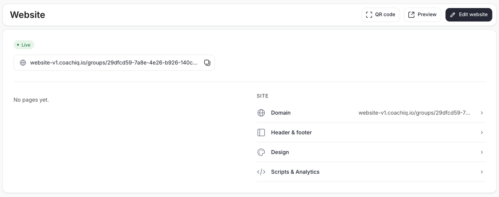
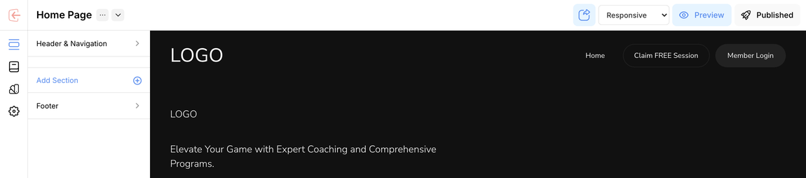

<Info>
**Where to find this:** sidebar → **Website & App** → **Website**
</Info>

Your website is the public site families find on Google and from your social links. It shows your programs, sessions, prices and forms, and sends visitors into your app to book and pay. Everything about it starts on the **Website** page.

## The Website page

Open **Website & App** in the sidebar. It has two pages: **Website** (this one) and **App** (your [app](/athlete-portal/understanding-your-athlete-portal)). Saved links to the old dashboard open the Website page.

<Frame>
  
</Frame>

What's on the page:

| Part | What it does |
|---|---|
| **Live** | Shows that your site is published and visitors can see it. |
| **Address** | Your website's address, with a copy button. It shows your own domain once one is connected, otherwise your free `website-v1.coachiq.io` address. Your app's address never shows here. |
| **QR code** | Opens **Create QR code**. Choose a size and click **Download QR Code** to print it on flyers, posters or a front-desk sign. |
| **Preview** | Opens your live website in a new tab. |
| **Edit website** | Opens the [website builder](#the-website-builder). |
| **Pages** | Every page on your site, in two groups. See [Sitemap and Hidden pages](#sitemap-and-hidden-pages). Click a page to open it in the builder. |
| **Site** | **Domain**, **Header & footer**, **Design** and **Scripts & Analytics**. Each row opens the builder at that setting. |

<Note>
Staff whose access doesn't include Website & App don't see it in the sidebar.
</Note>

### Sitemap and Hidden pages

Your pages are split into two groups, each with a count:

- **Sitemap**: pages that are listed in your site's sitemap, so Google can find them and they can sit in your menus.
- **Hidden (link only)**: pages you took out of the sitemap. They're still live, but only people with the link can reach them, which suits thank-you pages, private team pages or a landing page for one ad. Each hidden page shows its title, its full path and a **Copy link** button that copies the page's full web address. This group starts closed; once you open it, it stays open the next time you visit in the same browser.

Sub-pages follow their parent. If a page is still in the sitemap but its parent is hidden, it shows in both groups: under **Sitemap** in its parent's place with a small **Parent is hidden** note, and under **Hidden** beneath its parent with an **In sitemap** note. Each page is counted once, so the two counts add up to all your pages.

To move a page between the groups, use the [Sitemap Builder](/website/seo-marketing/sitemap-builder).

## Start your website

If your website hasn't been started, the builder shows a **Start your website** card with one **Start website** button. Starting it publishes the site straight away at your free address, so add your content soon after.

Most coaches don't start from a blank site. When you fill out the website onboarding form, our team builds the site for you from your answers, your sport and photos, using a matching style with its own header, footer, sections and fonts. You review it, ask for changes, and it goes live. After that, you can change anything yourself in the builder.

<Note>
Once your website is published, it stays visible to visitors. To keep a single page out of menus and Google, hide it in the [Sitemap Builder](/website/seo-marketing/sitemap-builder).
</Note>

## The website builder

Click **Edit website** on the Website page, or any page or Site row, to open the builder.

<Frame>
  
</Frame>

**Along the top:**

- **Exit** (the arrow at the top left) takes you back to the admin.
- **Page name** with a down arrow: switch pages, **Add New Page**, or **Reorder** pages. The **⋯** button next to it opens **Page Settings** (title, slug, keywords, featured image, description, and hiding the site header or footer on that page). See [Website Pages](/website/pages-navigation/pages-navigation).
- **Device menu**: preview the page at **Responsive**, phone, tablet or laptop sizes.
- **Preview** shows the page without the editing tools.
- **Publish** saves your changes and puts them live. When there's nothing new to publish, the button reads **Published**.

**Down the left side:**

| Icon | Panel | What you do there |
|---|---|---|
| Layers | **Sections** | Edit **Header & Navigation**, the page's sections, **Add Section** and the **Footer**. See [Working with Sections](/website/sections/working-with-sections). |
| Book | **Blog** | Write and manage blog posts. See [Blog](/website/blog). |
| Palette | **Design** | Theme, fonts, colors, media style and shadows for the whole site. See [Settings & Design](/website/settings-and-design). |
| Gear | **Settings** | Favicon, blog archive page, Scripts & Analytics, domains, Sitemap Builder, URL Redirects and Purge Cache. See [Settings & Design](/website/settings-and-design#site-settings). |

Your logo, brand colors and fonts come from the [Brand Kit](/website/brand-kit), so the website, your app and your emails match. You can still change any design setting for the website alone.

## Publish your changes

1. Make your edits. The top button changes to **Publish**.
2. Click **Publish**. Your changes go live on your website.
3. Open **Preview** on the Website page, or your site address, to check the page on a computer and a phone.

If you try to leave the builder with unpublished changes, it asks first. If a publish fails, your edits stay on screen and the button still reads **Publish**, so you can try again. For more, see [Save before leaving a page](/website/sections/working-with-sections#save-before-leaving-a-page).

## When something's wrong on your site

- **A visitor types a wrong address:** they see a **Page not found** screen in your site's own header, footer and colors, with a **Home** button. Header and footer links on that screen take them back to your home page.
- **A change doesn't show yet:** wait a minute and reload. If it still doesn't show, use **Purge Cache** under **Settings**. See [Site cache](/website/settings-and-design#site-cache).
- **A button does nothing:** if a button that opens a program, form, product or session in your app can't reach it, visitors see "This button is not available right now. Please try again later." Check the button's link in the builder. See [Buttons & CTAs](/website/sections/buttons-ctas).

## Next steps

<CardGroup cols={2}>
<Card title="Brand Kit" icon="palette" href="/website/brand-kit">
  Set your logos, colors and fonts once for your website, app and emails.
</Card>
<Card title="Website Pages" icon="file" href="/website/pages-navigation/pages-navigation">
  Add, rename, reorder and delete pages.
</Card>
<Card title="Working with Sections" icon="layer-group" href="/website/sections/working-with-sections">
  Add sections from the library and edit their content.
</Card>
<Card title="Domain Setup" icon="link" href="/website/domain-setup/domain-setup">
  Put your website on your own domain.
</Card>
</CardGroup>
