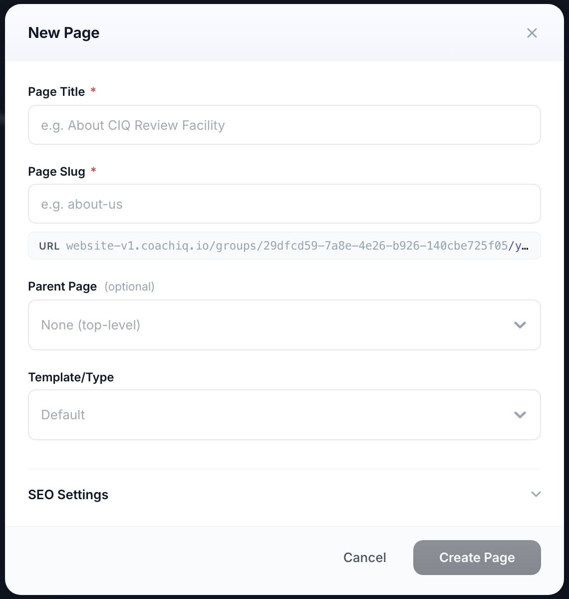

<Info>
  **Where to find this**: **Website & App** → **Website** → **Edit website**, then the page name at the top of the builder
</Info>

## How your pages are organized

Every page has a title, an address (its slug), and an optional parent. A page with a parent is a sub-page: its address sits under the parent's, and menus can show it in a dropdown under the parent.

You can see every page at a glance on the [Website page](/website/overview#sitemap-and-hidden-pages), split into **Sitemap** and **Hidden** pages. Click any page there to open it in the builder.

## Switch between pages

1. In the builder, click the down arrow next to the page name at the top.
2. The **Pages** list opens. Click a page to edit it. Your home page shows as **Home Page**.

**Reorder** at the top of the list lets you drag pages into a new order.

## Add a page

<Frame>
  
</Frame>

<Steps>
  <Step title="Open New Page">
    Click the down arrow next to the page name, then **Add New Page**.
  </Step>
  <Step title="Fill in the page">
    - **Page Title**: what visitors see, for example "Basketball Skills Training".
    - **Page Slug**: the end of the page's address, filled in from the title. Spaces, capitals and slashes are turned into a valid address as you type, and the full **URL** shows underneath. If the address still isn't valid, for example it ends in a hyphen, the rule shows right away and **Create Page** stays off until you fix it.
    - **Parent Page** (optional): pick a page to make this a sub-page, or leave **None (top-level)**.
    - **Template/Type**: **Default** for a blank page, or a ready-made page. See [Page Templates](/website/pages-navigation/page-templates).
    - **SEO Settings**: the title and description Google shows. See [Page metadata](/website/seo-marketing/meta-titles-descriptions#set-metadata-when-creating-a-page).
  </Step>
  <Step title="Create it">
    Click **Create Page**. The page opens in the builder, ready for sections. It's added to your sitemap, but it isn't in your menus until you add it to the [header or footer](/website/sections/header-footer-navigation).
  </Step>
</Steps>

<Note>
A few characters can't be saved in a page title or description yet, such as the ʻokina in Hawaiʻi. If you use one, a message names the character and asks you to remove or replace it. Nothing is saved until you do.
</Note>

## Page Settings

Click **⋯** next to the page name to open **Page Settings** for the page you're on:

- **Title**, **Slug**, **Keywords**, **Featured Image** and **Description**
- **Hide site header on this page** and **Hide site footer on this page**, for focused landing pages

Publish to save changes. See [URL Slugs & Page Management](/website/pages-navigation/url-slugs-page-management) before you change a live page's slug.

## Hide a page

To keep a page live but out of your sitemap and Google, so only people with the link reach it, use the [Sitemap Builder](/website/seo-marketing/sitemap-builder). It then shows under **Hidden (link only)** on the Website page.

## Delete a page

Deleting a page removes it and its sections for good. Your home page can't be deleted. The confirmation lists any header or footer menu items and buttons that point at the page, and those are removed with it, so your menu never has a dead link.

Before you delete:

- Check buttons inside your page sections that link to the page. The confirmation doesn't list those.
- Add a [URL redirect](/website/seo-marketing/url-redirects) from the old address to another page, so visitors and Google links still land somewhere.

The Assistant and connected AI apps can't delete a page that a menu item or button points at.

## Plan your pages

### Group pages under a parent

Many coaches benefit from organizing services into logical groups. Here's how to structure your offerings:

<Tabs>
  <Tab title="Training Programs Structure">
    **Training Programs** (Parent Page)

    - In-Person Training
    - Online Coaching
    - Group Sessions
    - One-on-One Training
  </Tab>
  <Tab title="About Structure">
    **About** (Parent Page)

    - Coach Biography
    - Training Philosophy
    - Credentials
    - Success Stories
  </Tab>
  <Tab title="Services Structure">
    **Services** (Parent Page)

    - Youth Training
    - High School Prep
    - College Recruiting
    - Adult Fitness
  </Tab>
</Tabs>

## Frequently asked questions

<AccordionGroup>
  <Accordion title="How many pages should my coaching website have?">
    Most successful coaching websites have 5-10 pages total. Start with essential pages (Home, About, Services, Contact) and add specialized pages as your business grows. Focus on quality content that serves your athletes and parents rather than creating many pages with thin content.
  </Accordion>
  <Accordion title="Can I delete pages after creating them?">
    Yes. See [Delete a page](#delete-a-page). Menu items and header buttons that point at the page are removed with it; add a redirect for the old address.
  </Accordion>
  <Accordion title="What's the difference between page templates?">
    **Default** starts a blank page. A ready-made template starts the page with sections already in place, such as a booking page or a camp registration page. You can add, change or remove sections afterwards. See [Page Templates](/website/pages-navigation/page-templates).
  </Accordion>
</AccordionGroup>

## Ready to build your coaching website structure?

<CardGroup cols={2}>
  <Card title="Learn About Page Sections" icon="album-collection" href="/website/sections/sections">
    Discover how to customize content within your pages using CoachIQ's section system
  </Card>
  <Card title="Domain Setup Guide" icon="globe" href="/website/domain-setup/domain-setup">
    Connect your custom coaching domain once your pages and navigation are configured
  </Card>
  <Card title="SEO & Marketing" icon="search" href="/website/seo-marketing/seo-marketing">
    Optimize your website structure for search engines and local discovery
  </Card>
  <Card title="Analytics & Tracking" icon="chart-line" href="/website/analytics-tracking/analytics-tracking">
    Set up tracking to measure how visitors navigate your coaching website
  </Card>
</CardGroup>

<Tip>
  **Pro tip**: Before creating many pages, sketch out your ideal website structure on paper. Consider your coaching services, target audience (parents, athletes, or both), and the journey you want visitors to take from first discovery to booking their first training session. This planning prevents navigation confusion later.
</Tip>