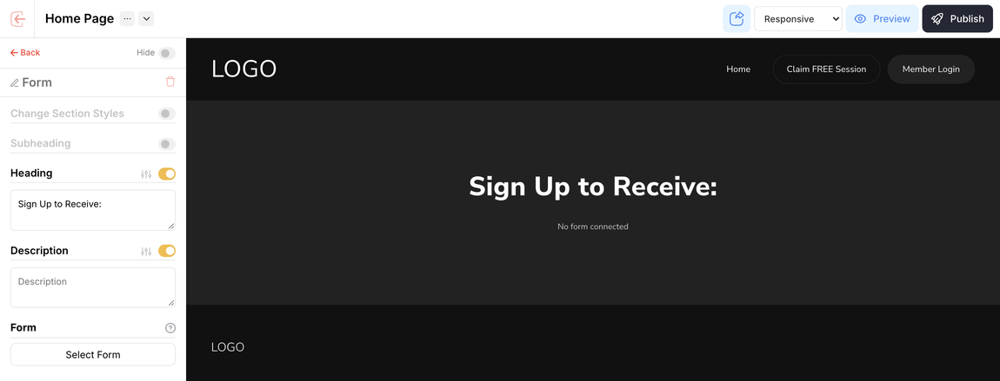

<Info>
**Where to find this:** website builder → **Add Section** → **Default Templates** → **Form** (or any section in a form type), then click the section to edit it.
</Info>

A Form section shows one of your [CoachIQ forms](/tools/forms/overview) on a page of your website. The form's own steps still apply: required questions, sign-in, products to buy and sessions to book. Set those up in the [form builder](/tools/forms/payments-and-bookings).

## Add a form to a page

<Frame>
  
</Frame>

1. Click **Add Section**, open **Default Templates** and pick **Form**, then **Add to page**.
2. Fill in the **Heading** and **Description**. Turn on **Subheading** if you want a small line above the heading.
3. Under **Form**, click **Select Form** and pick the form. Until you do, the page shows **No form connected**.
4. **Publish**, then open the live page and run through the form once yourself.

<Tip>
Publish your page before you go off to build a new form, so you don't lose edits.
</Tip>

## What visitors see

- Every question shows its label. A question saved without a label shows its question type instead, such as "Text", and required questions show an asterisk.
- Image and video uploads work. If an upload fails, the visitor sees a message under that file and keeps their other answers.
- If **Continue** or **Submit** fails, the cursor moves to the first field that needs fixing.
- After submitting, the **Form Submitted** message scrolls into view, even on a long form.
- If you disconnect the form and publish, the section keeps its heading with no empty form box.

## When visitors sign in on a form

If a form needs visitors to sign in, the sign-in step explains why it opened. Someone whose email already has an account is asked to sign in as soon as they enter it. See [Returning visitor sign-in](/tools/forms/returning-visitor-sign-in).

Visitors can sign in two ways:

- **Password**, with **Forgot password?** if they need to reset it.
- **Text me a code instead**: they enter their mobile number, get a 6-digit code by text, and carry on exactly where they were. If the form already has their email, the code signs in that account, so family members who share one mobile number each reach their own account.

New visitors can also create an account with a texted code. After they confirm their phone number, they add their name, email and your sign-up questions, with no password. Registration, waivers and checkout then continue with what they'd chosen.

If sign-in doesn't work, the message says why:

| Message is about | What to tell the family |
|---|---|
| Too many attempts | Wait a few minutes and try again. |
| The account can't sign in to your business | They should contact you. Check the person in [People](/people/overview). |
| A temporary problem | Try again in a moment. |
| Wrong password or unknown email | Same as before: check the email or reset the password. |

## Notices in the builder

The builder warns you when a form spot can't show a form:

| Notice | What it means | What to do |
|---|---|---|
| **Form not found** on the form card, with "The form chosen here is no longer available." | The form was deleted or belongs to another organization. | Click **Replace** to pick another form, or **Disconnect**. |
| "No form is picked here." | The spot is empty. | Pick a form. |
| "This section's form spot has no form picked; the attached form no longer fills it." | An older section that attached one form to the whole section. | Click **Use the attached form**, or pick another form. |

Nothing changes on your live site until you publish. A form spot left empty shows nothing to visitors.

## Common questions

<AccordionGroup>
<Accordion title="My form doesn't show on the live site">
Check the section shows the form you picked, not **No form connected** or **Form not found**, then publish. If it still doesn't show, wait a minute and reload.
</Accordion>
<Accordion title="A parent says they never made an account">
Someone in the family probably did. Search their email in [People](/people/overview), then have them use **Forgot password?** or **Text me a code instead**.
</Accordion>
</AccordionGroup>
