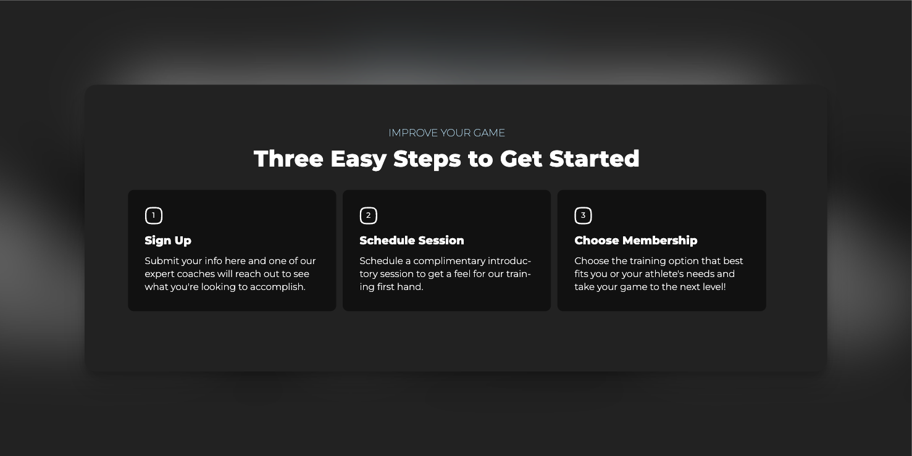

<Info>
**Where to find this:** website builder → **Add Section** → **Default Templates** → **Numbered Steps**
</Info>

A Numbered Steps section lays out a short process as numbered cards: how to get started, how a first session works, or how your program is built. The template starts with three steps: **Sign Up**, **Schedule Session** and **Choose Membership**.

<Frame>
  
</Frame>

## Add the section

<Steps>
  <Step title="Open the page">
    Go to **Website & App** → **Website**, click **Edit website**, and pick the page from the page menu at the top.
  </Step>
  <Step title="Add Numbered Steps">
    Click **Add Section**, open **Default Templates**, click **Numbered Steps**, then **Add to page**. The section lands at the bottom of the page; drag it where you want it.
  </Step>
  <Step title="Fill it in">
    Click the section in the left panel. Write the heading, then rename each step, write its description and turn on a button where you want one.
  </Step>
  <Step title="Publish">
    Click **Publish**, then check the live page on a computer and a phone.
  </Step>
</Steps>

## Settings

| Setting | What it does |
|---|---|
| **Subheading** | A short line above the heading, often in capitals. |
| **Heading** | The section's title. Up to 500 characters. |
| **Description** | A line or paragraph under the heading. |
| **Steps** | The cards, numbered in order. Click the pencil on a step to rename it (up to 350 characters) and fill in its **Description** (up to 750 characters). The trash icon deletes it. |
| **First Button**, **Second Button** | Each step can have up to two buttons. Turn one on, change its label, and click the gear to choose where it goes. |
| **Add step** | Adds another numbered card at the end. |

The numbers come from the order of the steps, so you don't type them. For **Background**, **Vertical Padding** and width, turn on **Change Section Styles**. See [Backgrounds & Styling](/website/sections/backgrounds-styling). For button links, see [Buttons & CTAs](/website/sections/buttons-ctas).

## Tips

- Three or four steps read best. Make each step title an action the family takes, like "Book a free evaluation".
- Put a button on the step that starts things off, linked to the form or scheduler it describes, so a family can act without scrolling to find it.

## Related

- [Working with Sections](/website/sections/working-with-sections): add, reorder, hide and delete sections
- [Backgrounds & Styling](/website/sections/backgrounds-styling): what **Change Section Styles** does
- [Section Types](/website/section-types/section-types): every default section
