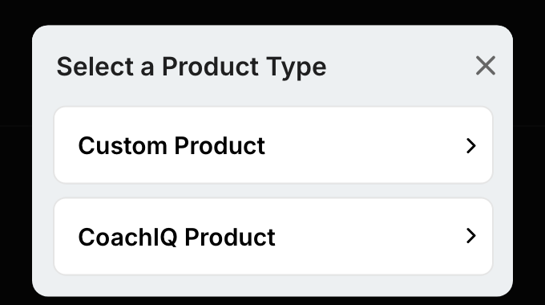
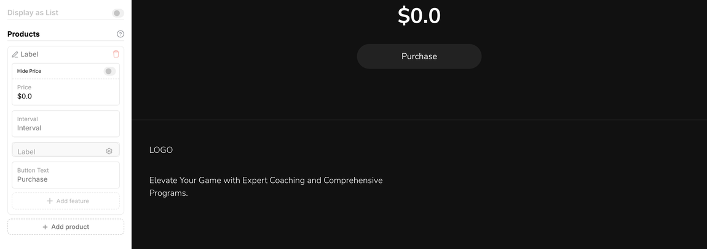

<Info>
**Where to find this:** website builder → **Add Section** → **Default Templates** → **Pricing** (or any section in the **Pricing** type), then click the section to edit it.
</Info>

A Pricing section shows cards with a name, price, features and a button. Use CoachIQ products so visitors can buy straight from your website, or custom products for anything you sell somewhere else.

## Edit the section

Click the section in the left panel. Along with **Subheading**, **Heading** and **Description**, you get:

- **Display as List**: shows the products as rows instead of cards.
- **Products**: the cards in the section. Click **Add product** to add one, then choose a product type.

<Frame>
  
</Frame>

## Add a CoachIQ product

Choose **CoachIQ Product** and pick from your products. Its price and features come from the product, and you can edit the features shown on the card.

When a visitor clicks **Purchase**, checkout opens in your app in a new tab with the product's price, payment methods and registration steps. Change those in the [Product Builder](/payments/product-builder).

- A product that's unlocked with an access code shows its price as **Code** in the builder and on your website.
- Archived products don't show. If a card still points at a product that was archived or deleted, the card shows blank. Pick an active product for it and publish.
- On phones, the product picker shows each product's full price and billing cadence under its name, and the number of products selected on its own line.

## Add a custom product

Choose **Custom Product** for something you don't sell through CoachIQ, such as merchandise on another store.

<Frame>
  
</Frame>

1. Click **Label** at the top of the card to name the product, for example "In-person skills session".
2. Enter the **Price** and the **Interval**, such as "per session" or "/month".
3. Set where the button goes in the link box (the one with the gear icon), and its wording in **Button Text**.
4. Click **Add feature** for each line you want on the card, such as "60-minute session".
5. **Publish**.

To show a card without a price, for example "Contact us for pricing", turn on **Hide Price**. The **Price** and **Interval** boxes hide, and a note says "The card shows no price or interval." Turn it off to bring both back with what you entered before.

## What visitors see

- **Purchase** buttons for CoachIQ products open your app in a new tab and show a small new-tab icon. Buttons in the same row line up.
- Visitors can open pricing rows and the checkout window with a keyboard. Escape closes checkout unless a payment is in progress.
- Prices at checkout show with their currency symbol. A quick second tap on a checkout button shows a short "One moment" notice instead of opening checkout twice.
- In a camp grid, a camp with no registration products shows **Coming Soon** with a disabled **Registration Coming Soon** button until you add registration options.

## Common questions

<AccordionGroup>
<Accordion title="If I change a product's features in CoachIQ, does the card update?">
No. Features are copied when you add the product. Edit them on the card after you change the product.
</Accordion>
<Accordion title="How many products can a Pricing section hold?">
As many as you need. For a long list, turn on **Display as List**.
</Accordion>
</AccordionGroup>
