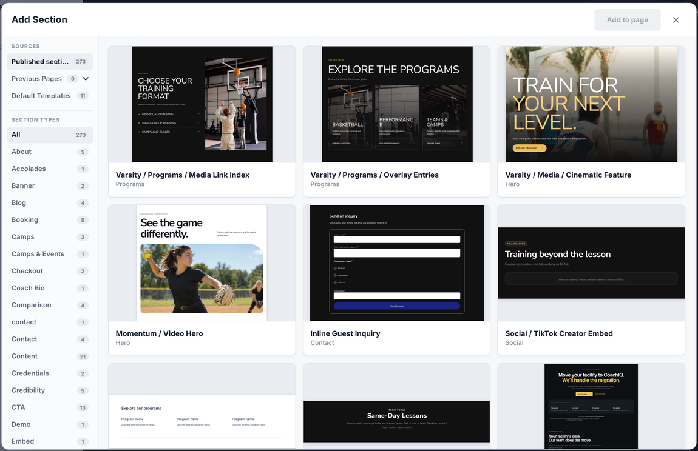
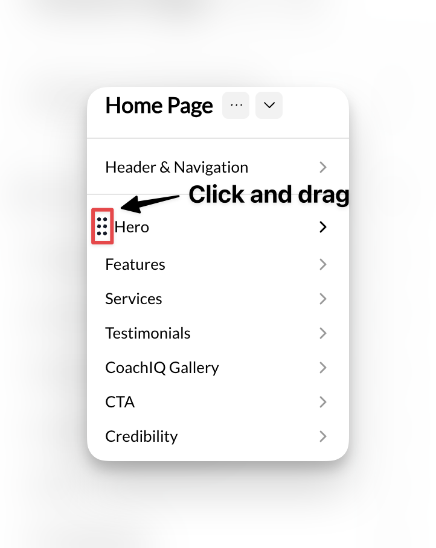
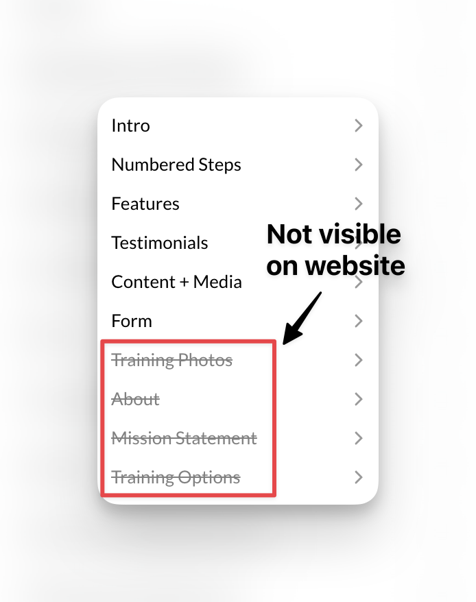

<Info>
  **Where to find this**: **Website & App** → **Website** → **Edit website**, then pick a page
</Info>

## What you'll accomplish

Learn how to add new sections to your coaching website, reorder them for the best user flow, temporarily hide sections, and remove sections you no longer need.

## Adding new sections to your website

<Steps>
  <Step title="Open the page">
    Go to **Website & App** → **Website**, click **Edit website**, and pick the page from the page menu at the top.
  </Step>
  <Step title="Click Add Section">
    In the left panel, click **Add Section**. It sits between **Header & Navigation** and **Footer**.
  </Step>
  <Step title="Choose sections from the library">

    <Frame>
      
    </Frame>

    Pick where to look under **Sources**:

    - **Published sections**: ready-made designs, including styles such as Varsity and Momentum.
    - **Previous Pages**: sections already used on your site.
    - **Default Templates**: the standard CoachIQ sections, such as Form, Pricing, Schedule, Gallery and Testimonials.

    Narrow the list with **Section types** (About, Booking, Contact, Pricing and so on). Each card shows the section the way it looks once added: your site colors and fonts, the design's own starting text, and the whole section scaled to fit. Booking and form sections show the same message the page shows until you connect something. A card with nothing to preview yet says "Preview shows once content is added".

    Click one or more cards. **Add to page** shows how many you picked; click it to insert them, then edit their content. Closing the library without adding leaves your page unchanged.

  </Step>
</Steps>

## Reuse a custom section

Open **Add Section → Previous pages** to find sections already used on your site, or browse **Published sections** for published custom templates. Select the section, add it to the page, and replace its text, images, and linked products or schedulers with the content for that page. A section copied from **Previous pages** arrives with its saved headline, image, button text and link.

AI-generated sections are custom sections too: use their editable text, image, icon, and link fields to adapt them to your page. Custom sections expose different editable fields depending on their design. Review the page preview and the published result after changing a section.

## Choose an icon

When a section exposes an icon field, open its icon picker and search the library or browse its categories. Choose the icon and its available color setting. The categories offered can vary by section; an icon field may be limited to social icons, for example.

## Choose which part of a photo or video stays visible

When a section crops a photo or video to fit a card or gallery tile, you can choose which part stays in view. Once an image or video is added to a section, a **Focus** setting appears under it:

- **Auto** (the default) keeps the centered crop
- **Top**, **Bottom**, **Left**, **Center** or **Right** move the crop toward that edge
- For finer control, click or drag on the preview under the choices to place the focus point anywhere. The arrow keys nudge it, and a short line under the preview shows where the point sits

For example, on a tall phone video in a wide gallery card, place the point between the player's face and the ball to keep both in view. Publish to apply it. The same point is used on the live site on desktop and phones.

Sections where you never pick a Focus look the same as before. How much stays visible still depends on the shape of the clip and the card, so a landscape version of a clip can work better in a wide card.

## Remove an optional image or video cover

Some section images are optional, such as background images and video cover images. These show a **Remove** button, along with a thumbnail of the current image, including images that came with the template. Required images don't have it.

Click **Remove**, then **Publish**. The image stays removed on desktop and mobile, and no broken image icon is left behind. The rest of the section is untouched, and the file stays in your Media Hub.

## Save before leaving a page

Use **Publish** to save page changes and make them visible on your site. Check the published page as well as the editor preview.

- **When the button says Publish:** after any real edit, including changes in the **Design** panel. Just opening a section, the header, the footer or **Page Settings** doesn't count as a change.
- **Leaving with unsaved changes:** the builder asks before you leave, including when you go to **Blog**. Choose **Stay** to keep your draft.
- **If a save fails:** your edit stays on screen and the button still says **Publish**, so you can try again. If a published change doesn't reach the live site on the first try, CoachIQ keeps retrying in the background.
- **If a page won't load:** you see **Couldn't load this page** with **Retry** and **Back to dashboard**. There's no Publish button on that screen, so the saved page can't be overwritten.

## Edit a section

Click a section in the left panel to open its settings. At the top you'll find **Back**, the **Hide** switch, the section's name (click the pencil to rename it) and the delete icon. Below that are **Change Section Styles** and the section's own fields, which differ by section. Each field has a switch to show or hide it on the page.

- **Lists of items** (cards, steps, testimonials, links): use **Add** or **Duplicate** to add items. A list can hold up to 500 items.
- **Linked names and prices:** some designs place a camp, program, form or coupon name or price somewhere it can't print. The card shows a note starting "Prints empty:", and after you publish, a warning lists the sections affected. Pick a different section design, or ask us to adjust it.
- **Images you just uploaded** show in the field and on the page right away, after a short loading state.
- **Media tags** in gallery and video fields: search finds a tag from one letter or part of its name, whatever the capitals.

## Reordering sections on your page

You can change the order of sections to create the perfect flow for your visitors.

<Steps>
  <Step title="Locate the section to move">
    Find the section you want to reorder in your page layout.
  </Step>
  <Step title="Use the section controls">
    Look for the reorder controls next to the section name in the left sidebar by hovering over the section with your mouse.

    <Tip>
      **Best practice**: Place your most important sections (like scheduling or contact forms) higher on the page where visitors will see them first.
    </Tip>
  </Step>
  <Step title="Move to desired position">
    Click and drag the six dot icon to move the section up or down to your preferred position.

    <Frame>
      
    </Frame>
    <Check>
      The section will immediately move to its new position and you can preview the change.
    </Check>
  </Step>
</Steps>

## Hiding sections temporarily

Sometimes you want to keep a section configured but temporarily hide it from visitors.

<Steps>
  <Step title="Select the section">
    Click on the section you want to hide in your Website Builder.
  </Step>
  <Step title="Toggle the Hide option">
    Look for the **Hide** toggle in the section settings panel and switch it on.

    <Frame>
      
    </Frame>
    <Note>
      Hidden sections remain in your Website Builder but won't appear to visitors on your live site. This is perfect for sections you're still working on or seasonal content.
    </Note>
  </Step>
  <Step title="Unhide when ready">
    To make the section visible again, simply toggle the Hide option back off.
  </Step>
</Steps>

## Removing sections permanently

<Warning>
  **Important**: Once you publish, a removed section and all its content and settings are gone for good. If you might want it back, use **Hide** instead.
</Warning>

<Steps>
  <Step title="Select the section to remove">
    Click on the section you want to delete in your Website Builder.
  </Step>
  <Step title="Find the delete option">
    Click the red trash icon next to the section's name at the top of the panel.
  </Step>
  <Step title="Confirm deletion">
    Confirm, then click **Publish** to remove it from your live page.
  </Step>
</Steps>

## Common questions

<AccordionGroup>
  <Accordion title="How many sections can I add to a page?">
    There's no strict limit on the number of sections you can add, but keep user experience in mind. Pages that are too long may lose visitor attention.
  </Accordion>
  <Accordion title="Can I copy sections between pages?">
    Use **Add Section → Previous pages** to reuse a section on another page, then update its text, images, and links.
  </Accordion>
  <Accordion title="What happens to hidden sections?">
    Hidden sections are saved in your Website Builder but don't appear to visitors. They don't affect your site's loading speed or SEO.
  </Accordion>
  <Accordion title="Can I undo removing a section?">
    No, removing a section permanently deletes it. If you might need the section later, use the Hide option instead.
  </Accordion>
</AccordionGroup>

## Pro tips

<Tip>
  **Plan your layout**: Before adding sections, sketch out your ideal page flow. Start with essential sections like hero, about, services, and contact.
</Tip>

<Tip>
  **Use Hide for testing**: When trying new section layouts, hide existing sections instead of removing them so you can easily revert changes.
</Tip>

<Tip>
  **Mobile preview**: After reordering sections, always check how your page looks on mobile devices to ensure good user experience.
</Tip>

## Related articles

- [Section Styling and Layout](/website/sections/backgrounds-styling) - Customize the visual appearance of your sections
- [Editing Section Content](/website/sections/sections) - Learn how to edit text, images, and content within sections
- [Section Types](/website/section-types/section-types) - Explore the specific features available for each section type