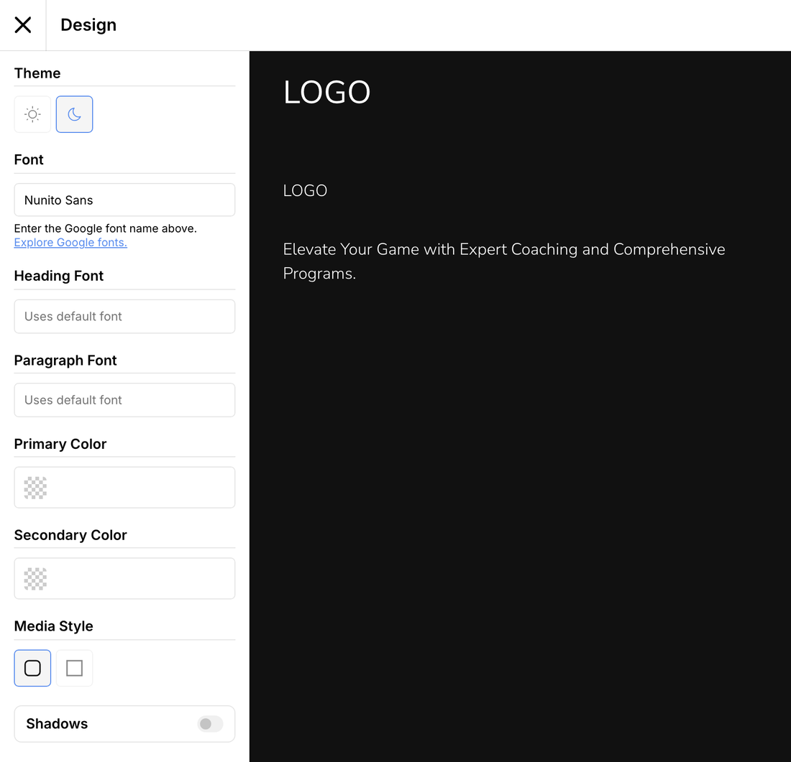
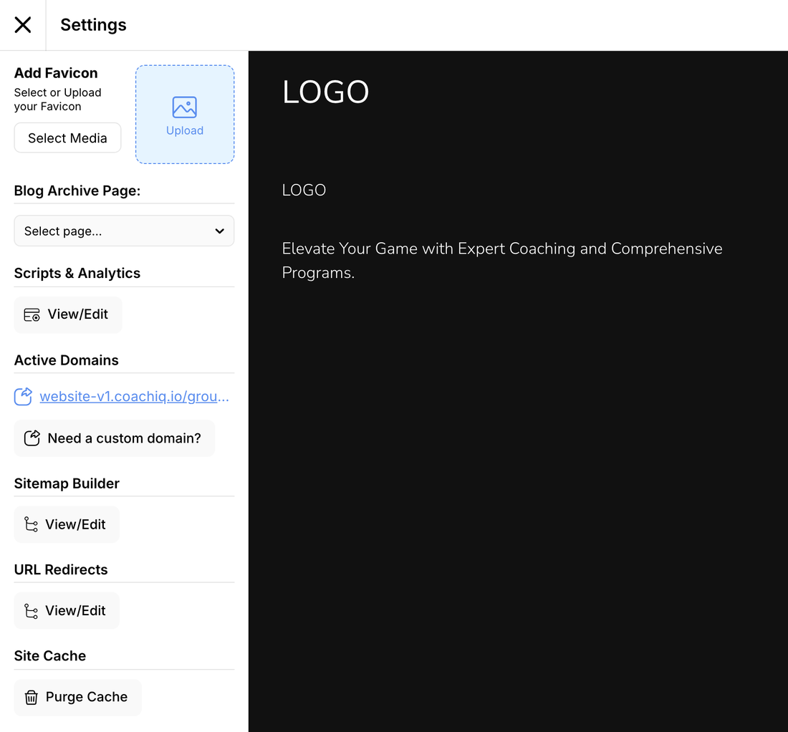

<Info>
**Where to find this:** **Website & App** → **Website** → **Edit website**, then the palette icon (**Design**) or the gear icon (**Settings**) on the left. You can also click **Design** or **Domain** under **Site** on the Website page.
</Info>

Two panels in the website builder apply to your whole site: **Design** for how it looks, and **Settings** for everything behind the scenes.

## Design

<Frame>
  
</Frame>

| Setting | What it does |
|---|---|
| **Theme** | Light (sun) or Dark (moon). Sets the default background and text colors for every section. |
| **Font** | The main Google font for your site. Type the exact name from [Google Fonts](https://fonts.google.com), for example `Montserrat`. |
| **Heading Font** / **Paragraph Font** | Optional. A different font for headings or body text. Left empty, they read **Uses default font** and use the main font. |
| **Primary Color** | Your brand color for buttons, links, labels and highlights. |
| **Secondary Color** | A second brand color some sections use. |
| **Media Style** | Rounded or square corners on photos and videos. |
| **Shadows** | A soft shadow on cards and buttons. |

Every change switches the top button to **Publish**. Click **Publish** to put it live across your site.

### Design follows your Brand Kit

These settings start from your [Brand Kit](/website/brand-kit), so your website matches your app. If you change one here, it shows **Changed for this website** and stops following the Brand Kit, so your website can look different from your app on purpose. Click **Use Brand Kit** under the setting to follow the Brand Kit again, then **Publish**.

Changing the Brand Kit later updates every setting that still follows it.

### Fonts

- Font names can only use letters, digits, spaces and hyphens, up to 60 characters. Copy the name exactly as Google Fonts shows it.
- If a font name isn't available, the builder preview and the live site both fall back to the same plain font, so a plain font in the preview means the name needs fixing.

### How your colors stay readable

Your **Primary Color** is used for small labels, headings, text links, outline buttons, star ratings and **Read More** links. If that color would be hard to read on the background behind it, such as a dark brand color on the Dark theme or a light brand color on the Light theme, those details switch to a readable shade automatically:

- On dark sites they use a lighter shade of your brand color, and on light sites a deeper shade. Some details, such as outline button borders, switch to white or black.
- Small labels over a background photo switch to white or near-black.
- Brand colors that already read well are not changed.
- Main buttons keep your brand color as their fill.
- With no primary color chosen, button text follows the theme: dark on a light site, white on a dark site.

Your saved color doesn't change, and the builder preview shows the same colors as the live site. Text you place directly on a photo, with no section color behind it, keeps the color you chose.

### How sections use Design settings

Every section, including custom sections, uses these settings as its defaults. A color or font set on an individual section overrides the default. If a section doesn't follow a site-wide change, check that section's own style settings. See [Backgrounds & Styling](/website/sections/backgrounds-styling).

## Site settings

<Frame>
  
</Frame>

| Setting | What it does |
|---|---|
| **Add Favicon** | The small icon in browser tabs and bookmarks. **Select Media** or **Upload**. See [Favicon & Share Images](/website/seo-marketing/favicon-share-images). |
| **Blog Archive Page** | The page that lists your blog posts. Create the page first, then pick it here. See [Blog](/website/blog). |
| **Scripts & Analytics** | **View/Edit** to add Google Analytics, Facebook Pixel or your own scripts. See [Analytics & Tracking](/website/analytics-tracking/analytics-tracking). |
| **Active Domains** | The addresses your website answers on. Click one to open it. **Need a custom domain?** requests a domain of your own. See [Domain Setup](/website/domain-setup/domain-setup). |
| **Sitemap Builder** | **View/Edit** to choose which pages are listed for Google and which are hidden (link only). See [Sitemap Builder](/website/seo-marketing/sitemap-builder). |
| **URL Redirects** | **View/Edit** to send old addresses to new pages. See [URL Redirects](/website/seo-marketing/url-redirects). |
| **Site Cache** | **Purge Cache** refreshes the copy of your site visitors are served. See [Site cache](#site-cache). |

### Custom domains

**Need a custom domain?** sends a request to our team; there's no self-serve connection yet. If the address you type isn't a valid domain, for example `abc` with no dot or one with spaces, a message explains it, such as "Enter a domain like www.example.com", and nothing is requested. **Domain Requested** only shows once the request is saved. Your app's address can't be added as a website address.

### Site cache

Visitors are served a saved copy of your site so pages load fast. Publishing refreshes it for you. Use **Purge Cache** only when a published change still isn't showing after a few minutes.

What the message after **Purge Cache** means:

- **It worked:** the refresh went through. Reload your site.
- **It was sent but not confirmed:** the refresh was sent but didn't confirm within 10 seconds. Some pages may already show the change. Wait a minute, then purge once more if needed.
- **Refresh isn't set up:** cache refresh isn't set up for this website, so nothing was sent. Contact support.

## Text that doesn't show on your live site

<iframe
  className="w-full aspect-video rounded-xl"
  src="https://share.coachiq.io/rYkgFltF"
  title="Fixing Text Display Issues"
  frameBorder="0"
  allow="accelerometer; autoplay; clipboard-write; encrypted-media; gyroscope; picture-in-picture"
  allowFullScreen
></iframe>

If text shows in the builder but not on your live site, it's almost always a color problem: white text on a white background, or a color set to transparent.

<Steps>
<Step title="White text on a white background">
This usually happens on the Dark theme, which uses white text by default, in a section with a white background. Select the section and set its text color to a dark color, or change the section background. For text you colored with the text color tool, highlight it and pick a dark color.
</Step>

<Step title="Text set to transparent">
Section text colors (Text, Muted Text, Button Text, Heading) don't offer **Set transparent**, so text can't be hidden by accident. A section saved with a transparent color before that change shows **Transparent** in the color box. Click **Use inherited** to go back to your brand color, or pick any visible color.

For text you colored with the text color tool, highlight it, open the color picker, and check the hex field doesn't say "transparent".
</Step>

<Step title="Publish and check">
Click **Publish**, then open your live site on a computer and a phone.
</Step>
</Steps>

<Tip>
After switching between Light and Dark, check every section before you publish. Dark backgrounds need light text and light backgrounds need dark text.
</Tip>

## Troubleshooting

<AccordionGroup>
<Accordion title="My font isn't showing">
- Check the name matches Google Fonts exactly, with no typos.
- Names with apostrophes or other symbols aren't allowed.
- Publish, then reload the live site.
</Accordion>

<Accordion title="My colors aren't updating">
- Check the setting doesn't show **Changed for this website** when you expected it to follow the Brand Kit.
- Some sections have their own colors that override the site colors.
- Publish, wait a minute, then use **Purge Cache** if the change still doesn't show.
</Accordion>

<Accordion title="My blog page isn't working">
- Check you picked a page under **Blog Archive Page**.
- Check you have at least one published post.
</Accordion>
</AccordionGroup>

## Related articles

- [Brand Kit](/website/brand-kit)
- [Favicon & Share Images](/website/seo-marketing/favicon-share-images)
- [Sitemap Builder](/website/seo-marketing/sitemap-builder)
- [URL Redirects](/website/seo-marketing/url-redirects)
- [Domain Setup](/website/domain-setup/domain-setup)
- [Working with Sections](/website/sections/working-with-sections)
